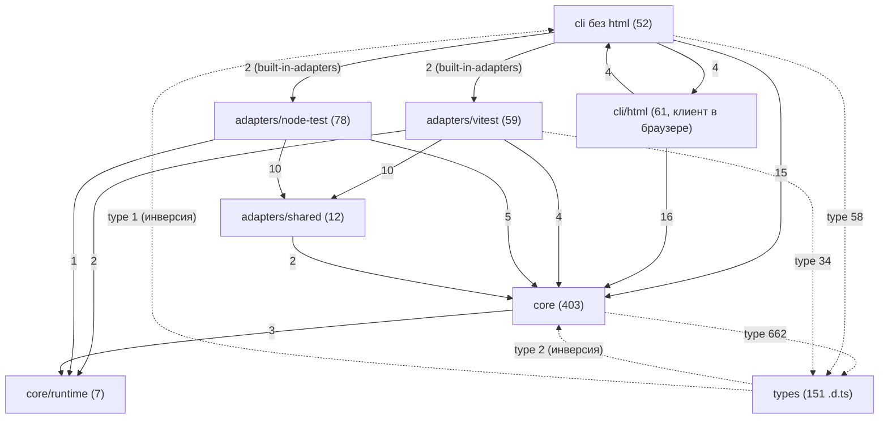
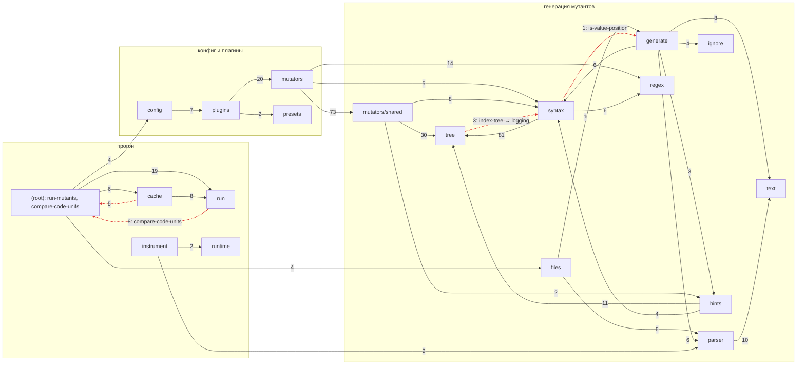
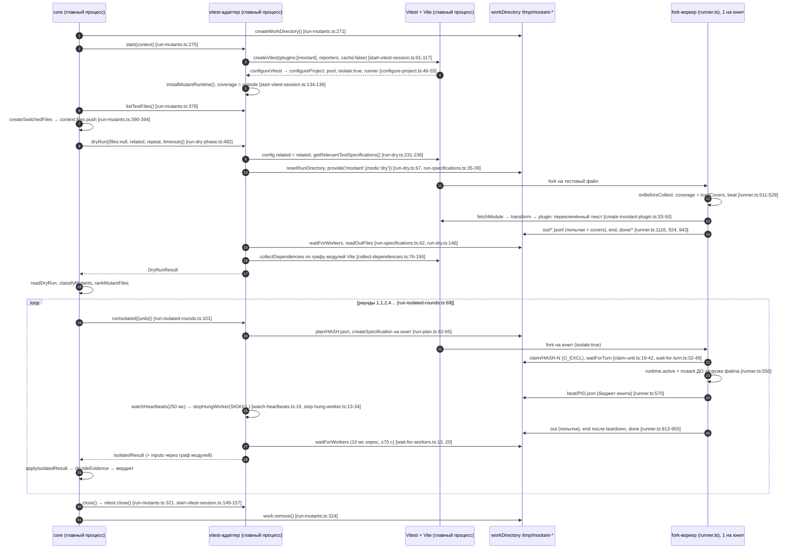
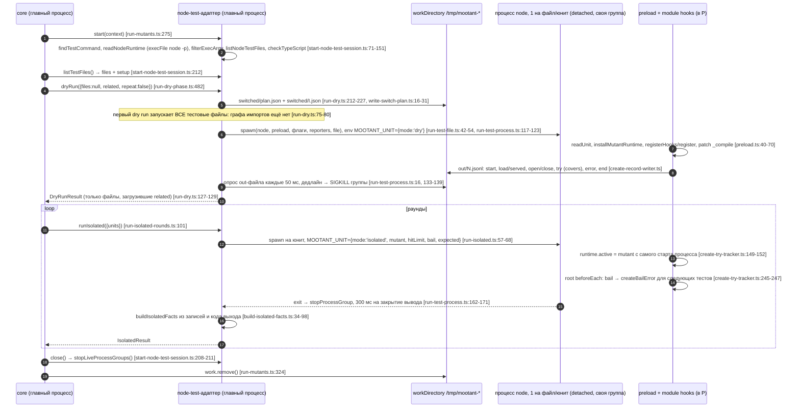

# Раздел 1. Архитектура

> Исследуемый коммит: `170ec52` (main). Рабочая копия — ветка
> `analysis/2026-11`, исходники совпадают с `170ec52`. Дата: 2026-11-04. Node
> v22.23.4.
>
> Инструменты (поставлены в `/home/user/tools-arch`, вне репозитория):
> dependency-cruiser 18.7.2, madge 8.0.0, jscpd 4, oxc-parser 0.156.0 (та же
> версия, что в проекте), esbuild 0.25, @hpcc-js/wasm-graphviz. Все скрипты и
> сырые данные — в [`analysis/architecture/`](architecture/README.md); любую
> цифру этого файла можно пересчитать командой
> `bash analysis/architecture/scripts/run-all.sh`.
>
> Тест-сьюты, сборка, `tsc` и `vitest` по договорённости не запускались (на
> машине шли замеры). Всё, что требует прогона тестов, помечено как оценка.
> Подраздел об адаптерах тестовых раннеров (контракт ядро↔адаптер, жизненный
> цикл, матрица ответственности, изоляция, Rstest/Jest) готовит другой агент;
> здесь — только границы пакетов и экспортов.

## Содержание

1. [Резюме](#1-резюме)
2. [Текущая картина](#2-текущая-картина)
3. [Проблемы по приоритету](#3-проблемы-по-приоритету)
4. [Граф зависимостей: циклы, fan-in/fan-out](#4-граф-зависимостей)
5. [Папки хелперов: семейства, одиночные импортёры, дубли](#5-папки-хелперов)
6. [Стиль «одна функция — один файл» и правило группировки](#6-стиль-одна-функция--один-файл)
7. [Границы слоёв core ↔ adapters ↔ cli ↔ types](#7-границы-слоёв)
8. [Публичный API, плагины, конфиг, содержимое пакета](#8-публичный-api)
9. [Устранение случайной архитектурной сложности](#9-устранение-случайной-архитектурной-сложности)
10. [Архитектура адаптеров тестовых раннеров](#архитектура-адаптеров-тестовых-раннеров)
11. [Целевая структура](#11-целевая-структура)
12. [План миграции небольшими PR](#12-план-миграции)
13. [Что сознательно не рекомендую и отрицательные результаты](#13-что-не-рекомендую-и-отрицательные-результаты)
14. [Что не проверено](#14-что-не-проверено)

---

## 1. Резюме

**Общее состояние: архитектура здоровая на уровне слоёв и ESLint-модели,
сложность сосредоточена в двух местах — в «движке владения» мутантов и в
публичной поверхности плагинного API.** Резкой реорганизации проект не требует.
Нужны правило группировки вместо «всё или ничего», выделение трёх-четырёх
концептов, которые сейчас размазаны по десяткам файлов, и сужение того, что
торчит наружу, до 1.0.

Что спроектировано хорошо и чего трогать не надо:

- **Ядро не знает раннеров.** В `core/` нет ни одного упоминания Vitest или
  `node:test` (grep по `vitest|node:test` → 0 строк). Встроенные адаптеры ядру
  передаёт CLI (`cli/built-in-adapters.ts:17-39`, `core/run-mutants.ts:64-68`).
  Правила `core ↛ cli`, `core ↛ adapters`, `adapters ↛ cli`,
  `vitest ↮ node-test` выполняются без единого нарушения
  ([`depcruise.config.cjs`](architecture/scripts/depcruise.config.cjs)).
- **ESLint-модель реализована чисто.** Мутатор — объект `{ meta, create }`
  (`types/mutator/mutator.d.ts:9-20`), реестр —
  `core/plugins/core-plugin.ts:30-54`, пресеты —
  `core/presets/recommended.ts:10-36` и `strict.ts:8-35`. Независимый мутатор —
  это 3–4 исходных файла (сам мутатор, реестр, пресеты) плюс тест, приёмочная
  фикстура и страница документации. Эту цену стоит сохранить (§9.1).
- **Копипасты почти нет:** jscpd находит 0.03 % дублированных строк при пороге
  50 токенов и 0.19 % при пороге 35 токенов (§5.5). Проблема проекта —
  размазанность концептов, а не дублирование текста.
- **Тесты точно зеркалят исходники:** у 636 из 653 исходных файлов (97 %) есть
  `test/<путь>.test.ts`, и 439 из 637 тестовых файлов (69 %) импортируют только
  своего «двойника». Это и сильная сторона, и главный множитель стоимости любой
  перегруппировки (§6.4).
- `adapters/shared` небольшой и действительно общий, JSON-отчёты версионированы
  (`schemaVersion: 3`, `types/report/run-report.d.ts:293`), CLI тонкий
  (`cli/index.ts` — 32 строки).

Главные проблемы:

1. **Плагинный API — неотфильтрованный дамп внутренних хелперов.**
   `MutatorContext.syntax` даёт плагинам 40 методов
   (`types/syntax/syntax-helpers.d.ts:24-306`). 16 из них нужны одному
   встроенному файлу, 3 ядро не использует вовсе. Каждый новый синтаксический
   факт для встроенного мутатора — это правка трёх файлов-посредников и
   расширение публичного API (§8.2).
2. **Логика «владения и избыточности» мутантов разнесена по циклу из 11 файлов**
   в `core/mutators/shared`. 7 из 20 мутаторов транзитивно зависят от 84–95
   файлов по импортам. С учётом хелперов, вызываемых через фасад
   `context.syntax`, — от 119–129 файлов, это ≈4.2–4.7 тыс. строк кода.
   Спецификация, на которую ссылаются 102 файла («catalog 2.8», «O19»), в
   репозитории отсутствует (§5.3).
3. **Одно правило подтверждения таймаута закодировано в 6 файлах ядра.** Масштаб
   `2` записан в двух файлах (3 места), проверка `scale > 1` — в двух, формула
   `2·k+1` — в двух, набор причин, требующих подтверждения, — в двух (§9.2).
4. **Плагин не может завести своё правило пропуска.** Если он всё же это делает,
   `mootant list --skipped` падает с `TypeError` (**подтверждено**, §8.3).
5. **Пакет:** 822 файла `.d.ts` (46 % распакованного размера), из которых
   публичным точкам входа нужны 62. `preserveModules` даёт 469 модулей на старте
   CLI: `mootant --help` занимает 241 мс против 93 мс у того же кода в бандле
   (замер, §8.5).

**Предлагаемое правило группировки:** «модуль = концепт». Приватные шаги меньше
40 строк кода переносятся в своего единственного импортёра, если тот не фасад.
Семейства вариантов одной операции, циклы импорта и константы одного протокола
собираются в один модуль. Листовые утилиты с большим fan-in, точки расширения и
код других процессов остаются отдельными файлами (§6.3). На реальном графе
консервативный вариант правила сокращает исходники с 653 до 535 файлов,
расширенный — до 494. Для связанных мутаторов число того, что надо открыть,
чтобы понять мутатор, падает со 119–129 файлов до 90–97 модулей в консервативном
варианте и до 56–62 в расширенном (с учётом фасада; по одним импортам — с 84–95
до 58–67 и 24–32).

---

## 2. Текущая картина

### 2.1. Размеры

Данные: [`style-areas.tsv`](architecture/data/style-areas.tsv),
[`folders.tsv`](architecture/data/folders.tsv). «Код» — строки без пустых,
JSDoc, комментариев и импортов. Подсчёт сделан парсером oxc, поэтому
многострочные импорты и комментарии учтены точно.

| Слой                               | Файлы `.ts` |      Строк |        Код |      JSDoc |   Импорты | Медиана кода на файл |
| ---------------------------------- | ----------: | ---------: | ---------: | ---------: | --------: | -------------------: |
| core                               |         410 |     38 814 |     56.4 % |     32.4 % |     5.5 % |                   25 |
| adapters (без `.d.ts`)             |         131 |      9 628 |     56.0 % |     33.5 % |     5.2 % |                   19 |
| cli                                |         112 |     10 829 |     63.0 % |     27.0 % |     4.9 % |                   26 |
| **итого исходники**                |     **653** | **59 271** | **57.5 %** | **31.6 %** | **5.4 %** |               **24** |
| types + adapters/*/types (`.d.ts`) |         169 |      7 866 |     21.5 % |     61.3 % |     3.7 % |                    6 |
| test (без fixtures)                |         696 |     85 907 |     81.4 % |      6.7 % |     3.5 % |                   40 |

| Папка                         | Файлов | 1 импортёр | …из той же папки | Медиана кода | < 15 строк кода |
| ----------------------------- | -----: | ---------: | ---------------: | -----------: | --------------: |
| core/syntax                   |     76 |         37 |               28 |           22 |              21 |
| core/mutators/shared          |     84 |         15 |               12 |           19 |              36 |
| core/mutators (правила)       |     20 |         20 |                0 |            — |               — |
| core/run                      |     45 |         29 |               14 |           25 |              10 |
| core/regex                    |     30 |         17 |               11 |           28 |               8 |
| core/hints                    |     18 |          7 |                4 |           92 |               5 |
| core/text                     |     16 |          5 |                3 |           29 |               3 |
| core/tree                     |     10 |          0 |                0 |            9 |               6 |
| core/parser                   |     20 |          7 |                6 |           21 |               5 |
| core/cache                    |     19 |         11 |                6 |           29 |               7 |
| adapters/vitest (+worker)     |     55 |         35 |               33 |           20 |              18 |
| adapters/node-test (+preload) |     66 |         34 |               32 |           18 |              27 |
| adapters/shared               |     10 |          3 |                3 |           41 |               1 |

Сводка по стилю ([`style-summary.json`](architecture/data/style-summary.json),
[`summary.json`](architecture/data/summary.json)):

- 601 из 653 исходных файлов (92 %) экспортируют ровно одну функцию.
- 197 файлов (30 %) содержат меньше 15 строк кода, 365 (56 %) — меньше 30.
- У 322 исходных файлов (49 %) ровно один импортёр, у 206 из них он лежит в той
  же папке.
- В среднем 4.48 импорта на файл, из них 3.85 локальных. 40.7 % импортов —
  `import type`.
- В файлах короче 15 строк кода собственно код занимает 39 % строк: в среднем
  7.8 строки кода, 8.9 строки JSDoc и 1.7 строки импортов.

Стиль применён неравномерно. `adapters/vitest/runner.ts` — класс на 1 285 строк
с 40 приватными полями и 25 методами. Его чистые хелперы при этом вынесены в 18
файлов `adapters/vitest/worker/*.ts` со средним размером 20 строк кода.
`core/mutators/shared/get-comparison-plan.ts` содержит 617 строк кода, а
соседний `is-always-nullish.ts` — 3.

### 2.2. Слои (Mermaid)

Граф уровня слоёв. Учтены только импорты значений, `import type` показан
пунктиром. Сгенерирован из
[`folder-edges.tsv`](architecture/data/folder-edges.tsv), полная версия —
[`layers.mmd`](architecture/data/layers.mmd).



Граф подпапок ядра (импорты значений с весом ≥ 2; красным отмечены обратные
рёбра, образующие циклы папок). Полная версия —
[`core.mmd`](architecture/data/core.mmd); SVG уровня папок —
[`folders-src-archi.svg`](architecture/folders-src-archi.svg) (без `types/`) и
[`folders-archi.svg`](architecture/folders-archi.svg) (с `types/`).



### 2.3. Что спроектировано хорошо (оставить как есть)

| Что                                                                     | Чем подтверждено                                                                                                                                       | Какое поведение защищает                                                                                    |
| ----------------------------------------------------------------------- | ------------------------------------------------------------------------------------------------------------------------------------------------------ | ----------------------------------------------------------------------------------------------------------- |
| Ядро не знает раннеров; встроенные адаптеры внедряет CLI                | 0 упоминаний `vitest`/`node:test` в `core/`; `core/run-mutants.ts:64-68` (`builtIns`), `cli/built-in-adapters.ts:17-39`                                | Новый раннер не трогает ядро; `core` тестируется фейковым адаптером (`test/helpers/create-fake-adapter.ts`) |
| Ни одного нарушения направлений слоёв в коде                            | 0 нарушений правил `core-not-to-cli`, `core-not-to-adapters`, `adapters-not-to-cli`, `adapter-not-to-other-adapter`                                    | Изоляция адаптеров друг от друга                                                                            |
| ESLint-модель: правило, реестр, пресеты, плагины с неймспейсом          | `core/plugins/core-plugin.ts:30-54`, `core/presets/*`, `docs/content/guide/configuration.mdx:280-296`                                                  | Явное включение мутаторов и стабильность пресетов                                                           |
| Тонкий CLI                                                              | `cli/index.ts` (32 строки), `cli/run-mutation.ts` (138)                                                                                                | Логика прогона не размазана по CLI                                                                          |
| Почти нет копипасты                                                     | jscpd: 2 клона на 56.9 тыс. строк (§5.5)                                                                                                               | —                                                                                                           |
| `adapters/shared` — 10 файлов, все нужны обоим адаптерам                | [`helpers.tsv`](architecture/data/helpers.tsv): 7 файлов импортируют оба адаптера напрямую, 3 — внутренние шаги `track-inputs` и `list-tsconfig-files` | Общие для раннеров отслеживание входов и часы                                                               |
| `core/tree` — листовые утилиты с fan-in до 51                           | `unwrap-expression` 51 импортёр, `get-context-slot` 27                                                                                                 | «Файл на функцию» здесь работает как индекс                                                                 |
| `core/hints` — крупные связные модули                                   | медиана 92 строки кода; цикл `infer-*` отражает взаимную рекурсию вывода типов                                                                         | —                                                                                                           |
| JSON-отчёты версионированы                                              | `schemaVersion: 3` в `types/report/{run,list,slim-run,slim-list}-report.d.ts`                                                                          | Совместимость для агентов и CI                                                                              |
| Центральные фильтры шума применяются ко всем мутаторам, включая плагины | `core/generate/collect-candidates.ts:39-43,235-239` (timer delay)                                                                                      | Одинаковый отсев для плагинов                                                                               |

---

## 3. Проблемы по приоритету

Критических архитектурных проблем, которые сами по себе делают вердикт неверным,
не найдено. Риски корректности вердикта — в разделе 2 (`02-bugs.md`).

| ID      | Приоритет | Трудоёмкость        | Проблема                                                                                                                                                                                                                                                | Доказательство                                                                                                                                                             | §        |
| ------- | --------- | ------------------- | ------------------------------------------------------------------------------------------------------------------------------------------------------------------------------------------------------------------------------------------------------- | -------------------------------------------------------------------------------------------------------------------------------------------------------------------------- | -------- |
| ARCH-1  | high      | L                   | `MutatorContext.syntax` (40 методов), `.hints`, `.sourceCode` — публичный, недокументированный и неотфильтрованный API. Каждый новый факт для встроенного мутатора расширяет его.                                                                       | `types/mutator/mutator-context.d.ts:39-49`, `types/syntax/syntax-helpers.d.ts:24`, `core/syntax/create-syntax-helpers.ts:136-178`; коммиты `cda98a7`, `b72d16f`, `a5d3a03` | 8.2, 9.1 |
| ARCH-2  | high      | L (M без редизайна) | Межмутаторное «владение/избыточность» — цикл из 11 файлов плюс `get-comparison-plan` (617 строк кода). 7 мутаторов тянут транзитивно 84–95 файлов (119–129 с учётом фасада). Каталог правил, на который ссылаются 102 файла, отсутствует.               | [`scc.txt`](architecture/data/scc.txt), §5.3                                                                                                                               | 5.3      |
| ARCH-3  | medium    | M                   | Политика подтверждения таймаута и протокол batch-попыток закодированы в 6 файлах `core/run`.                                                                                                                                                            | `plan-isolated.ts:23`, `run-batch-phases.ts:76,78`, `plan-batch.ts:69,106`, `get-batch-unit-cost.ts:24,35`, `get-unit-evidence.ts:22-28`, `apply-batch-result.ts:163-178`  | 9.2      |
| ARCH-4  | medium    | S / M               | `SkipNote.rule` — закрытое множество встроенных id. Плагин со своим `rule` роняет `list --skipped` и HTML-отчёт (**подтверждено**).                                                                                                                     | `types/mutant/skip-rule-id.d.ts:1,7`, `core/generate/generate-file-mutants.ts:376-377`; [репро](architecture/repro-plugin-skip-rule/README.md)                             | 8.3      |
| ARCH-5  | medium    | M                   | Граница adapters→core не совпадает с публичным API. Встроенные адаптеры используют 3 приватные функции ядра и весь `adapters/shared` (1 345 строк), которых у стороннего адаптера нет. Новый встроенный раннер — это правки в 6 местах вне своей папки. | §7.3                                                                                                                                                                       | 7.3      |
| ARCH-6  | medium    | S–M                 | В пакете 822 `.d.ts` (798 КБ из 1.75 МБ), публичным входам нужны 62 (77 КБ). `preserveModules`: 469 модулей на старте CLI, `--help` 241 → 93 мс в бандле.                                                                                               | §8.5, [`startup-bench.txt`](architecture/data/startup-bench.txt)                                                                                                           | 8.5      |
| ARCH-7  | medium    | M (по частям)       | «Одна функция — один файл» без правила группировки: семейства по 6–11 файлов (logging 10, type-view 11, member-chain 7, loops 6), хелперы дороже операции.                                                                                              | §5.2, §6                                                                                                                                                                   | 5–6      |
| ARCH-8  | low       | S                   | Инверсии слоёв: `types → core/cli` (3 импорта), `core/tree → core/syntax` (индексатор знает про логгеры), общие утилиты в доменных папках дают циклы папок.                                                                                             | §7.1–7.2                                                                                                                                                                   | 7        |
| ARCH-9  | low       | S                   | Id встроенных мутаторов — строковые литералы в 44 местах ядра вне реестра и пресетов (`'logical-operator'` — 15 раз в 12 файлах) без типовой проверки.                                                                                                  | §5.3                                                                                                                                                                       | 5.3      |
| ARCH-10 | low       | S                   | Лишнее или неясное в публичном API: `classifyTry` и `mootant/runtime` без потребителя и документации; 22 из 35 имён `mootant` — SPI адаптеров; типы JSON-отчётов не экспортируются; `settings.timeouts` ≠ `run.timeout`.                                | §8.1, §8.4                                                                                                                                                                 | 8        |
| ARCH-11 | low       | S                   | Церемония вокруг констант: 11 тестов на файлы-константы, названия `describe` искажены автофиксом (`'rUNTIME_VERSION'`); 3 файла на 3 строки-ключа.                                                                                                      | §5.4                                                                                                                                                                       | 5.4      |

### 3.1. Карточки существенных рекомендаций

| Рекомендация                                                                                      | Какую проблему решает                                                                | Чем подтверждена проблема                                                                                              | Польза для пользователей                                                                                      | Риски и компромиссы                                                            | Как проверить после                                                              |
| ------------------------------------------------------------------------------------------------- | ------------------------------------------------------------------------------------ | ---------------------------------------------------------------------------------------------------------------------- | ------------------------------------------------------------------------------------------------------------- | ------------------------------------------------------------------------------ | -------------------------------------------------------------------------------- |
| R1. Внутренний контекст встроенных мутаторов + курируемый `syntax` + страница о плагинах (ARCH-1) | Публичный API растёт с каждым внутренним фактом и не документирован                  | 40 методов, 16 нужны одному файлу, 3 не нужны никому; 3 коммита правили тройку «реализация + интерфейс + фасад» (§8.2) | Авторы плагинов получают стабильный документированный API; до 1.0 обязательства semver меньше                 | Breaking для недокументированного API (0.x); правка типа `Mutator`             | Тесты мутаторов и фикстура list без изменения ожиданий; `tsc` на примере плагина |
| R2. Каталог владения в репозитории + `core/mutators/plans/` + типизированные id (ARCH-2, ARCH-9)  | Межмутаторная логика разнесена по циклу из 11 файлов, спецификации нет               | SCC (§4.1), замыкания 119–129 файлов (§5.3), 102 файла ссылаются на отсутствующий каталог                              | Быстрее и безопаснее правки отсева дублей — ключевой фичи; меньше риск незаметно потерять или вернуть мутанты | Средний: перенос 16 файлов; каталог нужно написать                             | Фикстура list байт-в-байт, тесты планов перенесены как есть                      |
| R3. `core/run/timeout-policy.ts` (ARCH-3)                                                         | Политика подтверждения таймаута записана в 6 файлах                                  | §9.2: литерал `2` в 3 файлах, `2·k+1` в 2, причины подтверждения в 2                                                   | Одинаковые вердикты `Timeout` в batch и isolated при будущих правках                                          | Низкий                                                                         | Тесты `core/run/*` без изменения ожиданий, e2e с таймаутами                      |
| R4. Проверка `skip.rule`, затем `Plugin.skipRules` (ARCH-4)                                       | Плагин роняет `--skipped`/HTML или не может описать свой пропуск                     | Воспроизведение (§8.3)                                                                                                 | Понятная ошибка вместо `TypeError`; плагины с собственным отсевом шума                                        | Нет (S); расширение API (M)                                                    | Новый тест генерации, репро — exit 0                                             |
| R5. `adapters/kit` + правило импорта, затем `mootant/adapter` (ARCH-5)                            | Сторонний адаптер не может повторить встроенный без копирования около 1.4 тыс. строк | §7.3: 3 приватные функции ядра и `adapters/shared`                                                                     | Rstest, Jest и сторонние адаптеры на равных со встроенными                                                    | Ещё одна публичная поверхность (после стабилизации)                            | depcruise-правило; e2e обоих адаптеров                                           |
| R6. `.d.ts` только для публичных входов; бандлинг входов CLI, воркера и preload (ARCH-6)          | Лишние 760 деклараций; 469 модулей на старте                                         | §8.5 (`tar`, замер 241 → 93 мс)                                                                                        | Пакет примерно на 40 % меньше; `list` и циклы агента быстрее на ≈150 мс за вызов                              | Бандлинг: идентичность модулей между процессами; нужен e2e на собранном пакете | Проверка состава `npm pack`; `startup-bench.sh`; e2e на dist                     |
| R7. Правило группировки «модуль = концепт» (ARCH-7)                                               | Концепты по 6–11 файлов, хелперы дороже операции                                     | §5.2, симуляция §6.3                                                                                                   | Косвенная: быстрее правки, меньше файлов для понимания (на 18–24 % меньше файлов)                             | Объём механических переносов, конфликты с параллельной работой                 | Тесты переносятся без изменения случаев; 100 % покрытия; фикстура list           |

---

## 4. Граф зависимостей

Конфиг: [`depcruise.config.cjs`](architecture/scripts/depcruise.config.cjs).
Сырые данные: `data/depcruise.json.gz` (823 файла, 2 740 локальных рёбер, из них
1 545 — импорты значений). Агрегаты:
[`analyze-graph.mjs`](architecture/scripts/analyze-graph.mjs). Все локальные
импорты разрешены (0 неразрешённых). Статически различимых динамических импортов
7, из них локальных 3: `cli/built-in-adapters.ts:23,33` и
`cli/run-mutation.ts:127`. Импорты по вычисляемому URL
(`core/config/import-config.ts:12`,
`adapters/vitest/start-vitest-session.ts:70`) загружают код пользователя и
Vitest, в граф они не входят.

### 4.1. Циклы (сильно связные компоненты)

| Размер | Компонента                                                                                                                                                                                                                                              | Вид         | Оценка                                                                                                                  |
| -----: | ------------------------------------------------------------------------------------------------------------------------------------------------------------------------------------------------------------------------------------------------------- | ----------- | ----------------------------------------------------------------------------------------------------------------------- |
|     11 | `core/mutators/shared/{get-branch-copy-skip, get-condition-constants, get-group-constant, get-literal-flip, get-literal-skip, get-logical-drops, get-nullish-directions, get-or-default-skip, get-owner-constant, get-toward-mutant, has-polar-mutant}` | значения    | **Проблема** (ARCH-2): один концепт, «кто из мутаторов уже даёт этот мутант», разрезан на 11 взаимно рекурсивных файлов |
|      5 | `core/hints/infer-{annotation,binding,call,expression,member}-type.ts`                                                                                                                                                                                  | значения    | Оправдан: рекурсивный спуск вывода типов, файлы крупные (59–488 строк). Оставить                                        |
|      2 | `types/run/isolated-evidence.d.ts` ↔ `mutant-state.d.ts`                                                                                                                                                                                                | только типы | Безвреден                                                                                                               |
|      2 | `types/run/live-verdicts.d.ts` ↔ `run-state.d.ts`                                                                                                                                                                                                       | только типы | Безвреден                                                                                                               |

Независимая перепроверка madge 8
([`madge-circular.txt`](architecture/data/madge-circular.txt)) находит 9
элементарных циклов в тех же трёх местах: 8 из 11 файлов компоненты
`mutators/shared`, все 5 файлов `hints/infer-*` и обе пары `types/run`. madge
перечисляет отдельные циклы, а не компоненты связности, поэтому файлов в его
списке меньше.

Циклы на уровне папок (импорты значений):

- `core/syntax ↔ core/tree`: `core/tree/index-tree.ts:6-8` импортирует
  `is-logger-factory-call`, `is-logger-label`, `is-module-call`. Индексатор
  дерева исключает слоты подписей дочерних логгеров
  (`core/tree/index-tree.ts:105-109`), то есть политика шума живёт в самом
  нижнем слое (ARCH-8).
- `core/generate ↔ core/syntax`: `core/syntax/is-value-position.ts` →
  `core/generate/get-replacement-kind.ts`.
- `core/(root) ↔ core/{run,cache,config,files}`: из-за утилиты
  `core/compare-code-units.ts`, лежащей в корне рядом с оркестраторами
  `run-mutants.ts` и `list-mutants.ts`.

### 4.2. Fan-out: модули, которые «знают много»

Топ по числу локальных импортов значений
([`summary.json`](architecture/data/summary.json)):

| Файл                                              | Импортов значений | Чужих папок | Оценка                                                                                               |
| ------------------------------------------------- | ----------------: | ----------: | ---------------------------------------------------------------------------------------------------- |
| `core/syntax/create-syntax-helpers.ts`            |                40 |           3 | Фасад: 36 из 40 записей — лямбды-переходники `node => f(tree, node)`, ещё 4 — прямые ссылки (ARCH-1) |
| `core/run-mutants.ts`                             |     35 (+13 type) |          13 | Оркестратор прогона, оправдан; 712 строк, читается линейно                                           |
| `core/generate/generate-file-mutants.ts`          |     26 (+16 type) |          13 | Оркестратор генерации по файлу, оправдан                                                             |
| `cli/html/client/start-report.ts`                 |                23 |           3 | Вход браузерного клиента, оправдан                                                                   |
| `core/plugins/core-plugin.ts`                     |                22 |           3 | Реестр мутаторов, оправдан (ESLint-модель)                                                           |
| `core/mutators/shared/get-comparison-plan.ts`     |                21 |           5 | Часть движка владения (ARCH-2)                                                                       |
| `adapters/vitest/runner.ts`                       |      20 (+6 type) |           6 | Класс-воркер на 1 285 строк (детали — у другого агента)                                              |
| `core/mutators/shared/get-condition-constants.ts` |                20 |           3 | Движок владения                                                                                      |
| `adapters/node-test/start-node-test-session.ts`   |                19 |           2 | Сборка сессии из 8 одноразовых шагов                                                                 |
| `core/generate/collect-candidates.ts`             |     12 (+16 type) |          11 | Центральные фильтры, оправдан                                                                        |

«Знают слишком много» в плохом смысле, то есть знание не своего уровня:

- `core/tree/index-tree.ts` — низкоуровневый индексатор, который знает про
  логгеры и вызовы модулей (`:6-8`, `:105-109`).
- `create-syntax-helpers.ts` импортирует 36 синтаксических хелперов и ещё 4 из
  `core/tree` и `core/regex`: другого способа дать встроенному мутатору доступ к
  `tree` и `scopes` нет (§8.2).
- Семь мутаторов знают о мутантах друг друга через общие «планы», а id чужих
  мутаторов записаны строками: `'logical-operator'` встречается в 12 файлах
  (`get-condition-constants.ts:130`, `get-logical-drops.ts:85,233`,
  `get-owner-constant.ts:91` и др.). Это ARCH-9.

### 4.3. Fan-in

| Файл                                        |                                             Импортёров (значения) | Комментарий                                            |
| ------------------------------------------- | ----------------------------------------------------------------: | ------------------------------------------------------ |
| `core/tree/unwrap-expression.ts`            |                                                                51 | лист, оставить                                         |
| `core/compare-code-units.ts`                | 27 (20 из ядра, 5 из адаптеров, 1 из `adapters/shared`, 1 из CLI) | общая утилита в корне `core/` → в `core/util/`         |
| `core/tree/get-context-slot.ts`             |                                                                27 | лист                                                   |
| `cli/html/client/html.ts`                   |                                                                25 | лист клиента                                           |
| `core/mutators/shared/get-literal-value.ts` |                                                      25 (+4 type) | его тип `LiteralValue` импортирует `types/` (инверсия) |
| `cli/html/client/escape-html.ts`            |                                                                24 | лист                                                   |
| `core/tree/unwrap-parentheses.ts`           |                                                                23 | лист                                                   |
| `core/mutators/shared/get-type-view.ts`     |                                                      18 (+2 type) | центр семейства type-view (§5.2)                       |
| `core/text/pluralize.ts`                    |                                                                12 | 3 строки кода, 11 импортёров из CLI                    |

Типы с наибольшим числом импортёров: `types/mutator/mutator-context.d.ts` (60),
`types/syntax/tree-index.d.ts` (55), `types/mutant/skip-note.d.ts` (32),
`types/run/run-state.d.ts` (28).

### 4.3a. Fan-in и fan-out по папкам

Ca — сколько других папок зависят от этой, Ce — от скольких папок зависит она, I
= Ce / (Ca + Ce) — нестабильность по Мартину. `types/` не учитывается
([`folders.tsv`](architecture/data/folders.tsv)).

| Папка             |  Ca |  Ce |    I | Комментарий                                                                                                          |
| ----------------- | --: | --: | ---: | -------------------------------------------------------------------------------------------------------------------- |
| `core/(root)`     |  12 |  15 | 0.56 | Оркестраторы и утилита `compare-code-units` в одной папке. Отсюда и высокий Ca, и высокий Ce, и 4 цикла папок (§7.2) |
| `core/text`       |  12 |   3 | 0.20 | Стабильный нижний слой, как и должно быть                                                                            |
| `core/tree`       |   9 |   2 | 0.18 | Стабильный нижний слой; единственное лишнее ребро — в `core/syntax` (§7.2)                                           |
| `core/parser`     |   7 |   4 | 0.36 | —                                                                                                                    |
| `core/syntax`     |   6 |   6 | 0.50 | Середина; ребро в `core/generate` обратное                                                                           |
| `core/generate`   |   2 |  15 | 0.88 | Оркестратор генерации — нестабилен, это нормально                                                                    |
| `core/mutators`   |   1 |  11 | 0.92 | Правила, 165 исходящих рёбер, из них 73 в `mutators/shared`                                                          |
| `cli/report`      |   2 |  11 | 0.85 | —                                                                                                                    |
| `adapters/vitest` |   1 |   9 | 0.90 | 88 исходящих рёбер                                                                                                   |

Направление зависимостей в целом правильное: нестабильные оркестраторы и правила
зависят от стабильных `tree` и `text`. Исключения — корень `core/` и обратные
рёбра `tree → syntax` и `syntax → generate`.

### 4.4. Охват точек входа

Статические импорты значений, без динамических
([`reach.tsv`](architecture/data/reach.tsv)):

| Вход                                                                 | Локальных модулей |
| -------------------------------------------------------------------- | ----------------: |
| `cli/index.ts` (любая команда, даже `--help`)                        |               469 |
| `adapters/vitest/index.ts`                                           |                52 |
| `adapters/vitest/runner.ts` (в каждом воркере Vitest)                |                28 |
| `adapters/node-test/preload/preload.ts` (в каждом тестовом процессе) |                24 |
| `core/index.ts`                                                      |                 4 |

`cli/index.ts` статически импортирует `cli/run-mutation.ts` →
`core/run-mutants.ts`, поэтому даже `mootant --help` и `mootant list` грузят всё
ядро. В сборке с `preserveModules` (`vite.config.ts:133`) это 469 отдельных
файлов (§8.5).

---

## 5. Папки хелперов

Таблица по каждому файлу хелперных папок — размер, импортёры, тесты — лежит в
[`helpers.tsv`](architecture/data/helpers.tsv). Семейства по префиксам имён,
цепочки приватных хелперов и «всегда импортируются вместе» собраны в
[`helper-families.txt`](architecture/data/helper-families.txt).

### 5.1. Одиночные импортёры

Из 653 исходных файлов у 322 ровно один импортёр, у 206 из них он в той же
папке. С кодом меньше 40 строк таких файлов 111, меньше 25 — 73
([`merge-candidates-private-helpers.tsv`](architecture/data/merge-candidates-private-helpers.tsv)).
Цепочки «файл → его единственный импортёр» показывают, что многие папки — это
деревья одноразовых шагов одного алгоритма:

| Корень (единственный импортёр)                                  | Приватные шаги                                                                   |  Строк кода всего |
| --------------------------------------------------------------- | -------------------------------------------------------------------------------- | ----------------: |
| `core/syntax/create-syntax-helpers.ts`                          | 23 файла (`is-loop-test`, `is-condition-test`, `get-lower-bound`, …)             |             1 220 |
| `adapters/vitest/index.ts` (через `start-vitest-session`)       | 17 файлов                                                                        |               889 |
| `adapters/vitest/runner.ts`                                     | 14 файлов `worker/*`                                                             |               993 |
| `adapters/node-test/index.ts` (через `start-node-test-session`) | 21 файл                                                                          |               835 |
| `core/hints/infer-expression-type.ts`                           | `infer-{call,member,operator,this}-type`                                         |               809 |
| `core/regex/create-regex-replacement.ts`                        | 6 файлов печати и кодирования                                                    |               311 |
| `core/run/run-isolated-rounds.ts`                               | `apply-isolated-result`, `get-file-cost`, `number-chains`, `plan-isolated`       |               210 |
| `core/cache/prepare-run-cache.ts`                               | `create-run-cache`, `find-lockfile`, `get-environment-key`, `get-test-file-keys` |               444 |
| `core/git/read-changed-lines.ts`                                | `find-git-root`, `get-merge-base`, `parse-binary-paths`                          | ≈250 на всю папку |

Не всякий одиночный импортёр — повод сливать файлы. Фасад
(`create-syntax-helpers`) не владеет теми, кого связывает. Если влить в него 23
файла, получится модуль на 1 220 строк кода. Поэтому в правиле (§6.3) фасады
исключены, а для них есть отдельная рекомендация (§8.2).

### 5.2. Один концепт, размазанный по файлам

Семейства я искал тремя независимыми способами: по общим словам в именах (без
`is/get/read/...`), по цепочкам единственных импортёров и по одинаковым наборам
импортёров. Отобраны только семейства, где файлы действительно отвечают на
вопросы об одном понятии. Источник цифр —
[`simulate-grouping.mjs`](architecture/scripts/simulate-grouping.mjs).

| Семейство                    | Файлы                                                                                                                                                                                                                              | Строк / код |    Внешних импортёров | Тестов-двойников | Предложение                                                                                                                   |
| ---------------------------- | ---------------------------------------------------------------------------------------------------------------------------------------------------------------------------------------------------------------------------------- | ----------: | --------------------: | ---------------- | ----------------------------------------------------------------------------------------------------------------------------- |
| **Логирование**              | `core/syntax/{is-logging-call, is-logger-name, is-logger-label, is-log-message, is-logger-factory-call, find-logging-calls, is-console-path, find-message-texts, is-format-free, is-plain-message}`                                |   541 / 294 |                     3 | 10 (703 строки)  | `core/syntax/logging.ts`                                                                                                      |
| **Взгляд на выведенный тип** | `core/mutators/shared/{get-type-view, is-always-nullish, may-be-nullish, is-non-nullable, may-be-boolean, is-always-truthy, has-defined-falsy-value, is-number-type, is-non-number-type, get-canonical-falsy, is-canonical-falsy}` |   254 / 100 |                    21 | 11 (267 строк)   | `core/hints/type-view.ts`: это вопросы к `InferredType` из `core/hints`, а не к мутаторам                                     |
| **Цепочки членов**           | `core/syntax/{get-member-path, get-member-root, get-root-name, get-chain-root, get-chain-end, is-read-chain, is-written-member}`                                                                                                   |   288 / 146 |                    19 | 7 (327)          | `core/syntax/member-chain.ts`; разница между `getMemberRoot` (не идёт через вызовы) и `getRootName` (идёт) видна только рядом |
| **Циклы**                    | `core/syntax/{advances-loop, get-exited-loops, is-caught-in-loop, is-loop-advance-value, is-loop-test, is-tested-loop}`                                                                                                            |   508 / 252 |                     2 | 6 (661)          | `core/syntax/loops.ts`                                                                                                        |
| **Git**                      | `core/git/*` (7 файлов)                                                                                                                                                                                                            |   426 / 250 |                     2 | 7 (629)          | 2 модуля: `read-changed-lines.ts` (запуск git), `parse-diff.ts` (разбор)                                                      |
| **Владение мутантами (SCC)** | 11 файлов, §5.3                                                                                                                                                                                                                    | 1 536 / 887 |                     7 | 11 (2 926)       | `core/mutators/plans/`                                                                                                        |
| Слоты и развёртка обёрток    | `core/tree/{get-raw-slot, get-slot, get-context-slot, unwrap-expression, unwrap-parentheses, is-expression-wrapper}`                                                                                                               |    149 / 53 | **88** (118 импортов) | 6                | **Не трогать**: правка 118 импортов дороже пользы (правило K1)                                                                |

Пример «хелпера дороже операции» из семейства type-view:

```ts
// core/mutators/shared/may-be-nullish.ts — 14 строк, тест 18 строк
export function mayBeNullish(inferred: InferredType): boolean {
  return !isNonNullable(inferred)
}
// core/mutators/shared/is-non-nullable.ts — 15 строк, тест 18 строк
export function isNonNullable(inferred: InferredType): boolean {
  return getTypeView(inferred).nullability === 'non-nullable'
}
// core/mutators/shared/is-always-nullish.ts — 14 строк, тест 17 строк
export function isAlwaysNullish(inferred: InferredType): boolean {
  return getTypeView(inferred).type === 'nullish'
}
```

Всё семейство — 100 строк кода в 22 файлах (11 исходных на 254 строки и 11
тестовых на 267) и 42 импорта в 21 файле. После объединения это
`core/hints/type-view.ts` (≈180 строк с JSDoc), один тест (≈250 строк,
`describe` на функцию) и 21 импорт.

Дубли внутри семейств:

- Два списка методов логгера: `logMethods` (`core/syntax/is-logging-call.ts:11`,
  12 имён) и `consoleMethods` (`core/syntax/find-logging-calls.ts:19`, 22
  имени). Назначение у них разное: методы любого логгера и полный API `console`.
  Но шесть имён пересекаются, а сами списки лежат в разных файлах и не ссылаются
  друг на друга. В одном модуле расхождение было бы видно.
- `isComparison` (`core/mutators/shared/is-comparison.ts`) — узловая обёртка над
  `isComparisonOperator` (`core/syntax/is-comparison-operator.ts`). `isAndOr`
  (`core/mutators/shared/is-and-or.ts`) живёт отдельно от `getLogicalChain`
  (`core/syntax/get-logical-chain.ts`). Это одна тема «форма логического
  выражения» в двух папках.
- Формула числа попыток batch-юнита `2 · k + 1` повторена в
  `core/run/plan-batch.ts:106` и `core/run/get-batch-unit-cost.ts:35` (§9.2).

### 5.3. Движок «владения и избыточности» (ARCH-2)

**Что это.** Философия Mootant — не выдавать мутант, который уже дал другой
мутатор, или который поглощён другим мутантом. Поэтому мутатор, решая,
пропустить ли свой вариант, вычисляет, что сделали бы другие мутаторы в этом
месте: константы `condition`, отбрасывание операндов `logical-operator`, сдвиги
`comparison-operator`, флипы литералов. Каждое такое знание оформлено «планом»:
`get-condition-constants`, `get-logical-drops`, `get-comparison-plan`,
`get-nullish-plan` и другие. Решение о пропуске проверяет, запустится ли
«владелец», через `context.isActive(id, node)` и `createRunContext().runs`
(`core/mutators/shared/create-run-context.ts`).

**Почему это проблема:**

- Планы ссылаются друг на друга, и вышел цикл из 11 файлов с 23 внутренними
  рёбрами ([`scc.txt`](architecture/data/scc.txt)). Понять один из них, не
  прочитав остальные, нельзя.
- 13 мутаторов из 20 не участвуют в общем движке владения. Их замыкание по
  импортам — от 0 до 26 файлов, кроме `comparison-operator` (49: свой
  617-строчный план). С учётом фасада — от 2 до 46, у `comparison-operator`
  — 67. Остальные 7 (`boolean-literal`, `condition`, `logical-operator`,
  `number-literal`, `return-value`, `statement-removal`, `string-literal`) тянут
  84–95 файлов по импортам и 119–129 с фасадом.

  «С фасадом» означает: вызов `context.syntax.isLoopTest(...)` в файле замыкания
  добавляет `core/syntax/is-loop-test.ts` и его импорты. Граф импортов эти
  зависимости не видит. Данные:
  [`mutator-closures-with-facade.tsv`](architecture/data/mutator-closures-with-facade.tsv),
  скрипт [`facade-closures.mjs`](architecture/scripts/facade-closures.mjs).

  | Мутатор                                            | Файлов по импортам | Файлов с фасадом | Строк кода с фасадом |
  | -------------------------------------------------- | -----------------: | ---------------: | -------------------: |
  | `string-literal`                                   |                 95 |              129 |                4 599 |
  | `statement-removal`                                |                 88 |              128 |                4 687 |
  | `return-value` / `number-literal`                  |                 86 |              125 |        4 370 / 4 511 |
  | `condition`, `logical-operator`, `boolean-literal` |                 84 |              119 |                4 249 |
  | `comparison-operator`                              |                 49 |               67 |                2 386 |
  | `missing-await`                                    |                 21 |               46 |                1 640 |
  | `update-operator`                                  |                  0 |               16 |                  401 |
  | `bitwise-operator`                                 |                  2 |                2 |                   40 |

- Спецификация правил живёт вне репозитория. Комментарии в 102 файлах `core/`
  ссылаются на «catalog 2.2» (21 раз), «catalog 4.8» (12), «12.2» и на метки
  O1–O19 и R1–R7. Метки описаны пользователю в таблицах
  `docs/content/mutators/*.md`, а нумерованных разделов каталога нет ни в
  `docs/`, ни в `contributing.md`, ни в истории git. Предполагаю, что это личные
  заметки автора. Это **гипотеза**: проверяется вопросом к автору или поиском по
  его заметкам.
- Владельцы записаны строками. `'logical-operator'` встречается в 12 файлах,
  `'condition'` — в 5, `'comparison-operator'` — в 6. Карта «литерал → мутатор»
  зашита в `core/mutators/shared/get-literal-mutator.ts:13-31`. Опечатка в id не
  ловится ни типами, ни тестом.

**Что предлагаю (по возрастанию риска):**

1. _(M)_ Положить каталог в репозиторий: `docs/internals/ownership-catalog.md` с
   разделами, на которые уже ссылается код. Ничего не ломает, сразу снижает
   стоимость входа.
2. _(M)_ Собрать планы в `core/mutators/plans/` по владельцу: `comparison.ts`
   (`get-comparison-plan` с хелперами, при необходимости двумя файлами — план
   больше лимита размера), `condition.ts`, `logical.ts`, `literal.ts`,
   `ownership.ts` (`get-owner-constant`, `get-toward-mutant`, статический
   контекст). Один `index.ts` с описанием API запросов. Цикл останется, но
   внутри одной папки с явным входом. Вместе с перегруппировкой остального
   `core/mutators/shared` по концептам замыкание связанных мутаторов падает с
   119–129 файлов до 56–62 модулей (по импортам — с 84–95 до 24–32; расширенная
   симуляция,
   [`grouping-simulation-extended.json`](architecture/data/grouping-simulation-extended.json)).
3. _(S)_ Типизировать id встроенных мутаторов:
   `type BuiltInMutatorId = keyof typeof corePlugin.mutators` и константы вместо
   строк. Ловит опечатки на уровне `tsc`.
4. _(XL, гипотеза-направление, не к ближайшему плану)_ Двухфазная генерация.
   Сначала мутаторы выдают все кандидаты со структурным описанием эффекта
   («принуждает решение к `true`», «отбрасывает левый операнд»), затем
   центральный этап применяет правила владения ко всему набору — так же, как уже
   работают `core/generate/deduplicate-candidates.ts` и
   `apply-solitary-rule.ts`. Тогда мутаторы снова станут независимыми, как
   правила ESLint, и цикл исчезнет. Риск высокий: тонкая семантика пропусков,
   которую сейчас защищают `test/fixtures/list/expectations.json` и 4 858 строк
   `test/core/generate/generate-file-mutants.test.ts`. Браться только после пп.
   1–2 и только если появятся новые связанные мутаторы.

**Как проверить пп. 2–3.** Байт-в-байт совпадение `expected-mutants*.json` и
`expected-skipped*.json` в `test/cli/index.test.ts:158-200`, перенесённые без
изменений тесты планов (`test/core/mutators/shared/get-*.test.ts` → `describe` в
новых модулях), 100 % покрытия.

### 5.4. Константы и церемония вокруг них (ARCH-11)

33 исходных файла не объявляют функций верхнего уровня
([`style-files.tsv`](architecture/data/style-files.tsv), `topFunctions = 0`).
Если не считать входов, реэкспортов, мутаторов-объектов и пресетов, остаются 20
файлов, где лежат только константы. Среди них:

- три ключа одного протокола preload —
  `adapters/node-test/preload/{loaded,served,reported}-key.ts`, по 1 строке кода
  в каждом;
- три константы рантайма —
  `core/runtime/{runtime-global,runtime-symbol-key,runtime-version}.ts`;
- две заметки о пропуске —
  `core/mutators/shared/{leave-now-skip,no-op-callback-skip}.ts`.

На 11 таких файлов написаны отдельные тесты. Их заголовки искажены автофиксом
правила о строчной первой букве: `describe('rUNTIME_VERSION')`
(`test/core/runtime/runtime-version.test.ts:5`), `'cACHE_VERSION'`,
`'lEAVE_NOW_SKIP'` и ещё 8. Тест вроде `expect(RUNTIME_VERSION).toBe(1)`
проверяет литерал, а не поведение. Это прямое следствие правила «файл на
символ + тест на файл».

### 5.5. Дублирование кода (отрицательный результат)

jscpd по `core adapters cli` без `.d.ts`:

- `--min-tokens 50 --min-lines 6`: 2 клона, 16 строк (0.03 %);
- `--min-tokens 35 --min-lines 4 --mode weak`: 14 клонов, 109 строк (0.19 %).
  Самые крупные — 9 строк в `get-owner-constant.ts:60-68` и
  `get-toward-mutant.ts:78-86` (та же компонента владения), 9 строк в
  `adapters/node-test/list-package-files.ts:14-22` и
  `adapters/shared/list-tsconfig-files.ts:17-25`.

Копипаста в проекте не проблема. Автор уже провёл чистку: коммиты
`d865f6d refactor: remove duplicated code` (125 файлов) и
`f3f3b19 test: remove duplicated test code` (77 файлов). Дальнейшая работа — над
концептами, а не над текстом.

---

## 6. Стиль «одна функция — один файл»

Правило записано в `contributing.md:240`: «One exported function per file, named
after the file». Линтер его не проверяет: в `@azat-io/eslint-config` нет
`max-lines`, `complexity` и `import-x/no-cycle`, есть `max-params: 3` и
`unicorn/filename-case`. Значит, это конвенция, и менять её можно без борьбы с
инструментами.

### 6.1. Где стиль помогает

| Свойство               | Наблюдение                                                                                                                                                                                                                                                                                                                                              | Вес     |
| ---------------------- | ------------------------------------------------------------------------------------------------------------------------------------------------------------------------------------------------------------------------------------------------------------------------------------------------------------------------------------------------------- | ------- |
| Тестируемость          | 97 % файлов имеют тест-двойник, 69 % тестов импортируют только его, тесты табличные и короткие (`test/core/syntax/is-loop-test.test.ts` — 36 строк). Порог 100 % (`vitest.config.ts:9-14`) легко держать: непокрытая строка сразу указывает на файл.                                                                                                    | Высокий |
| Навигация по имени     | Имя файла = имя функции: нечёткий поиск файла находит любую функцию; история git по функции.                                                                                                                                                                                                                                                            | Средний |
| Контроль мёртвого кода | knip ловит неиспользуемый файл (`pnpm test:usage`).                                                                                                                                                                                                                                                                                                     | Средний |
| Tree-shaking           | **Не помогает.** Rolldown (сборщик Vite 8 из lockfile) удаляет неиспользуемые экспорты модуля и при `preserveModules: true`. Проверено экспериментом ([`experiments/treeshake`](architecture/experiments/treeshake/README.md)): `unusedHelper` выброшен из `helpers.js`. Браузерный клиент отчёта собирается целиком (`vite.config.ts` `inlineScript`). | Нет     |

### 6.2. Где стиль мешает

| Свойство          | Наблюдение                                                                                                                                                                                                                                                                                             |
| ----------------- | ------------------------------------------------------------------------------------------------------------------------------------------------------------------------------------------------------------------------------------------------------------------------------------------------------ |
| Связность         | Концепты по 6–11 файлов (§5.2). Цикл из 11 файлов (§5.3) нельзя читать по частям.                                                                                                                                                                                                                      |
| Глубина навигации | Чтобы понять `condition.ts` (60 строк кода), надо открыть транзитивно до 84 файлов по импортам и до 119 с учётом фасада `context.syntax`. Медиана хелпера — 22 строки кода.                                                                                                                            |
| Импорт-шум        | 3 182 строки импортов (5.4 % строк, 9.3 % от строк кода), 4.48 импорта на файл. В малых файлах код занимает 39 % строк, JSDoc — 44 %, импорты — 9 %. Сам по себе шум умеренный. Хуже то, что каждый шаг алгоритма требует отдельного JSDoc, отдельного файла теста и отдельного импорта у потребителя. |
| Поиск             | Поиск по содержимому работает. Хуже другое: варианты одной операции (`getRawSlot`/`getSlot`/`getContextSlot`, `getMemberRoot`/`getRootName`) не видны рядом, и легко выбрать не тот.                                                                                                                   |
| Фасады            | Мутатор видит файл только через контекст, а каждый хелпер — отдельный файл с явными параметрами `tree` и `scopes`. Поэтому их пришлось связывать поштучно, и получился фасад на 40 лямбд, который к тому же стал публичным API (§8.2). Сам стиль фасад не требует, но делает его длинным.              |
| Неравномерность   | Где правило неприменимо (класс-раннер Vitest с состоянием), файл вырос до 1 285 строк, а его чистые хелперы разнесены по 18 файлам.                                                                                                                                                                    |
| Время старта      | Не следствие стиля, а сборки с `preserveModules`: 469 модулей на старте CLI (§8.5). Лечится бандлингом входов без изменения исходников.                                                                                                                                                                |

### 6.3. Правило группировки: «модуль = концепт»

Файл соответствует модулю, модуль — концепту. «Одна функция в файле» — частный
случай концепта из одной функции.

**Группировать в один модуль, если выполняется хотя бы одно:**

- **G1. Приватный шаг.** У файла ровно один импортёр. Импортёр лежит в той же
  папке и не является фасадом или реестром: он не связывает 10 и больше соседей
  и это не `index.ts`. В файле меньше 40 строк кода. Функция переезжает в
  импортёр. Если у неё был свой тест, она остаётся экспортированной.
- **G2. Семейство вариантов.** Три и больше функций, которые отвечают на вопросы
  к одному типу данных или различаются режимом одной операции: предикаты над
  `InferredType`, логирование, цепочки членов, циклы. Модулю нужен вводный JSDoc
  о том, чем варианты различаются.
- **G3. Цикл импорта.** Сильно связная компонента становится одной папкой с
  `index.ts` и описанием.
- **G4. Константы одного протокола** (ключи `Symbol.for`, версии одного кэша) —
  один файл рядом с владельцем, без отдельного теста.

**Не группировать (оставить файл):**

- **K1.** Листовая утилита, у которой 5 и больше импортёров минимум из двух
  папок (`unwrap-expression`, `get-context-slot`, `compare-code-units`).
  Исключение — если она часть семейства G2 и импортов немного.
- **K2.** Точка расширения или вход: мутатор, пресет, адаптер, команда CLI,
  entry сборки, воркер, preload, клиент.
- **K3.** Функция от 80 строк кода или со своим состоянием либо кэшем
  (`solve-value-bounds`, `get-comparison-plan`, `analyze-scopes`).
- **K4.** Код, который исполняется в другом процессе или окружении (worker,
  preload, браузер): граница процесса должна быть видна по пути файла.

**Размер модуля:** до ≈400 строк кода (≈700 с JSDoc). Больше — делить по
под-концептам, а не по функциям.

**Тесты:** один тестовый файл на модуль, `describe` на экспортируемую функцию.
При слиянии тесты переносятся без изменения тестовых случаев, меняется только
`import`. Сужение экспорта (сделать функцию приватной) — отдельный шаг после
слияния (§6.4).

**Эффект на реальном графе**
([`simulate-grouping.mjs`](architecture/scripts/simulate-grouping.mjs)):

| Вариант                                                                                                                                             | Исходных файлов | Тестовых файлов | Локальных импорт-рёбер | Замыкание 7 связанных мутаторов: по импортам / с фасадом |
| --------------------------------------------------------------------------------------------------------------------------------------------------- | --------------: | --------------: | ---------------------: | -------------------------------------------------------- |
| Сейчас                                                                                                                                              |             653 |             636 |                  1 571 | 84–95 / 119–129 файлов                                   |
| Консервативный (G1 < 40 строк + семейства §5.2 + G3 + G4)                                                                                           |     535 (−18 %) |             522 |          1 409 (−10 %) | 58–67 / 90–97 модулей                                    |
| Расширенный (+ перегруппировка `core/mutators/shared` по концептам: boolean-mode, callbacks, returns, literal-values, nullish, loop-running, calls) |     494 (−24 %) |             481 |          1 314 (−16 %) | 24–32 / 56–62 модуля                                     |

Обе симуляции меняют только раскладку. Если ещё и убрать фасад для встроенных
мутаторов (§8.2), граф импортов начнёт показывать реальные зависимости: сейчас
35–40 файлов на каждый связанный мутатор от него скрыты.

Самые крупные модули после слияния: `plans/comparison.ts` (826 строк кода — по
правилу размера делится на план и хелперы), `plans/logical.ts` (≈505),
`regex/collect-pattern-changes.ts` (318), `syntax/logging.ts` (294),
`syntax/loops.ts` (252). Все остальные меньше 250. Карты «файл → модуль» —
[`grouping-map.tsv`](architecture/data/grouping-map.tsv) и
[`grouping-map-extended.tsv`](architecture/data/grouping-map-extended.tsv).

Правило не требует трогать `core/tree`, оркестраторы, мутаторы, адаптерные входы
и `core/hints`. Оно не превращает фасад в мегамодуль и даёт измеримый критерий
для ревью: «новый файл короче 40 строк с одним импортёром рядом — почему не в
импортёре?».

### 6.4. Как группировка повлияет на тесты и на 100 % покрытия

- **Покрытие не меняется**, если тестовые случаи переносятся как есть. Порог
  глобальный (`vitest.config.ts:9-15`, `include: adapters, cli, core`), а
  множество выполняемых строк и ветвей не меняется от того, в каком файле лежит
  функция.
- **Риск появляется на шаге сужения экспорта.** Если приватную функцию
  тестировать только через публичную, ветви, достижимые лишь прямым вызовом
  (защитный код), станут непокрытыми и порог упадёт. Это полезный сигнал о
  мёртвом коде, но такой шаг нельзя смешивать с механическим переносом. Поэтому
  экспорт сохраняется, а сужение идёт отдельным PR.
- **knip** считает тестовые файлы точками входа: плагин vitest включается сам,
  потому что `vitest` есть в devDependencies, а `knip.config.ts` его не
  отключает. Экспорт, который используют только тесты, не будет ошибкой.
- **Стоимость.** 69 % тестов импортируют только своего двойника, поэтому слияние
  N исходных файлов — это слияние N тестов в один с N блоками `describe` и
  правкой путей. 177 тестов импортируют и чужие модули, чаще всего фикстурные
  хелперы (`core/regex/parse-regex-pattern.ts` — 13 тестов,
  `core/tree/walk-tree.ts` — 11): правится один `import`
  ([`test-importers-per-source.tsv`](architecture/data/test-importers-per-source.tsv)).
- **Совместимость с историей.** Автор уже сливал разбитые тесты в «один файл на
  исходник» (коммит `f9f0859`, 21 файл). Правило продолжает ту же логику: «один
  тестовый файл на модуль».

---

## 7. Границы слоёв

### 7.1. `types/` — не только типы и не лист

`types/` содержит только `.d.ts`, но не является листовым слоем:

- `types/mutant/skip-rule-id.d.ts:1,7` — `keyof typeof skipRules` из реализации
  `core/skips/skip-rules.ts`. Этот тип публичен (достижим из `MutatorContext` →
  `Replacement.skip` → `SkipNote.rule`), значит `.d.ts` реестра пропусков —
  часть публичной поверхности типов.
- `types/syntax/literal-change.d.ts:1` — `LiteralValue` из
  `core/mutators/shared/get-literal-value.ts:8`.
- `types/cli/text-style.d.ts:1` — `ColorName` и `Color` из
  `cli/terminal/colors.ts`.
- `types/html/inline-script.d.ts` — `declare module '*?inline-script'` и
  `/// <reference types="vite/client" />`: окружение сборки, а не типы домена.

Правило из `contributing.md:241` («shared types in `types/`, types used by one
adapter in its own `types/`») соблюдается частично:

- 20 типов из `types/` используются ровно одним файлом
  ([`types-visibility.tsv`](architecture/data/types-visibility.tsv)), например
  `types/syntax/binding-closure.d.ts` с одной строкой без документации;
- 75 типов объявлены прямо в файлах реализации (`core/mutators/shared` и
  другие).

Классификация 151 типа из `types/`:

| Категория                          | Число |
| ---------------------------------- | ----: |
| достижимы из публичных входов      |    50 |
| используются несколькими слоями    |     9 |
| используются одним слоем           |    63 |
| используются одним файлом          |    20 |
| используются только другими типами |     9 |

**Рекомендация (S):**

- инвертировать три импорта: перенести `LiteralValue`, `ColorName` и `Color` в
  `types/`, а `SkipRuleId` объявить объединением строк в `types/` и в
  `skip-rules.ts` написать `satisfies Record<SkipRuleId, SkipRule>`;
- добавить в depcruise правило `types-only-types`, которое уже есть в конфиге
  анализа и сейчас даёт 6 нарушений, все перечислены здесь;
- типы с одним потребителем переносить к нему постепенно, при перегруппировках,
  а не отдельной кампанией.

### 7.2. Утилиты не на своём месте

| Утилита                 | Где лежит       | Кто использует                                                                 | Последствие                                 |
| ----------------------- | --------------- | ------------------------------------------------------------------------------ | ------------------------------------------- |
| `compare-code-units.ts` | корень `core/`  | 20 файлов ядра, 6 адаптерных (включая `adapters/shared`), 1 файл CLI           | Циклы папок `(root)↔run/cache/config/files` |
| `is-record.ts`          | `core/plugins/` | `core/cache/read-run-cache.ts:8`, `core/run/validate-adapter.ts:4` и др. (6)   | Ребро `cache → plugins`                     |
| `is-kebab-case-name.ts` | `core/plugins/` | `core/run/validate-adapter.ts:3`                                               | Ребро `run → plugins`                       |
| `create-digest.ts`      | `core/cache/`   | 4 файла `core/cache`, `core/generate/get-mutant-regions.ts`, 2 файла адаптеров | Ребро `generate → cache`                    |

**Рекомендация (S):** завести `core/util/` для 4–6 доменно-нейтральных функций.
Все 15 рёбер из `core/{run,cache,config,files}` в корень `core/` ведут в
`compare-code-units.ts`, поэтому его перенос убирает 4 из 6 циклов папок, а
адаптерам нужен один разрешённый путь в ядро (§7.3). Если закрепить это правилом
depcruise, новые нарушения не появятся.

`core/tree/index-tree.ts:6-8,105-109` → `core/syntax/*`. Индексатору дерева
лучше получать предикат «пропустить слот» параметром из `generate-file-mutants`
(там уже есть `findLoggingCalls`), чем импортировать логику логгеров. Защищаемое
поведение — подписи дочерних логгеров не попадают в рантайм-дерево — проверяет
`test/core/tree/index-tree.test.ts`, приёмку — фикстура list.

### 7.3. Адаптеры и ядро; что станет проблемой с Rstest и Jest

Детали контракта — у другого агента. Здесь — только уровень пакета.

**Что встроенный адаптер берёт из ядра в обход публичного API:**

| Импорт                                                                                          | Кто                                                                                                                                                                       | Публичен?             |
| ----------------------------------------------------------------------------------------------- | ------------------------------------------------------------------------------------------------------------------------------------------------------------------------- | --------------------- |
| `core/compare-code-units.ts`                                                                    | 5 файлов адаптеров и 1 в `adapters/shared` (`adapters/node-test/run-dry.ts`, `adapters/vitest/collect-dependencies.ts`, `adapters/shared/index-environment-hashes.ts`, …) | нет                   |
| `core/cache/create-digest.ts`                                                                   | `adapters/node-test/get-test-id.ts`, `adapters/shared/index-environment-hashes.ts`                                                                                        | нет                   |
| `core/run/compare-dry-entries.ts`                                                               | `adapters/vitest/run-dry.ts:10` (сортировка результата dry run по контракту «sorted», `types/adapter/dry-run-result.d.ts:46`)                                             | нет                   |
| `core/instrument/resolve-switched-text.ts`                                                      | `adapters/vitest/create-mootant-plugin.ts`, `adapters/node-test/preload/create-source-switcher.ts`                                                                        | да, `mootant`         |
| `core/runtime/install-mutant-runtime.ts`                                                        | `adapters/vitest/runner.ts`, `start-vitest-session.ts`, `adapters/node-test/preload/preload.ts`                                                                           | да, `mootant/runtime` |
| `adapters/shared/*` (10 файлов, 1 345 строк: отслеживание входов, часы, tsconfig, test-скрипты) | оба адаптера                                                                                                                                                              | нет                   |

**Что придётся трогать при добавлении встроенного раннера** (Rstest, Jest),
кроме его собственной папки:

1. `cli/built-in-adapters.ts:17-39` — запись с `load` и `detect`. Порядок
   записей — это порядок автодетекта.
2. `package.json` `exports` — новый подпуть `./rstest` и т.п.
   (`package.json:23-41`).
3. `package.json` `peerDependencies` и `peerDependenciesMeta` — ещё один
   опциональный peer (`package.json:130-149`).
4. `vite.config.ts:116-125` — входы сборки для кода воркера или preload: их
   грузят по пути файла (`adapters/vitest/get-runner-path.ts`,
   `adapters/node-test/get-preload-path.ts` с фолбэком `.js` → `.ts`).
5. `docs/content/guide/configuration.mdx:378-427` и `compatibility.mdx`.
6. При желании переиспользовать `adapters/shared` — импорт приватных путей.

Пункты 1–5 — нормальная цена встроенного адаптера. Внутри своей папки новый
адаптер повторит скелет, который уже виден по 9 парам файлов с одной ролью в
`adapters/vitest` и `adapters/node-test`:

- `index.ts`, `start-*-session.ts`, `run-dry.ts`, `run-isolated.ts`,
  `build-isolated-facts.ts`;
- `collect-dependencies.ts` и `collect-node-dependencies.ts`;
- `get-cache-inputs.ts` и `get-node-cache-inputs.ts`;
- `score-vitest.ts` и `score-node-test.ts`;
- `types/*-adapter-options.d.ts`.

Что из этого скелета переносить в общий код, решает матрица ответственности в
подразделе адаптеров. Проблемы начинаются на уровне пакета:

- **Сторонний адаптер — гражданин второго сорта.** Через публичный API ему
  недоступны `adapters/shared` и три приватные функции ядра. Чтобы повторить
  поведение встроенных адаптеров (отслеживание входов для кэша, хэши окружения,
  порядок dry-результатов), ему придётся скопировать около 1.4 тыс. строк.
- **Связанные релизы.** Все адаптеры выходят с одной версией `mootant`. Если
  выйдет Vitest 6, пользователи `node:test` тоже получат новую версию. Пока
  раннеров два, это приемлемо, но набор опциональных peer-зависимостей будет
  расти: `vitest`, `@rstest/core`, `jest`, …
- **Нет правила, которое удержит границу.** Ничто не мешает адаптеру
  импортировать любой модуль ядра.

**Рекомендация (M):**

- выделить `adapters/kit/`: нынешний `adapters/shared` плюс реэкспорт
  `compareCodeUnits`, `createDigest`, `compareDryEntries`,
  `resolveSwitchedText`, `installMutantRuntime`;
- разрешить адаптерам импортировать из ядра только `types/adapter/*`,
  `core/runtime/*` и `adapters/kit/*` (правило depcruise или
  `no-restricted-imports`);
- после стабилизации опубликовать kit как `mootant/adapter`, единый вход SPI
  адаптеров вместо нынешнего смешения в `mootant` (§8.1).

Так встроенные адаптеры начнут «есть свою собачью еду», и граница станет
проверяемой. Защищаемое поведение — одинаковая семантика вердикта для всех
раннеров. Классификация остаётся в ядре (`core/run/classify-try.ts`,
`read-isolated-unit.ts`), адаптер поставляет только факты.

### 7.4. CLI ↔ ядро

CLI импортирует из ядра оркестраторы (`core/run-mutants.ts`,
`core/list-mutants.ts`), подсчёт очков (`core/run/compute-score.ts`,
`count-statuses.ts`), `get-display-path` и текстовые утилиты. Всё это в одном
пакете и не нарушает слоёв. `compute-score` и `count-statuses` нужны и
браузерному клиенту (`cli/html/client/index-report.ts`), и это правильно: одна
формула очков. Программного API (`runMutants` из `mootant`) нет. Это
сознательное сокращение обязательств, но решение стоит зафиксировать до 1.0:
если появится MCP-сервер или интеграции, им понадобится стабильный вход, а
сейчас они могут только запускать CLI с `--json`.

---

## 8. Публичный API

### 8.1. `exports` и `core/index.ts`

`package.json:23-41` объявляет `"."`, `"./node-test"`, `"./vitest"`,
`"./runtime"`, `"./package.json"`. `core/index.ts` экспортирует 35 имён: 3
значения и 32 типа.

| Группа        | Имена                                                                                                                                                                                                                                                                                                                                                                             | Для кого         | Оценка                                                              |
| ------------- | --------------------------------------------------------------------------------------------------------------------------------------------------------------------------------------------------------------------------------------------------------------------------------------------------------------------------------------------------------------------------------- | ---------------- | ------------------------------------------------------------------- |
| Конфиг        | `defineConfig`, `Config`, `Plugin`, `Preset`, `PresetSettings`                                                                                                                                                                                                                                                                                                                    | пользователи     | нужно                                                               |
| API мутаторов | `Mutator`, `MutatorMeta`, `MutatorContext`, `MutatorVisitors`, `MutatorSetting`, `Replacement`                                                                                                                                                                                                                                                                                    | авторы плагинов  | нужно, но `MutatorContext` тянет 40 + 5 + 11 методов (§8.2)         |
| SPI адаптеров | `TestAdapter`, `AdapterSession`, `AdapterContext`, `DryRunRequest`, `DryRunResult`, `DryFile`, `DryTest`, `BatchPlan`, `BatchUnit`, `BatchTest`, `BatchResult`, `IsolatedPlan`, `IsolatedUnit`, `IsolatedResult`, `IsolatedFacts`, `SwitchedFile`, `MutantRuntime`, `TryLimits`, `TryFacts`, `TryVerdict`, `TryCause`, `UnitEnd` (22 типа) + `resolveSwitchedText`, `classifyTry` | авторы адаптеров | 70 % главного входа — SPI, у которого пока нет внешних потребителей |

Подробнее:

- `classifyTry` (`core/index.ts:38`) не использует ни один встроенный адаптер.
  Его импортируют только `core/run/read-isolated-unit.ts` и
  `apply-batch-result.ts`. Тест `test/core/index.test.ts:9` называет его «helper
  of test runner adapters», но потребителя нет.
- `mootant/runtime` не упоминается ни в документации, ни в коде. Встроенные
  адаптеры берут рантайм по относительному пути.
- Типы JSON-отчётов (`RunReport`, `SlimRunReport`, `ListReport`) не
  экспортируются, хотя формат версионирован (`schemaVersion: 3`) и его
  потребляют агенты.

### 8.2. Плагинный API: `MutatorContext` (ARCH-1)

`types/mutator/mutator-context.d.ts:11-60` даёт мутатору:

- `syntax: SyntaxHelpers` — 40 методов (`types/syntax/syntax-helpers.d.ts`, 306
  строк);
- `hints: TypeHints` — 5 методов;
- `sourceCode: SourceCode` — 11 методов;
- `isActive` и `isEnabled`, `settings`, `options`.

Сколько файлов ядра вызывают каждый метод `syntax`
([`syntax-helpers-usage.tsv`](architecture/data/syntax-helpers-usage.tsv)):

| Файлов ядра | Методы                                                                                                                                                                                                                                                                                                                                                                 | Число методов |
| ----------- | ---------------------------------------------------------------------------------------------------------------------------------------------------------------------------------------------------------------------------------------------------------------------------------------------------------------------------------------------------------------------- | ------------: |
| ≥ 10        | `getContextSlot` (32), `unwrapExpression` (11), `isBooleanContext` (11)                                                                                                                                                                                                                                                                                                |             3 |
| 2–9         | `getEnclosingFunction` (8), `unwrapParentheses` (6), `isValuePosition`, `isRuntimeNode` (по 4), `isLoopAdvanceValue`, `isGlobalName`, `getMemberPath`, `advancesLoop` (по 3), `readsRegexStatics`, `isTimerDelay`, `isResultUnused`, `isLoopTest`, `isErrorMessage`, `isConditionTest`, `getStatementList`, `getLogicalChain`, `getExitedLoops`, `getChainRoot` (по 2) |            18 |
| ровно 1     | `getMatchResultUse`, `getNamedGroupsFact`, `getNeverFalsyFact`, `getTruthOnlyName`, `getValueBound`, `isCaughtInLoop`, `isForEachResult`, `isGlobalTypeName`, `isInsideTryBlock`, `isJoinedArray`, `isLogMessage`, `isLoggingCall`, `isNonThenable`, `isPresenceTest`, `isRegexOnlyTested`, `readTimerCall`                                                            |            16 |
| 0           | `getLowerBound` («for plugins that need only the number», `core/syntax/get-lower-bound.ts:9`), `isLogicalOperand`, `isPropertyKey`                                                                                                                                                                                                                                     |             3 |

**Проблема.** Фасад — единственный способ дать встроенному мутатору доступ к
`tree` и `scopes`, поэтому любой частный вопрос одного мутатора становится
публичным методом. История это подтверждает: коммиты `b72d16f` (+33 строки в
`syntax-helpers.d.ts`, +16 в фасаде, +51 в его тесте), `cda98a7` и `a5d3a03`
каждый раз правят тройку «реализация + интерфейс + фасад». API не
документирован: в `docs/content` нет ни `MutatorContext`, ни `create(context`.
После 1.0 каждый из 40 методов станет обязательством semver.

Вторая цена фасада — он прячет зависимости от инструментов.

- Граф импортов не видит, что `update-operator` зависит от 16 файлов: по
  импортам у него 0
  ([`mutator-closures-with-facade.tsv`](architecture/data/mutator-closures-with-facade.tsv)).
- knip не сообщает о трёх неиспользуемых методах (`getLowerBound`,
  `isLogicalOperand`, `isPropertyKey`), потому что на их реализации ссылается
  фасад.
- Если удалить вызов `context.syntax.X` из последнего мутатора, хелпер останется
  жить — и с тестом, и с JSDoc.

**Рекомендация (L):**

1. Встроенным мутаторам — внутренний контекст:
   `InternalMutatorContext extends MutatorContext { program: AnalyzedProgram; bounds(): ValueBounds }`.
   Его создаёт `generate-file-mutants`; тип `Mutator` получает параметр
   контекста. Встроенные мутаторы импортируют хелперы концептов напрямую
   (`core/syntax/loops.ts` и т.п.).
2. Публичный `syntax` сократить до курируемого набора из 10–15 общих вопросов:
   первая строка таблицы и самые общие из второй (обёртки, слоты, позиция
   значения, охватывающая функция), без частных фактов. Документировать
   страницей «Writing a plugin».
3. В 0.x объявить изменение как breaking в changelog. Внешних плагинов, судя по
   документации, пока нет.

- **Польза:** новый факт для встроенного мутатора — 2 файла вместо 5 (§9.1),
  публичный API не растёт сам по себе.
- **Риски:** ломается нынешний недокументированный API (приемлемо в 0.x);
  `RunContext` (`create-run-context.ts`) придётся расширить.
- **Как проверить:** `test/core/syntax/create-syntax-helpers.test.ts` уменьшится
  до курируемого набора, все тесты мутаторов и приёмочная фикстура
  `test/cli/index.test.ts` проходят без изменения ожиданий, `tsc` проверяет, что
  плагины видят только публичный тип.

### 8.3. Правила пропуска в плагинах (ARCH-4, подтверждено)

`Replacement.skip?: SkipNote` (`types/mutator/replacement.d.ts`), а
`SkipNote.rule: SkipRuleId = keyof typeof skipRules`
(`types/mutant/skip-rule-id.d.ts:7`) — только 95 встроенных id
(`core/skips/skip-rules.ts:9`). `validateReplacement`
(`core/generate/validate-replacement.ts`) правило не проверяет, а
`core/generate/generate-file-mutants.ts:376-377` читает
`skipRules[candidate.rule].heuristic`.

**Воспроизведение**
([`repro-plugin-skip-rule/`](architecture/repro-plugin-skip-rule/README.md),
пакет `mootant-0.1.0-170ec52.tgz`). Плагин возвращает
`skip: { rule: 'my-own-rule', reason: 'plugin rule' }`.

- `mootant list src` → exit 0, кандидат плагина молча отброшен;
- `mootant list src --skipped` →
  `Error: Cannot read properties of undefined (reading 'heuristic')`, exit 1. По
  коду тем же путём идёт `run --html`: при HTML-отчёте собираются пропущенные
  кандидаты (`core/run-mutants.ts:198`). Это вывод из кода, `run` не запускал:
  нужен тестовый раннер.

TypeScript-плагин такую ошибку не совершит, тип не даст. Но тогда плагин вообще
не может описать свой пропуск: только чужим встроенным `rule`, с чужими
категорией и флагом `heuristic`.

**Рекомендация.**

- **S:** проверять `skip.rule` в `collect-candidates` или `validateReplacement`;
  неизвестное правило — диагностика ошибки мутатора, как другие нарушения
  контракта.
- **M:** `Plugin.skipRules?: Record<string, SkipRule>` с неймспейсом плагина
  (`acme/my-rule`), как у мутаторов и пресетов, и
  ``SkipRuleId = BuiltInSkipRuleId | `${string}/${string}` ``.

Как проверить: новый тест в `test/core/generate/generate-file-mutants.test.ts`
на плагин с неизвестным и с зарегистрированным правилом, репро даёт exit 0.

### 8.4. Формат конфига

`types/config/*.d.ts` и `core/config/*` — компактная ESLint-подобная модель:
`extends`, `mutators`, `settings`, `plugins`, `run`. Валидация ручная
(`core/config/validate-config.ts`, `core/plugins/get-settings-problem.ts`), без
зависимостей; ошибки называют ближайшее имя (`core/text/find-closest-name.ts`).
Это хорошо. Что поправить до 1.0:

- **Коллизия имён `timeout`.** `settings.timeouts: boolean` — «добавлять
  мутанты, которые могут вызвать таймаут» (`types/config/preset-settings.d.ts`,
  `configuration.mdx:268-271`). `run.timeout: { factor, constant }` — лимит
  времени попытки (`configuration.mdx:429-434`). Это два разных слоя (генерация
  и прогон) с почти одинаковыми именами. Кандидат на переименование:
  `settings.hangingMutants` или `settings.loopMutants`.
- **Внутренний тип в конфиге.** `types/config/run-settings.d.ts` (разрешённые
  настройки) импортирует `LimitSettings` из `types/run/run-state.d.ts` — тип
  конфига зависит от типа состояния прогона. Перенести `LimitSettings` в
  `types/config/`.
- **Захардкоженное число мутаторов.** «All 20» в
  `docs/content/guide/configuration.mdx:147` придётся править руками при каждом
  новом мутаторе (§9.1).

### 8.5. Что лежит в пакете (ARCH-6)

`tar tzf /home/user/artifacts/mootant-0.1.0-170ec52.tgz`: 1 434 файла, 1.75 МБ
распакованного, 648 КБ архива.

- 608 `.js` (945 КБ). Все достижимы из 9 входов сборки, мёртвого JS нет.
- **822 `.d.ts` (798 КБ). Из 4 типовых входов (`core/index.d.ts`,
  `core/runtime/index.d.ts`, `adapters/{vitest,node-test}/index.d.ts`) достижимы
  62 (77 КБ).** Остальные 760 — декларации внутренностей, в том числе 54 файла
  браузерного клиента `dist/cli/html/client/*.d.ts`, код которого встроен
  строкой. Причина —
  `dts({ include: ['adapters', 'cli', 'core', 'types'], copyDtsFiles: true })`
  (`vite.config.ts:146-148`). Глубокие импорты закрыты `exports`, так что вреда
  нет, только вес и шум.
- `dist/docs/public/fonts/*.js` (192 КБ) и `dist/docs/styles/*.js` — шрифты и
  стили HTML-отчёта. Это оправдано: отчёт самодостаточен.
- В архиве есть `devDependencies` и `scripts`. Это артефакт упаковки без
  `ci:clear`: релизный workflow выполняет `pnpm run ci:clear`
  (`.github/workflows/release.yml:50`) перед `npm publish`. Не дефект.

**Старт CLI** (замер,
[`startup-bench.txt`](architecture/data/startup-bench.txt), скрипты
[`startup-bench.sh`](architecture/scripts/startup-bench.sh) и
[`preload-bench.sh`](architecture/scripts/preload-bench.sh)). Машина — 4 vCPU,
общая, load average ≈2.1, `nice -n 19`, по 15 чередующихся запусков. Бандл
собран esbuild 0.25 из того же `dist`
(`--bundle --splitting --minify --packages=external`).

| Что                                                         | dist (preserveModules)            | бандл                   | Разница                      |
| ----------------------------------------------------------- | --------------------------------- | ----------------------- | ---------------------------- |
| `mootant --help`                                            | медиана 241 мс (p25 201, p75 253) | 93 мс (p25 78, p75 105) | ≈150 мс на каждый запуск CLI |
| preload `node:test` без юнита (только загрузка 24 модулей)  | 51 мс (p25 46, p75 63)            | 44 мс (p25 39, p75 49)  | ≈7 мс на тестовый процесс    |
| для сравнения: `node -e 0` / `node --import node:test -e 0` | 26 / 34 мс                        |                         |                              |

Шум большой, но распределения для `--help` почти не пересекаются (максимум
бандла 142 мс, минимум dist — 171 мс). На полный прогон это не влияет: тесты
идут секунды и минуты. Влияет на `mootant list`, на циклы агента
(`run --mutant <id>`) и на `node:test`, где процесс запускается на каждого
мутанта: 1 000 мутантов дают ≈7 с суммарно по воркерам.

**Рекомендация (S–M):**

1. генерировать `.d.ts` только для публичных входов: `rollupTypes` у
   `vite-plugin-dts` или отдельный `tsc --emitDeclarationOnly` с `files` из
   четырёх входов, плюс проверка состава пакета в CI (скрипт, который сравнивает
   `npm pack --dry-run` со списком);
2. собирать в бандл входы, которые грузятся в других процессах и на старте CLI:
   `cli/index`, `adapters/vitest/runner`, `adapters/node-test/preload/*`.

Риск второго пункта — идентичность модулей. После бандлинга копии рантайма
окажутся в разных бандлах. Рантайм к этому готов:

- `installMutantRuntime` переиспользует уже установленный `globalThis.__mootant`
  (`core/runtime/install-mutant-runtime.ts:18-22`);
- `isHitLimitError` сравнивает `name`, а не `instanceof`
  (`core/runtime/is-hit-limit-error.ts`).

Остальные модули, разделяемые воркером и главным процессом (типы, ключи), надо
проверить e2e-тестами адаптеров на собранном пакете. Сейчас e2e идут по
исходникам: `get-runner-path.ts` выбирает `.ts`, если `.js` нет.

---

## 9. Устранение случайной архитектурной сложности

### 9.1. Трасса (а): добавление мутатора

Процедура описана в `contributing.md:173-180` (5 шагов). Ниже фактическая
картина, сверенная с историей (`git show --stat` коммитов `cda98a7`, `b72d16f`,
`a5d3a03`, `07af2a1`).

**(а1) Независимый мутатор** (как `bitwise-operator`, `update-operator`):

| #   | Модуль                                                                                                        | Переход нужен из-за                                       | Тип           |
| --- | ------------------------------------------------------------------------------------------------------------- | --------------------------------------------------------- | ------------- |
| 1   | `core/mutators/<name>.ts` (`create`, `meta`)                                                                  | семантики JS: какие узлы и как менять                     | сущностный    |
| 2   | `core/plugins/core-plugin.ts:30-54`                                                                           | реестр, ESLint-модель                                     | сущностный    |
| 3   | `core/presets/recommended.ts:11-32` (+ `strict.ts` для опций)                                                 | явное включение, semver пресетов                          | сущностный    |
| 4   | `test/core/mutators/<name>.test.ts`                                                                           | корректность                                              | сущностный    |
| 5   | `test/fixtures/list/{source,expectations.json}` + перегенерация `expected-*.json` (`contributing.md:210-232`) | приёмка: защищает от незаметных изменений набора мутантов | сущностный    |
| 6   | `docs/content/mutators/<name>.md`                                                                             | пользовательская документация                             | сущностный    |
| 7   | `docs/content/guide/configuration.mdx:147` («All 20»)                                                         | захардкоженное число                                      | **случайный** |

Итого 7 файлов, из них случайный один. **Эта граница хорошая, её стоит
сохранить:** реестр и пресеты защищают явное включение мутатора, так что новый
мутатор меняет score только через пресет.

**(а2) Мутатору нужен новый синтаксический факт.** Это типичная правка:
`b72d16f` добавил 6 файлов в `core/syntax` и 4 метода фасада, `cda98a7` — 5
файлов и 1 метод, `a5d3a03` — 1 файл и 1 метод (`git show` по
`types/syntax/syntax-helpers.d.ts`):

| #   | Модуль                                                             | Тип                                                      |
| --- | ------------------------------------------------------------------ | -------------------------------------------------------- |
| 1   | `core/syntax/<fact>.ts`                                            | сущностный                                               |
| 2   | `test/core/syntax/<fact>.test.ts`                                  | сущностный                                               |
| 3   | `types/syntax/syntax-helpers.d.ts` (метод с JSDoc)                 | **случайный** (фасад), к тому же расширяет публичный API |
| 4   | `core/syntax/create-syntax-helpers.ts:136-178` (лямбда-переходник) | **случайный**                                            |
| 5   | `test/core/syntax/create-syntax-helpers.test.ts`                   | **случайный**                                            |

После §8.2: факт живёт в модуле концепта (например, `core/syntax/loops.ts`),
встроенный мутатор импортирует его напрямую с `context.program` из внутреннего
контекста. Остаётся 2 файла (функция и `describe` в тесте модуля), публичный API
не меняется. **5 → 2 модулей, примерно −25 строк на факт**: JSDoc метода
интерфейса, лямбда и тест лямбды. В `b72d16f` это 33 + 16 + 51 строк на 4
метода.

**(а3) Мутатор пересекается с другими** (новый вид литерала, новый вид
константы):

- `core/mutators/shared/get-literal-mutator.ts:13-31` — карта «узел → мутатор
  литерала»;
- `get-literal-skip.ts:53-120` — общие правила литералов;
- `get-owner-constant.ts:35-97` и `get-toward-mutant.ts:51-178` — обходы
  «мутантов владельца»;
- `has-polar-mutant.ts`;
- записи в `core/skips/skip-rules.ts:9-390` и таблица пропусков в
  `docs/content/mutators/<name>.md`.

Чтобы безопасно изменить любой из них, нужно понимать весь цикл из 11 файлов и
`get-comparison-plan` — 13–15 модулей, около 1 600 строк кода. Сущностная часть
— сама семантика владения: какой мутант эквивалентен или поглощён. Это и есть
философия Mootant. Случайная часть:

- нет одного места, где видно «кто чем владеет», а каталог отсутствует;
- id записаны строками в 12+ файлах;
- взаимная рекурсия разнесена по файлам.

После §5.3 пп. 1–3 нужно прочитать каталог и 1–2 модуля `plans/` (`literal.ts`,
`ownership.ts`), id проверяет `tsc`. **13–15 → 3–4 модуля для понимания.** Объём
кода не меняется, исчезает около 25 % строк импортов и JSDoc-заголовков файлов.

### 9.2. Трасса (б): изменение обработки таймаута

Возьмём две типичные правки.

**(б1) Политика.** Например, «подтверждать таймаут с множителем ×3» или
«подтверждать и `hit-limit`». Вот всё, что надо понять и изменить.

| #   | Модуль (path:строка)                                                                                                                                                              | Что там                                                                   | Переход нужен из-за                     | Тип           |
| --- | --------------------------------------------------------------------------------------------------------------------------------------------------------------------------------- | ------------------------------------------------------------------------- | --------------------------------------- | ------------- |
| 1   | `types/config/run-config.d.ts`, `core/config/validate-config.ts:20,26,126-127`, `core/config/resolve-run-settings.ts:24-32`, `types/run/run-state.d.ts:106-118` (`LimitSettings`) | настройка `run.timeout`, валидация, умолчания                             | пользовательской настройки              | сущностный    |
| 2   | `core/run/read-dry-run.ts:35-67`                                                                                                                                                  | базовые длительности попыток (`baselines`, `loads`)                       | лимит считается от прогона без мутантов | сущностный    |
| 3   | `core/run/get-try-limits.ts:16-28`                                                                                                                                                | формула `scale × (ceil(factor × d) + constant)`                           | —                                       | сущностный    |
| 4   | `core/run/plan-isolated.ts:23`                                                                                                                                                    | `request.confirming ? 2 : 1`                                              | масштаб подтверждения, копия 1          | **случайный** |
| 5   | `core/run/run-batch-phases.ts:76,78,160`                                                                                                                                          | литералы `2` и `1` при вызове `planBatch` и `describeBatch`               | масштаб подтверждения, копия 2          | **случайный** |
| 6   | `core/run/plan-batch.ts:69,106`                                                                                                                                                   | `scale > 1` → половина воркеров; `2 · k + 1` попыток                      | протокол batch-попыток, копия 1         | **случайный** |
| 7   | `core/run/get-batch-unit-cost.ts:24,35`                                                                                                                                           | `scale > 1`; `2 · k + 1`                                                  | протокол batch-попыток, копия 2         | **случайный** |
| 8   | `core/run/get-unit-evidence.ts:22-28`                                                                                                                                             | какие причины требуют подтверждения (isolated)                            | политика, копия 1                       | **случайный** |
| 9   | `core/run/apply-batch-result.ts:163-178`                                                                                                                                          | какие причины требуют подтверждения (batch): `hit-limit` или `confirming` | политика, копия 2                       | **случайный** |
| 10  | `core/run/classify-try.ts:26-33`, `core/run/read-isolated-unit.ts:31-40,64-74`                                                                                                    | классификация `hit-limit`/`time-limit`/`hang`                             | единая семантика вердикта               | сущностный    |
| 11  | `core/run/apply-isolated-result.ts:86-88`, `run-isolated-rounds.ts:67,90`, `route-isolated.ts:29`                                                                                 | маршрутизация подтверждений                                               | —                                       | сущностный    |
| 12  | `core/run/run-dry-phase.ts:114` (`DRY_TIMEOUTS`)                                                                                                                                  | лимиты dry run                                                            | зависание без мутантов                  | сущностный    |
| —   | тесты: `test/core/run/{plan-isolated,plan-batch,run-batch-phases,get-batch-unit-cost,get-unit-evidence,apply-batch-result,classify-try,read-isolated-unit}.test.ts`               |                                                                           |                                         |               |

Адаптеры в (б1) не участвуют. **Эту границу стоит сохранить:** адаптер получает
абсолютные бюджеты в миллисекундах (`types/adapter/try-limits.d.ts`,
`batch-plan.d.ts:38`, `isolated-plan.d.ts:13`) и не знает политики
подтверждения. Значит, политика одинакова для всех раннеров, и новый раннер её
не реализует.

**Предложение (M, ARCH-3):** `core/run/timeout-policy.ts` — одно место для:

```ts
// до: 4 разных записи одного решения
let scale = request.confirming ? 2 : 1                          // plan-isolated.ts:23
let plan = planBatch(state, tries, 2)                            // run-batch-phases.ts:76
: test.timeout * (2 * test.mutants.length + 1)                   // plan-batch.ts:106
let tries = test === undefined ? 1 : 2 * test.mutants.length + 1 // get-batch-unit-cost.ts:35

// после
export const CONFIRM_SCALE = 2
export function needsConfirmation(cause: TryCause, confirming: boolean): boolean
export function getBatchTries(mutants: number): number // control before and after every mutant try
export function getTryLimits(...) // перенос из get-try-limits.ts
```

`get-unit-evidence.ts` и `apply-batch-result.ts` вызывают `needsConfirmation`, а
`plan-batch.ts` и `get-batch-unit-cost.ts` — `getBatchTries`. Правка политики
после этого — 1 модуль и 1 тест вместо 6 модулей и 6 тестов. Для понимания
остаётся около 4 модулей вместо 10. Объём кода не уменьшается (−10…−20 строк),
но исчезает возможность поменять масштаб в одном пути и забыть про другой.

- **Риск:** низкий, поведение не меняется.
- **Как проверить:** существующие тесты из таблицы без изменения ожиданий, плюс
  `test/core/run-mutants.test.ts` и e2e с таймаутами в
  `test/adapters/vitest/index.test.ts` и
  `test/adapters/node-test/index.test.ts`.

**(б2) Обнаружение.** Например, «отличать зависание хука от таймаута теста»:

- Vitest: `adapters/vitest/runner.ts` (`HANG_GRACE` :176, бюджеты :551-570,
  гонка :722-729, пульс :1087-1093), `worker/race-try-timeout.ts`,
  `worker/get-hook-budget.ts`, `worker/is-timeout-message.ts:5` (регулярка по
  тексту сообщения Vitest), `watch-heartbeats.ts`, `wait-for-workers.ts`;
- `node:test`: `adapters/node-test/get-unit-deadline.ts:7`
  (`STARTUP_ALLOWANCE`), `get-dry-deadline.ts`, `read-test-timeout.ts`,
  `run-test-process.ts:135`, `preload/create-try-tracker.ts:182`
  (`failureType === 'testTimeoutFailure'`), `read-tries.ts:75`;
- ядро: только `TryFacts.timedOut`, `IsolatedFacts.incomplete`.

Почти все переходы здесь сущностные: у Vitest гонка внутри воркера и пульс, у
`node:test` дедлайн процесса. Хрупкое место одно — `is-timeout-message.ts`
опирается на формулировку сообщения Vitest, и при обновлении Vitest это первое,
что надо проверить. Перекладывать (б2) не предлагаю. Детали жизненного цикла — в
подразделе адаптеров.

### 9.3. Слои-переходники, промежуточные форматы, повторные преобразования

| Находка                            | Пример                                                                                                                                                                                                                                                                                           | Оценка                                                                                                                                                                                                                                                                                                                      |
| ---------------------------------- | ------------------------------------------------------------------------------------------------------------------------------------------------------------------------------------------------------------------------------------------------------------------------------------------------ | --------------------------------------------------------------------------------------------------------------------------------------------------------------------------------------------------------------------------------------------------------------------------------------------------------------------------- |
| Слой, который лишь передаёт вызов  | `core/syntax/create-syntax-helpers.ts:136-178`: 36 из 40 записей — лямбды `node => f(tree, node)`, своя логика есть только у `isRuntimeNode` и мемоизированного `readsRegexStatics`                                                                                                              | Частично оправдан: привязка `tree`/`scopes`, ленивые `bounds` (`:121-134`), публичная поверхность. Лечится §8.2, а не удалением                                                                                                                                                                                             |
| Хелпер дороже операции             | семейство type-view (100 строк кода в 22 файлах), `get-lower-bound.ts` (4 строки поверх `getValueBound`), `print-regex-literal.ts` (3), `serialize-report-data.ts` (3), `set-markup.ts` (3), `is-source-file.ts` (3), 3 файла-ключа preload                                                      | G1/G2/G4 из §6.3                                                                                                                                                                                                                                                                                                            |
| Повторное правило                  | `2 · k + 1` (§9.2); подтверждение таймаута для batch и isolated (§9.2); `hits > hitLimit` в `classify-try.ts:26` и `read-isolated-unit.ts:31` — порог для попытки и для юнита целиком, это разные уровни, **оставить**                                                                           | ARCH-3                                                                                                                                                                                                                                                                                                                      |
| Повторное преобразование данных    | сортировка результата dry run: адаптеры (`adapters/vitest/run-dry.ts:209-210` по файлу и проекту, `adapters/node-test/run-dry.ts:145-147` только по файлу) и ядро на пути перезапуска (`core/run/run-dry-phase.ts:233-237`); `mergeSorted` пересортировывает всегда (`:618-620`)                 | Незначительно по стоимости. Но в обычном пути (`run-dry-phase.ts:201-203`) ядро берёт порядок от адаптера как есть, поэтому правило «sorted» из контракта держат два адаптера разным кодом, а вспомогательная функция ядра для этого приватна. Разумнее сортировать один раз в ядре — решать вместе с подразделом адаптеров |
| Промежуточные форматы              | `RunResult` → `RunReport` (полный JSON) → `SlimRunReport` (`--json` для агентов) → текст или `HtmlReport` (`cli/report/format-run-report.ts`)                                                                                                                                                    | **Оправданы:** у каждого свой потребитель (`--verbose`, агент, человек, браузер). Отрицательный результат                                                                                                                                                                                                                   |
| Изменяемое состояние без владельца | `MutantState.verdict` присваивается в 5 файлах (`core/cache/apply-cached-batch.ts:42,45`, `apply-cached-units.ts:45`, `core/run/apply-isolated-result.ts:145`, `apply-batch-result.ts:166,181`, `mark-outside-mutants.ts:28`), `path` — в 2 (`route-isolated.ts:26`, `apply-cached-batch.ts:44`) | Умеренно. Инварианты вроде «вердикт окончателен» и «кэшированный вердикт не перезаписывается» держатся на дисциплине писателей. `timeout-policy.ts` (§9.2) — первый шаг; полный автомат состояний мутанта стоит делать, только если раздел 2 найдёт баги переходов                                                          |

### 9.4. Сводка «до/после»

| Правка                                 | Модулей понять / изменить, до | После                                                  | Изменение кода                 | Риск                                          | Тестируемость                                                      |
| -------------------------------------- | ----------------------------- | ------------------------------------------------------ | ------------------------------ | --------------------------------------------- | ------------------------------------------------------------------ |
| (а1) независимый мутатор               | 7 / 7                         | 7 / 6 (число мутаторов из `PresetStats` или без числа) | 0                              | —                                             | без изменений                                                      |
| (а2) новый синтаксический факт         | 5 / 5                         | 2 / 2                                                  | ≈−25 строк на факт             | ломает недокументированный API плагинов (0.x) | лучше: факт тестируется в модуле концепта, тест фасада сокращается |
| (а3) мутатор, пересекающийся с другими | 13–15 / 3–6                   | 3–4 / 2–4                                              | ≈0 (минус импорты и заголовки) | средний (перенос 11 файлов цикла)             | без изменений: тесты переносятся как есть                          |
| (б1) политика таймаута                 | 10 / 6 + 6 тестов             | 4 / 1 + 1 тест                                         | −10…−20 строк                  | низкий                                        | лучше: политика проверяется одним тестом                           |
| (б2) обнаружение таймаута              | 6–8 на раннер                 | без изменений                                          | 0                              | —                                             | —                                                                  |

---

## Архитектура адаптеров тестовых раннеров

> Подраздел подготовлен отдельным агентом по заданию TASK.md («Архитектура
> адаптеров тестовых раннеров») и влит сюда целиком; места, где нужны цифры
> раздела 4, заполнены по итогам эксклюзивного окна замеров.

> Подраздел раздела 1 (`analysis/01-architecture.md`). Коммит 170ec52.
> Граф модулей, папки хелперов и общие слои разобраны в основном документе;
> здесь — только граница «ядро ↔ адаптер», жизненный цикл, ответственность,
> изоляция, производительность и расширение до Rstest и Jest.
>
> Пути без префикса — относительно корня репозитория. Ссылки `path:строка` —
> на 170ec52. Пометки: **[подтверждено]** — есть запуск/трасса/тест;
> **[по коду]** — вывод из чтения кода; **[гипотеза]** — не проверено.

### Резюме

* **Граница проведена правильно по смыслу**: ядро планирует и решает,
  адаптер исполняет и сообщает сырые факты (`types/adapter/test-adapter.d.ts:4-9`);
  ядро перепроверяет лимит вычислений, контрольные попытки batch,
  подтверждает таймауты и проверяет настоящие провалы без инструментирования.
  Это главное достоинство, его нужно сохранить.
* **Технически контракт — «внутренний API, который случайно экспортирован»**:
  нет версии, результаты не проверяются (BUG-605), четыре возможности сжаты в
  один `batch: boolean`, `runBatch` обязателен даже без batch, отмены нет,
  встроенные адаптеры берут `core/*` по внутренним путям, ядро знает
  раскладку папок адаптеров (`core/run/select-run-files.ts:27-28`).
* Ядро **не знает**, умеет ли раннер выбирать тест: isolated всегда гоняет
  весь файл (сознательно, ради состояния, оставленного мутантом), batch
  требует выбора по id, повторов и смены мутанта между попытками.
* Путь одного мутанта прослежен в обоих адаптерах декоратором поверх
  публичного контракта и V8-покрытием: вердикты 10 мутантов совпали, рабочая
  часть обоих адаптеров использует один и тот же набор из 5 модулей `shared`.
* **Изоляция isolated-пути держится** (по коду и по данным оракула
  `data/isolation.md`): процесс на юнит, вердикты не зависят от соседей,
  порядка и параллелизма; утечки возможны только в `--fast` (по замыслу) и
  через внешнее состояние. Контрактная дыра рядом: подсказку `related`
  Vitest-адаптер трактует как точный фильтр, и набор тестов dry run зависит
  от выбранных мутантов (BUG-201).
* **Отмена не имеет владельца**: каталог `mootant-*` остаётся при любом
  прерывании (BUG-600), а SIGTERM/SIGHUP оставляют бесконечно крутящиеся
  сироты зависших юнитов (BUG-601, Vitest — SIGTERM и SIGHUP, node:test —
  SIGHUP).
* **Смерть процесса юнита = Killed** без повтора: внешний SIGKILL превращает
  выжившего мутанта в убитого в обоих адаптерах (BUG-602).
* **Одно правило — два кода** с разным поведением: бюджет сторожа dry run
  (node:test обрывает прогон на честно долгом тесте, BUG-603), таймаут хука
  (`Timeout` против `Killed`, BUG-604). Остальные пары (dry run, кэш,
  детект, чтение попыток) различаются по делу и переносить их не нужно.
* Производительность: главное переиспользование уже есть (рантайм-
  переключение + общий кэш трансформаций Vite); на каждый юнит заново
  создаётся процесс и инициализируется раннер, и на маленьких файлах это
  доминирует (индикативно 454/91 мс у Vitest), а юниты одного тестового
  файла идут строго по очереди — на целевых прогонах (`--since`, один
  модуль, цикл агента) параллелизм падает до 1. Контракт мешает потоковому
  исполнению и префорку — места для цифр раздела 4 отмечены.
* Rstest 0.12.6 подключается через текущий контракт за **L** (проверено на
  фикстуре: путь теста в setup-файле, активация мутанта, свежий процесс; но
  `run()` пересобирает движок и не запускает файл дважды), Jest 30.5.2 — за
  **XL** (переиспользуемые воркеры, обёртки окружения и трансформеров). С
  целевым контрактом и `mootant/adapter-kit` — **M** и **L**.


### 0. Методика

1. **Фикстура** `analysis/tools/adapters/fixture/{vitest,node-test}` (рабочая
   копия с `node_modules` — `/home/user/projects/adapters/fixture`): один и
   тот же `src/price.js` (две функции, 3 теста) и эквивалентные тесты на
   Vitest 5.0.5 и `node:test`. Mootant поставлен из
   `/home/user/artifacts/mootant-0.1.0-170ec52.tgz`.
2. **Трассировка границы ядро ↔ адаптер без пересборки mootant.** Контракт
   позволяет передать в `run.runner` объект-адаптер, поэтому я написал
   декоратор `analysis/tools/adapters/tools/trace-adapter.js`,
   который оборачивает `vitestAdapter()` / `nodeTestAdapter()` и пишет каждый
   вызов сессии (запрос, результат, `onUnitEnd`, `onOutput`), снимок рабочего
   каталога после каждого вызова и аргументы каждого `spawn` (для `node:test`
   — с содержимым `MOOTANT_UNIT`). То, что такой декоратор пишется за 100 строк
   и работает, — само по себе свидетельство, что контракт хорошо отделён.
3. **Какие модули реально участвуют.** Тот же прогон под `NODE_V8_COVERAGE`:
   V8 пишет покрытие функций для главного процесса и для каждого дочернего
   (воркеры Vitest и процессы `node:test` наследуют переменную). Сборка
   mootant сохраняет структуру «файл на модуль» (`dist/core/run/*.js` и т. д.),
   поэтому из покрытия напрямую видно, какие модули `core/*`,
   `adapters/shared/*` и адаптера выполнялись в каком процессе
   (`analysis/tools/adapters/tools/v8-functions.py`; для воркера Vitest —
   `import-closure.py`).
4. **Статический анализ импортов** адаптеров в `core/*` и `adapters/shared/*`
   (раздел 2) и чтение мест вызова в ядре.
5. **Эксперименты с отказами**: прерывание сигналами, зависший юнит,
   внешнее убийство процесса юнита, долгий тест, таймаут хука, пустые
   `tries` в результате адаптера (разделы 4.4, 5, 7.1, `bugs/adapters.md`) и
   проба Rstest 0.12.6 (8.2).

**Воспроизведение.** Скрипты и исходники всех фикстур (без `node_modules`)
скопированы в `analysis/tools/adapters/` (`tools/` — декоратор, разбор
покрытия, сигналы; `fixture*/` — варианты проекта), сырые результаты — в
`analysis/data/adapters/`. Установка в каждом варианте:
`npm i -D --legacy-peer-deps <mootant.tgz> vitest@5.0.5 vite@8.3.5`
(npm 10.9 без `--legacy-peer-deps` падает на `Cannot read properties of
null (reading 'edgesOut')`; у Vitest 5 `vite` — обязательный peer). Трасса:
`TRACE_DIR=<каталог> npx mootant run --config mootant.trace.config.js
--mutant <id> --json --all`; неисправности — `TRACE_KILL_AFTER=<мс>`
(SIGKILL процессам юнита) и `TRACE_BREAK=empty-tries`.

### 1. Путь одного мутанта от ядра до вердикта

Мутант `qm8g8eqrtwnn` (`src/price.js:5`, `price - (price * percent) / 100` →
`price + …`), `mootant run --mutant qm8g8eqrtwnn`. Идентификаторы мутантов
у двух вариантов фикстуры **совпадают** (все 10), то есть идентичность не
зависит от раннера. Время `t` — от `start()` по журналу декоратора
(`analysis/data/adapters/trace-{vitest,node-test}-one-mutant.jsonl`), один
прогон на нагруженной машине (load ≈ 6 на 4 vCPU) — **индикативно**, не
замер производительности.

| # | Шаг | Где | Vitest | node:test |
|---|---|---|---|---|
| 1 | список мутантов, выбор `--mutant` | `core/run-mutants.ts:192-214` | 10 → 1 | 10 → 1 |
| 2 | выбор адаптера (объект из конфига → `validateAdapter`; имя → `builtIns[name].load()`) | `core/run/resolve-adapter.ts:38-75` | — | — |
| 3 | рабочий каталог | `core/run-mutants.ts:271` | `/tmp/mootant-ZggIot` | `/tmp/mootant-pd5dRY` |
| 4 | `start(context)`; `context.files` ещё **пуст** | `core/run-mutants.ts:275-300` | t=53 → 1121 мс: `detectVitest`, `checkVitestCopy`, `createVitest`, `globTestSpecifications`, рантайм в главном процессе | t=25 → 284 мс: команда из `package.json`, `execFile(node -p …)` за версией (`adapters/node-test/read-node-runtime.ts:22`), список файлов, `checkTypeScript`, входы кэша |
| 5 | `listTestFiles()` | `core/run-mutants.ts:378` | `[test/price.test.js]` | `[test/price.test.js]` |
| 6 | переключаемые файлы — **все 10** ожидающих мутантов файла, а не только выбранный | `core/run-mutants.ts:340-342, 390-394` | — | — |
| 7 | `dryRun({files:null, related:[src/price.js], repeat:false, instrumented:true, timeouts:{60000,60000}})` | `core/run/run-dry-phase.ts:195-199, 482` | 620 мс; 1 fork; покрытие попыток: тест 1 → 7 мутантов, тест 2 → 3, тест 3 → 3; `served:[src/price.js]` | 380 мс; 1 spawn с `MOOTANT_UNIT={mode:'dry', plan, out}`; то же покрытие; `line: null` у тестов (у node:test строки нет) |
| 8 | анализ dry run → isolated (не `--fast`) → файлы мутанта | `core/run/read-dry-run.ts`, `core/run/classify-mutants.ts:55-61`, `core/run/rank-mutant-files.ts` | `[test/price.test.js]` | то же |
| 9 | план раунда 0: юнит `{mutant, file, project:'', limits}` | `core/run/plan-isolated.ts:16-45` | `timeout: 1217, hitLimit: 400000` | `timeout: 1166, hitLimit: 400000` |
| 10 | `runIsolated(plan)` | `core/run/run-isolated-rounds.ts:101` | 584 мс: `plan/<hash>.json` → fork → `claim/<hash>-0` (pid) → `runtime.active` до загрузки (`adapters/vitest/runner.ts:550`) → тест 1 падает «expected 250 to be 150» с `reached` → bail → `end` → `done/<hash>-0`; **startup 454 мс, duration 91 мс** | 199 мс: spawn с `MOOTANT_UNIT={mode:'isolated', mutant, hitLimit, bail:true, expected:[]}` → тест 1 падает → bail; **startup 94 мс, duration 86 мс** |
| 11 | `onUnitEnd({unit, facts})` до конца прогона | `core/run-mutants.ts:276-288` | да (`adapters/vitest/run-plan.ts:94-103`) | да (`adapters/node-test/run-isolated.ts:93`) |
| 12 | факты → вердикт: `classifyTry` (failed + reached → killed, `assertion`) → `decideEvidence` | `core/run/read-isolated-unit.ts:46-62`, `core/run/decide-evidence.ts` | Killed | Killed |
| 13 | `close()`, удаление каталога | `core/run-mutants.ts:321, 324` | `vitest.close()` 32 мс | `stopLiveProcessGroups()` 0 мс |

Сквозная проверка на всех 10 мутантах фикстуры: **вердикты двух адаптеров
совпали** (7 Killed, 3 Survived, score 70), полное время 5,6 с (Vitest)
против 2,5 с (node:test). На 10 юнитах одного тестового файла: медиана
`startup` 1423 мс [562…1918] у Vitest против 170 мс [101…286] у node:test,
медиана `duration` 303 против 85 мс; юниты одного файла идут строго
последовательно, поэтому интервал между концами юнитов — 580 мс (Vitest) и
272 мс (node:test). Это **индикативные** числа одного прогона под
нагрузкой. Методичные замеры раздела 4 (`analysis/04-performance.md`, 4.5.3;
3 прогона, `--concurrency 3`, свободная машина) уточняют величины:

- старт процесса на юнит у Vitest — 142–156 мс (path-to-regexp, cheerio,
  perfectionist), на порядок меньше индикативных 1,4 с; у node:test — 58 мс
  (fast-json-stringify);
- тесты на path-to-regexp — 71 мс из ~390 мс стоимости юнита вместе со
  стартом;
- все 339 юнитов первого раунда path-to-regexp — одна цепочка одного
  тест-файла: 89–93 с при длине раунда 89–93 с, слоты заняты на 31 %.

Качественный вывод замеры подтверждают: на маленьком
проекте стоимость юнита определяется не тестами, а запуском и
сворачиванием процесса раннера (у Vitest старт следующего юнита того же
файла уже перекрывается с текущим за счёт claim + ожидания очереди —
`adapters/vitest/worker/wait-for-turn.ts:32-49`; у node:test процесс
следующего юнита запускается только после конца предыдущего —
`adapters/node-test/run-in-pool.ts:46-54`).

### 2. Где адаптеры обращаются к `adapters/shared` и внутренностям ядра

Сводка по V8-покрытию прогона (модули, в которых выполнилась хотя бы одна
именованная функция; `analysis/data/adapters/v8-functions-*.txt`,
`vitest-worker-import-closure.txt`) и,
для воркера Vitest, по статическому замыканию импортов `runner.js`: в этом
прогоне fork-воркеры Vitest файлов покрытия не оставили (вероятно, Vitest
завершает их не обычным выходом — не проверял).

| Процесс | `adapters/shared` | `core/*` (не `types`) | Шаги |
|---|---|---|---|
| главный, Vitest | `list-tsconfig-files` (входы кэша/зависимости, шаг 7, 10) | `core/instrument/resolve-switched-text` (Vite-плагин, шаг 7), `core/runtime/install-mutant-runtime` (шаг 4), `core/run/compare-dry-entries` (шаг 7), `core/compare-code-units` | 34 модуля `adapters/vitest` |
| воркер Vitest (`runner.js` + 18 `worker/*`) | `capture-clock`, `get-error-message`, `track-environment`, `track-file-reads`, `track-inputs` | `core/runtime/*` (4 модуля) | шаги 7, 10 |
| главный, node:test | `read-test-scripts` (шаг 4, `findTestCommand`), `index-environment-hashes` (шаг 4, входы кэша считаются даже при `cache: false`) | `core/cache/create-digest` (id тестов, хеши окружения), `core/compare-code-units` | 43 модуля `adapters/node-test` |
| процесс теста node:test (13 `preload/*`) | `capture-clock`, `track-environment`, `track-file-reads`, `track-inputs`, `get-error-message` (только в isolated: сообщение провала) | `core/runtime/install-mutant-runtime`, **`core/instrument/resolve-switched-text`** (переключение идёт в процессе теста) | шаги 7, 10 |

Наблюдения:

* **Рабочая часть обоих адаптеров использует один и тот же набор из пяти
  модулей `shared`** (часы, сообщение ошибки, учёт чтений `fs` и `env`).
  Это и есть настоящее общее ядро «кода в рабочем процессе»; оно уже
  вынесено правильно.
* **Протечки в `core/*`** по внутренним путям: `resolve-switched-text`
  (оба), `install-mutant-runtime` (оба), `compare-code-units` (оба),
  `create-digest` (node-test, shared), `compare-dry-entries` (vitest).
  Первые два — по сути публичный API адаптера (они и экспортируются:
  `core/index.ts:11`, `core/runtime/index.ts`), остальные три — нет.
* `select-run-files` исключает из мутации `adapters/*/worker/` и
  `adapters/*/runner.*` (`core/run/select-run-files.ts:27-28`), но **не**
  пять модулей `shared`, которые исполняются в рабочих процессах, и не
  `adapters/node-test/preload/` (BUG-607).


### 3. Фактический контракт

#### 3.1. Операции

Контракт — 19 файлов `types/adapter/*.d.ts` (887 строк, почти всё —
JSDoc-описание семантики). Ядро вызывает адаптер ровно в этих местах:

| Операция | Обязательна | Кто вызывает | Сколько раз | Комментарий |
|---|---|---|---|---|
| `TestAdapter.start(context)` | да | `core/run-mutants.ts:275` | 1 | контекст: `files` (живой массив, ядро дописывает его после старта: `core/run-mutants.ts:394`), `workDirectory`, `concurrency`, `root`, колбэки |
| `TestAdapter.batch` | да | `core/run-mutants.ts:234, 468` (→ `classifyMutants`) | — | единственный флаг возможностей |
| `TestAdapter.name` / `version` | `name` да | отчёты, ключ кэша `core/cache/prepare-run-cache.ts:159-163` | — | |
| `AdapterSession.listTestFiles()` | да | `core/run-mutants.ts:378` | 1 | тестовые и setup-файлы: их не мутируют (`core/run/select-run-files.ts:55-59`) |
| `AdapterSession.dryRun(request)` | да | `core/run/run-dry-phase.ts:482` | 1–5 | повтор при `--fast`, проверка без инструментирования, повтор без сломанных файлов |
| `AdapterSession.cacheInputs()` | нет | `core/cache/prepare-run-cache.ts:116-119` | 1 | без неё кэш выключен |
| `AdapterSession.runIsolated(plan)` | да | `core/run/run-isolated-rounds.ts:101` | по раунду | раунды 1, 1, 2, 4, … файлов на мутанта (`core/run/run-isolated-rounds.ts:69`) |
| `AdapterSession.runBatch(plan)` | **да по типу**, по смыслу — только при `batch: true` | `core/run/run-batch-phases.ts:82, 166` | фазы 1–2, ≤2 восстановления, подтверждение | `node-test` вынужден реализовать заглушку-исключение: `adapters/node-test/start-node-test-session.ts:206-207` |
| `AdapterSession.close()` | да | `core/run-mutants.ts:321` (finally) | 1 | «Safe to call twice» (`types/adapter/adapter-session.d.ts:54-57`) |
| `diagnostics`, `workers`, `version` | нет | `core/run-mutants.ts:382, 462, 544` | — | `diagnostics` читается один раз, сразу после `listTestFiles` |
| `context.onUnitEnd(end?)` | нет | `core/run-mutants.ts:276-288` | на юнит | только прогресс/живые счётчики (`core/run/preview-isolated-unit.ts`) |
| `context.onOutput(text, file)` | нет | `core/run-mutants.ts:289-295` | — | вывод тестов |
| `globalThis.__mootant` (`MutantRuntime`) | да | переключённый код | на каждое вычисление сайта | рантайм ставят **адаптеры** в своих процессах: `adapters/vitest/runner.ts:256`, `adapters/node-test/preload/preload.ts:44`, главный процесс Vitest — `adapters/vitest/start-vitest-session.ts:134-136` |

Модель «ядро решает, адаптер сообщает факты» выдержана последовательно:
`TestAdapter` прямо требует «It never decides a status»
(`types/adapter/test-adapter.d.ts:4-9`), и ни один адаптер не вычисляет
статусы — только `TryFacts`/`IsolatedFacts`/`DryRunResult`. Классификация
(`core/run/classify-try.ts:21-45`, `core/run/read-isolated-unit.ts:22-107`,
`core/run/apply-batch-result.ts:305-320`) целиком в ядре. **Это хорошее
решение, и его надо сохранить**: благодаря ему правила вердикта одинаковы для
всех раннеров, а новый адаптер не может «придумать» свой Killed.

#### 3.2. Идентификаторы

| Что | Формат | Кто создаёт | Где используется | Замечание |
|---|---|---|---|---|
| id мутанта | строка ядра | `core/identity/*` | `IsolatedUnit.mutant`, `BatchTest.mutants`, `TryFacts.mutant`, `covers`, `runtime.active` | адаптер передаёт его в рабочий процесс непрозрачно |
| id теста | **определяет адаптер** | Vitest — `RunnerTestCase.id` (позиционный хеш Vitest), `adapters/vitest/run-dry.ts:158`; node:test — дайджест `(root, file, fullName, occurrence)`, `adapters/node-test/get-test-id.ts` (через `core/cache/create-digest`) | `BatchTest.id`, `TryFacts.test`, кэш (`recordBatch`) | контракт требует лишь «stable across runs while the file is unchanged» (`types/adapter/dry-test.d.ts:32-35`); уникальность внутри файла не оговорена, но `core/run/read-dry-run.ts:57` молча перезапишет дубликат |
| ключ тестового файла | `file` или `file\0project` | ядро, `core/run/get-test-file-key.ts:12-17` | весь планировщик | понятие «проект» — из Vitest; `node-test` всегда `''` (`adapters/node-test/build-dry-file.ts:98`) |
| индекс юнита | позиция в `plan.units` | ядро | `IsolatedFacts.unit`, `BatchResult.*.unit`, `UnitEnd.unit` | диапазон не проверяется (3.4) |

#### 3.3. Покрытие, результаты, ошибки

* **Покрытие** собирается только в dry run: на каждую попытку теста
  (`TryFacts.covers`, `types/adapter/try-facts.d.ts:6-10`) и вне попыток на
  файл (`DryFile.covers` — загрузка, setup, хуки набора). В batch/isolated
  `covers: null`. Механизм у обоих адаптеров одинаковый по сути: адаптер
  ставит в `runtime.coverage` множество текущей попытки
  (`adapters/vitest/runner.ts:1135-1146`,
  `adapters/node-test/preload/create-try-tracker.ts:153-165`).
* **Выбор тестов для мутанта** — целиком в ядре: покрывающие тесты →
  их файлы → ранжирование (`core/run/rank-mutant-files.ts:28-59`); в
  isolated-режиме гранулярность — **весь файл** (3.5).
* **Результаты** — сырые факты: `TryFacts` (провал, таймаут, `reached`, `hits`,
  `strays`, `skipped`), `IsolatedFacts` (`incomplete: crash|hang`,
  `loadError`, `hookError`, `timedOut`, `strays`), `BatchResult`
  (`tries`, `incomplete`, `hookErrors`, `late`).
* **Ошибки сессии** — исключением из `start()` с готовым предложением
  (`types/adapter/test-adapter.d.ts:12-17`); ошибки прогона — фактами
  (`hung`, `incomplete`, `loadFailed`); исключение из `dryRun`/`runIsolated`
  обрушивает весь `mootant run` (нет «юнит не смог стартовать» как факта).

#### 3.4. Что ядро проверяет, а что принимает на веру

**Проверяет (и это сильная сторона дизайна):**

| Гарантия | Как проверяется | Где |
|---|---|---|
| Лимит вычислений сайтов | ядро само сравнивает `hits > hitLimit`, не доверяя флагу адаптера | `core/run/classify-try.ts:26-28`, `core/run/read-isolated-unit.ts:31-38` |
| Kill в batch не вызван грязным состоянием | позиционные контрольные попытки до и после; нет контроля — `doubtful` → isolated | `core/run/apply-batch-result.ts:305-320, 351-358` |
| Провал dry run — от инструментирования, а не настоящий | повтор без переключённых файлов (`instrumented: false`) | `core/run/run-dry-phase.ts:385-421` |
| Загружен тот же текст, что был размечен | `resolveSwitchedText` в адаптере → `mismatched` → `instrument-error` | `core/run/run-dry-phase.ts:345-359` |
| Таймаут — не шум | подтверждение с удвоенными границами | `core/run/get-unit-evidence.ts:22-28`, `core/run/apply-batch-result.ts:163-177` |
| Потерянный юнит | повтор 1 раз, затем `Error` | `core/run/apply-isolated-result.ts:93-113` |
| Потерянные batch-попытки | до 2 восстановительных прогонов, затем isolated | `core/run/run-batch-phases.ts:109-138` |
| Посторонние ошибки (strays) | игнорируются для тестов/файлов, у которых они были в dry run | `core/run/read-isolated-unit.ts:48, 93-97` |
| Форма адаптера из конфига | `name` kebab-case, `batch` boolean, `start` function, `version` string | `core/run/validate-adapter.ts:32-49` |

**Принимает на веру (нигде не проверяется):**

| Предположение | Что будет при нарушении | Где опирается |
|---|---|---|
| Форма `AdapterSession` и результатов | `TypeError` в глубине ядра вместо ясной ошибки адаптера; `validateAdapter` проверяет только объект адаптера, не сессию | `core/run/validate-adapter.ts:32-49` |
| `DryTest.tries` не пуст | `TypeError: Cannot read properties of undefined (reading 'failed')` | `core/run/run-dry-phase.ts:589`, `core/run/read-dry-run.ts:66-77` |
| Индексы юнитов в диапазоне | `TypeError` в `run-batch-phases` / `apply-batch-result`; в `onUnitEnd` — исключение внутри колбэка адаптера | `core/run/run-batch-phases.ts:168`, `core/run/apply-batch-result.ts:86, 279`, `core/run/preview-isolated-unit.ts:25-27` |
| Дубликаты `IsolatedFacts.unit` | последний молча побеждает | `core/run/apply-isolated-result.ts:52` |
| `reached`, `failed`, `timedOut`, `skipped` честны | неверный вердикт; «expected to fail» уже перевёрнут адаптером | `types/adapter/try-facts.d.ts:22-52` |
| Юнит isolated — свежий граф модулей с самой загрузки | ложные вердикты от общего состояния | `types/adapter/isolated-plan.d.ts:3-11` |
| Два юнита одного файла не идут одновременно | ложные вердикты от общих файлов/портов | `types/adapter/adapter-session.d.ts:14-19` |
| `incomplete: 'crash'` вызван мутантом | **`Killed` без проверки `reached`**, даже если процесс убит извне (OOM, `kill`) — см. BUG-602 | `core/run/read-isolated-unit.ts:42-44` |
| `DryFile.dependencies` полны | устаревший кэш | `core/cache/prepare-run-cache.ts:129-135` |
| Покрытие полно | мутант без покрытия или не тот файл первым | `core/run/read-dry-run.ts:82-95` |
| `dryRun({files: null, related})` находит **все** тестовые файлы, которые могут загрузить мутируемые | ложный `NoCoverage`; у Vitest набор зависит даже от выбора мутантов (BUG-201, `data/isolation.md`) | `types/adapter/dry-run-request.d.ts:26-32`, `adapters/vitest/run-dry.ts:231-236`; ср. node-test: `adapters/node-test/run-dry.ts:75-80` |
| `DryRunRequest.repeat` поддержан, если `batch: true` | исключение из адаптера и падение `--fast` | `core/run-mutants.ts:234`, `core/run/run-dry-phase.ts:197`; `node-test` бросает: `adapters/node-test/run-dry.ts:58-62` |

#### 3.5. Как ядро узнаёт, умеет ли раннер выбирать тест или только файл

Никак, кроме одного булева `TestAdapter.batch`
(`types/adapter/test-adapter.d.ts:25-29`). Фактически контракт содержит **две
разные модели гранулярности**, и флаг `batch` неявно включает целый набор
возможностей:

| Путь | Гранулярность | Что адаптер обязан уметь |
|---|---|---|
| dry run | файл (`DryRunRequest.files`: путь+проект) или «связанные с `related`» | запустить файлы; собрать покрытие по попыткам; при `repeat` — дважды подряд каждый тест |
| isolated | **весь файл** на мутанта (`IsolatedUnit = {mutant, file, project, limits}`) | активировать мутант до загрузки файла; свежий граф модулей; останов после первого провала разрешён, но не обязателен (`types/adapter/isolated-plan.d.ts:6-8`) |
| batch | тест (по id) внутри файла | выполнить тесты до последнего запланированного, пропустить остальные; повторить тест N раз с переключением мутанта между попытками и контролями (`types/adapter/batch-plan.d.ts:3-8, 51-56`); `repeat` в dry run |

То есть `batch: true` = «умею выборочный запуск тестов по id» + «умею
повторять тест в одном процессе» + «умею переключать мутант между попытками»
+ «умею `repeat` в dry run». Возможности «выбрать отдельный тест в isolated»
контракт не предусматривает вовсе — и это сознательно: тест, не достигающий
мутанта, может увидеть оставленное им состояние
(`types/adapter/isolated-plan.d.ts:3-8`), поэтому isolated-юнит гоняет весь
файл. `--testNamePattern`-подобной операции нет ни в одном адаптере.

#### 3.6. Где детали Vitest и `node:test` известны вне адаптера

| Место | Что знает | Чем мешает |
|---|---|---|
| `core/run/select-run-files.ts:27-28` (`SELF_RUNTIME_PATTERN`) | раскладку папок адаптеров: `adapters/<имя>/worker/`, `adapters/<имя>/runner.` — раскладку **Vitest**; не покрывает `adapters/node-test/preload/` и `adapters/shared/*`, которые тоже исполняются в рабочих процессах | новый адаптер с другой раскладкой должен править ядро; запуск из исходников может переключить код самого mootant |
| `core/run/run-dry-phase.ts:489` | текст «did not finish within 60 s plus its own timeout and the timeouts of its hooks» — верно для Vitest (`adapters/vitest/runner.ts:989-998`), неверно для `node:test`, где к бюджету добавляется только `--test-timeout` (`adapters/node-test/get-dry-deadline.ts:17-28`) | сообщение вводит в заблуждение, а честно долгий тест обрывает прогон: BUG-603 |
| `types/adapter/*.d.ts` | словарь Vitest: «project», «worker-scoped fixtures», `aroundAll`; `DryFile.project` | терпимо: это документация семантики; `project` полезен и Jest/Rstest |
| `types/mutant/diagnostic.d.ts:10-33` | закрытый union кодов диагностик (`config-overridden`, `worker-hang`, …) | адаптер третьей стороны не может завести свой код без правки ядра |
| `cli/built-in-adapters.ts:3-4` | импортирует `adapters/*/score-*.ts` напрямую, мимо `index.ts` адаптера | CLI знает внутренние файлы адаптеров |
| `cli/parse-arguments.ts:40-41` | справка «default: Vitest's maxWorkers, CPU cores - 1 for node:test» | каждое новое имя раннера — правка CLI |
| `core/run-mutants.ts:237` | `fast` без `batch` → «runs every mutant isolated» | норм: формулировка общая |
| Внутренности ядра, которые импортируют адаптеры (протечки) | `core/instrument/resolve-switched-text` (`adapters/vitest/create-mootant-plugin.ts:7`, `adapters/node-test/preload/create-source-switcher.ts:8`); `core/runtime/install-mutant-runtime` (`adapters/vitest/runner.ts:23`, `adapters/vitest/start-vitest-session.ts:18`, `adapters/node-test/preload/preload.ts:9`); `core/compare-code-units` (5 файлов); `core/cache/create-digest` (`adapters/node-test/get-test-id.ts:3`, `adapters/shared/index-environment-hashes.ts:2`); `core/run/compare-dry-entries` (`adapters/vitest/run-dry.ts:10`) | `resolveSwitchedText` и `installMutantRuntime` публичны (`core/index.ts:11`, `core/runtime/index.ts`), но встроенные адаптеры берут их по внутренним путям; `compareCodeUnits`, `createDigest`, `compareDryEntries` вообще не экспортируются — адаптер третьей стороны должен их копировать |

Вывод по контракту: **граница проведена правильно по смыслу** (факты против
решений, план против исполнения), но **технически она — «внутренний API,
который случайно экспортирован»**: нет версии контракта, нет проверки
результатов, возможности сжаты в один флаг, обязательный `runBatch` у
адаптера без batch, протечки в `core/*` по внутренним путям.

### 4. Жизненный цикл

#### 4.1. Vitest: последовательность



#### 4.2. `node:test`: последовательность



#### 4.3. Границы процессов, владельцы ресурсов, время жизни

| Ресурс | Владелец | Живёт | Освобождает |
|---|---|---|---|
| `workDirectory` (`/tmp/mootant-XXXX`) | ядро | весь `run` | `finally` в `core/run-mutants.ts:323-325` |
| экземпляр Vitest: Vite-сервер, конфиг, **граф модулей с кэшем трансформаций в памяти** | vitest-адаптер | `start` → `close` | `vitest.close()` (`adapters/vitest/start-vitest-session.ts:149-157`) |
| рантайм мутанта в главном процессе (для `globalSetup`) | vitest-адаптер | сессия | возвращает прежнее `coverage` при `close` (`adapters/vitest/start-vitest-session.ts:153-155`) |
| fork-воркеры Vitest | пул Vitest, обёрнутый `createForksPool` (`adapters/vitest/create-forks-pool.ts:44-104`) | один юнит/тестовый файл (`isolate: true` навязан: `adapters/vitest/configure-project.ts:48`) | Vitest после прогона; затем `waitForWorkers` добивает живых через 70 с без пульса (`adapters/vitest/wait-for-workers.ts:20, 113`) |
| подкаталоги прогона `beat/claim/done/env/out/plan/worker` | vitest-адаптер | один прогон | очищаются в начале **следующего** (`adapters/vitest/reset-run-directory.ts:17-23`), в конце — вместе с `workDirectory` |
| процессы `node` (лидеры своих групп) | node-test-адаптер, модульный глобал `LIVE_PROCESS_GROUPS` (`adapters/node-test/live-process-groups.ts:5`) | юнит или файл dry run | группа убивается при выходе процесса (`adapters/node-test/run-test-process.ts:162-165`), по дедлайну (`:133-139`), на `close` (`adapters/node-test/stop-live-process-groups.ts:8-13`), на `exit`/`SIGINT`/`SIGTERM` главного процесса (`adapters/node-test/track-process-group.ts:17-46`) |
| out-файлы `node:test` | node-test-адаптер | юнит | удаляются сразу после чтения (`adapters/node-test/run-test-file.ts:55-57`) |
| план переключения `switched/`, `plain/` | node-test-адаптер | сессия | вместе с `workDirectory` |
| обработчики сигналов | node-test (пока живы процессы); CLI-спиннер (только в TTY: `cli/terminal/create-spinner.ts:143-163`) | — | снимаются (`adapters/node-test/track-process-group.ts:51-56`) |

Заметное различие во владении: у Vitest процессами владеет **пул Vitest**
(адаптер видит их только через pid в `worker/<pid>` и пульс), у `node:test` —
**сам адаптер**, через модульный глобальный `Set`. Последнее означает, что
`close()` одной сессии убьёт процессы любой другой сессии в том же процессе
(`adapters/node-test/stop-live-process-groups.ts:8-13` не знает сессий) —
сейчас две сессии в одном процессе не создаются, но для программного API это
скрытое ограничение **[по коду]**.

#### 4.4. Кто и что очищает: успех, таймаут, падение воркера, отмена

Прогоны отмены — `analysis/tools/adapters/tools/signal-case.sh` на `fixture-slow` (в dry run идут
синхронный цикл 5 с и `await` 3 с; сигнал через 1 с после `dryRun:call`),
приватный `TMPDIR`; живые процессы ищутся по `cwd` фикстуры; выводы —
`analysis/data/adapters/signals.txt`, `hang-signals.txt`. Сценарий
«зависший юнит + SIGTERM/SIGHUP» — `analysis/tools/adapters/tools/hang-signal.sh` на
`fixture-hang/{vitest,node-test}`: мутант
`if (fast)` → `if (false)` даёт шаг 0 и бесконечный цикл в немутируемом
модуле `lib/walk.js`, где нет сайтов, поэтому лимит вычислений не
срабатывает и останавливает только сторож.

| Событие | Vitest | node:test | Ядро/CLI |
|---|---|---|---|
| Успешный прогон | Vitest гасит воркеры после каждого прогона; `waitForWorkers` дожидается их смерти (`adapters/vitest/run-specifications.ts:41-42`); `close()` → `vitest.close()` | процесс завершён к моменту результата; группа добита при выходе (`adapters/node-test/run-test-process.ts:162-165`); out-файл удалён (`adapters/node-test/run-test-file.ts:55-57`) | `session.close()` и `work.remove()` в `finally` (`core/run-mutants.ts:320-325`) — **[подтверждено]**: каталоги удалены |
| Таймаут попытки/юнита | сторож: пульс просрочен → `stopHungWorker` (SIGKILL, только если родитель — мы: `adapters/vitest/stop-hung-worker.ts:19-24`); в batch — `abandoned`, остаток юнита пропускается (`adapters/vitest/runner.ts:886-888`) | дедлайн → SIGKILL всей группы (`adapters/node-test/run-test-process.ts:133-139`) | `hang` → Timeout с подтверждением (`core/run/get-unit-evidence.ts:22-28`) |
| Падение воркера | нет записи `end` → `crash`; Vitest запускает новый воркер для следующего юнита | нет `end` → `crash`; группа убита при выходе | **Killed без повтора** (`core/run/read-isolated-unit.ts:42-44`) — BUG-602 **[подтверждено]** |
| Зависание при сворачивании воркера | пульс покрывает teardown; без пульса — убийство через 70 с (`adapters/vitest/wait-for-workers.ts:20, 113`) | неприменимо (процесс на юнит) | — |
| Ctrl+C в терминале (TTY) | воркеры в той же группе получают SIGINT и умирают | процессы-лидеры своих групп убиты обработчиком адаптера (`adapters/node-test/track-process-group.ts:40-46`) | спиннер делает `process.exit(130)` (`cli/terminal/create-spinner.ts:147-160`) → `finally` не выполняется → **каталог `mootant-*` остаётся** (оба адаптера) **[подтверждено]** |
| SIGINT группе без TTY (CI, `kill -INT -pgid`) | воркеры умирают | убиты обработчиком | обработчиков нет → смерть по сигналу, код 130 → **каталог остаётся** (оба) **[подтверждено]** |
| SIGTERM только главному процессу (`kill`, `timeout`, отмена задачи CI) | **обработчика нет**: воркер в синхронном цикле осиротел (ppid 1, R) и жил до конца цикла (через 0,5 с жив, через 6,5 с нет); **зависший юнит** (`fixture-hang`) осиротел и крутился >75 с при ~30–37 % CPU, пока я не убил его вручную — бесконечно (BUG-601) **[подтверждено]** | процессы убиты обработчиком, код 143 | каталог остаётся (оба) **[подтверждено]** |
| SIGHUP главному процессу (закрыли терминал, оборвался SSH) | обработчика нет → зависший воркер — сирота | **обработчики только на SIGINT/SIGTERM** (`adapters/node-test/track-process-group.ts:7`), а процессы `detached` (`adapters/node-test/run-test-process.ts:117-123`) в своих сессиях SIGHUP не получают → зависший процесс юнита — сирота (R, 30–40 % CPU через 11 с) **[подтверждено]**, BUG-601 | каталог остаётся |

Итог: **отмена — единственная часть жизненного цикла, у которой нет
владельца.** У node-test есть локальная защита процессов (хорошая, но без
SIGHUP), у Vitest — никакой, а рабочий каталог не удаляется ни в одном из шести
вариантов прерывания (BUG-600). Утечка невелика (28–64 КБ на фикстуре; у
node-test план переключения содержит полный переключённый текст каждого
мутируемого файла), но накапливается в `/tmp` при каждом Ctrl+C.
Предложение (раздел 9): `AdapterContext.signal` + единый обработчик
SIGINT/SIGTERM/SIGHUP в CLI, который прерывает прогон, вызывает `session.close()`
и `work.remove()` и только потом выходит с 130/143/129; `close()` vitest-
адаптера обязан убить все воркеры (pid уже известны: `worker/<pid>`).
Проверка: интеграционный тест, который запускает `mootant run` на
фикстуре с зависающим мутантом, посылает SIGINT/SIGTERM/SIGHUP и проверяет, что нет
ни каталога, ни живых процессов с `cwd` фикстуры — для обоих адаптеров.


### 5. Изоляция

Эксперимент с эталоном (физически применённые мутации, оба порядка, batch,
параллельно) проводит агент-оракул: **[данные эксперимента:
data/isolation.md]**. Его разбор механизмов по коду независимо приходит к тем же выводам, что и
этот раздел, а результаты для Vitest (на 05:10 UTC) их подтверждают:

* isolated-вердикты **не зависят** от соседних мутантов, порядка (`AB` = `BA`)
  и `--concurrency` и совпадают с эталоном для модульного кэша, моков
  (`vi.mock`, `vi.doMock`, `{ spy: true }`), `globalThis`, `process.env`,
  прототипов и фейковых таймеров;
* batch (`--fast`) даёт ожидаемые ложные Killed из-за состояния,
  оставленного **контрольной** попыткой (пары counter и seen), а не вторым
  мутантом; ложных Survived batch дать не может — выжившие перепроверяются
  isolated (`core/run/run-batch-phases.ts:91-97`);
* два отклонения касаются контракта, а не изоляции: (1) **набор тестовых
  файлов dry run зависит от выбранных мутантов** — Vitest-адаптер трактует
  подсказку `related` как точный фильтр статического графа
  (`adapters/vitest/run-dry.ts:231-236`), и тест, достающий модуль через
  `vi.importActual` в хелпере, выпадает (`NoCoverage` вместо `Killed`,
  BUG-201 в `data/isolation.md`), хотя контракт обещает «those that may
  import them run» (`types/adapter/dry-run-request.d.ts:26-32`); node-test в
  первом dry run гоняет все файлы и этой проблемы не имеет; (2) лимит
  вычислений сайтов превращает медленного, но проходящего мутанта (мемо
  выключено → экспонента) в `Timeout (hit-limit)`, тогда как эталон
  выживает — это вопрос классификации (`core/run/classify-try.ts:26-28`), а не
  адаптера.

Ниже — механизмы по коду и то, что из них следует.

#### 5.1. Механизмы

| Канал утечки между мутантами | Vitest, isolated | Vitest, batch (`--fast`) | node:test, isolated |
|---|---|---|---|
| Кэш модулей (граф, модульное состояние) | новый fork-процесс на юнит, `isolate: true` навязан (`adapters/vitest/configure-project.ts:46-48`) — граф и модульное состояние не переживают юнит | **один процесс на файл**, мутанты сменяются между попытками (`adapters/vitest/runner.ts:846, 892-899`) — модульное состояние переживает попытку; от ложного kill защищают контрольные попытки (`core/run/apply-batch-result.ts:305-320`), но kill остаётся эвристическим (так и задокументировано: `core/run/apply-batch-result.ts:44-50`) | новый процесс на юнит (`adapters/node-test/run-test-process.ts:117-123`) |
| Кэш трансформаций в главном процессе | общий, но содержит текст со **всеми** мутантами; активный выбирается в рантайме → утечки нет | то же | нет кэша |
| Моки (`vi.mock`, `mock.module`) | живут в графе воркера → гибнут с ним | живут весь юнит (все попытки) | гибнут с процессом |
| Глобальное состояние (`globalThis`, `process.env`, слушатели) | гибнет с процессом | переживает попытки | гибнет с процессом |
| Таймеры/фейковые таймеры | сторож работает на часах, захваченных до тестов (`adapters/shared/capture-clock.ts:12-29`, `adapters/vitest/runner.ts:193`) | то же | то же (`adapters/node-test/preload/preload.ts:37-39`) |
| Внешнее состояние (файлы, порты, БД) | юниты одного файла строго последовательно и только после смерти воркера предыдущего (`adapters/vitest/worker/wait-for-turn.ts:14-22`); разные файлы — параллельно, как в обычном прогоне | то же | ключ файла в пуле (`adapters/node-test/run-in-pool.ts:21-26`) |
| Код вне воркеров (`globalSetup`, конфиг) | исполняется в главном процессе с `active = null`; такие мутанты получают `Error`, если тест их не убил (`core/run/mark-outside-mutants.ts`) | то же | `outside` всегда пуст (`adapters/node-test/run-dry.ts:104`) |

Вывод по коду: в isolated-режиме **оба адаптера не дают каналов утечки
внутри процессов** — цена этого и есть процесс на юнит (раздел 6).
Остаточные каналы — только внешние (диск, сеть), они такие же, как в
обычном прогоне раннера, с одной разницей: мутант может испортить файл,
который тест сам записал и который следующий юнит (другой мутант) прочтёт до
перезаписи. Mootant отслеживает такие файлы для кэша (`DryFile.modified`,
`types/adapter/dry-file.d.ts:34-41`), но не восстанавливает их между
юнитами **[гипотеза; проверяется оракулом]**.

#### 5.2. Как адаптер отличает падение теста от сбоя раннера

| Ситуация | Vitest | node:test | Вердикт ядра |
|---|---|---|---|
| Тест упал (assert, исключение) | `TryFacts.failed` из ошибок результата Vitest (`adapters/vitest/worker/read-try-facts.ts:51-53`) | `try`-запись с `failed` (`adapters/node-test/preload/create-try-tracker.ts:180-203`) | Killed, если попытка достигла мутанта (`core/run/classify-try.ts:39-43`) |
| Файл не загрузился | `loadError` (`adapters/vitest/runner.ts:599-601`) | ошибка до `loaded`-маркера (`adapters/node-test/list-file-errors.ts:16-30`) | Killed `load-error` (`core/run/read-isolated-unit.ts:75-83`) |
| Упал хук набора / teardown | `hookError` (`adapters/vitest/worker/find-hook-error.ts`, teardown — `adapters/vitest/runner.ts:1200-1211`) | ненулевой код выхода без провалившихся тестов (`adapters/node-test/build-isolated-facts.ts:65-82`) | Killed `hook-error`, если мутант достигнут (`core/run/read-isolated-unit.ts:84-92`) |
| Необработанная ошибка | `strays` (`adapters/vitest/runner.ts:665-689`) | `error`-записи (`adapters/node-test/preload/create-try-tracker.ts:320-330`) | Killed `stray-error`, если её не было в dry run (`core/run/read-isolated-unit.ts:93-105`) |
| Процесс завис | пульс просрочен → SIGKILL → `hang` (`adapters/vitest/build-isolated-facts.ts:36`) | дедлайн → SIGKILL группы → `hang` (`adapters/node-test/build-isolated-facts.ts:59-61`) | Timeout, с подтверждением (`core/run/read-isolated-unit.ts:39-41`) |
| **Процесс умер** (нет записи `end`) | `crash` (`adapters/vitest/build-isolated-facts.ts:32-45`) | `crash` (`adapters/node-test/build-isolated-facts.ts:62-64`) | **Killed без проверки `reached`** (`core/run/read-isolated-unit.ts:42-44`) |
| Сбой самого раннера (ошибка Vitest вне тестов) | первая `unhandledErrors` прогона (`adapters/vitest/run-specifications.ts:43-44`) → сообщение для непришедших файлов dry run и для `crash` в batch (`adapters/vitest/run-batch.ts:79`) | код выхода/сигнал (`adapters/node-test/describe-exit.ts:9-18`) | dry run → ошибка запуска; isolated → `crash` или юнит без фактов (повтор → `Error`) |

Отсутствующая гарантия: **смерть процесса, не вызванная мутантом,
неотличима от kill.** Внешний SIGKILL (OOM killer, ограничение CI, `kill`)
во время юнита даёт `Killed`. Проверка `reached` (адаптер его передаёт:
`adapters/vitest/build-isolated-facts.ts:37`, ядро не смотрит) не спасла бы:
в эксперименте мутант был достигнут и выжил бы — процесс убит во время
следующего, ожидающего теста. Нужен повтор юнита, как для таймаутов
(BUG-602, 4.4).

### 6. Производительность: что переиспользуется, а что нет

Цифры взяты из раздела 4: `analysis/04-performance.md`, 4.5, окно замеров
2026-11-04, 3 прогона на точку, `--concurrency 3`. Здесь — разбор по коду.
В колонке «Данные» — замер стенда или явная оговорка «не измерено».

#### 6.1. Что живёт всю сессию (переиспользуется между мутантами)

| Что | Vitest | node:test |
|---|---|---|
| Разбор конфигурации раннера | 1 раз: `createVitest` (`adapters/vitest/start-vitest-session.ts:91-117`) | 1 раз: команда, флаги, файлы (`adapters/node-test/start-node-test-session.ts:71-151`) |
| Обнаружение тестов | в каждом `dryRun` (`getRelevantTestSpecifications`, `adapters/vitest/run-dry.ts:233`); batch/isolated — без поиска, `createSpecification` (`adapters/vitest/run-plan.ts:63-65`) | список файлов 1 раз; модули каждого файла из последнего dry run (`adapters/node-test/run-dry.ts:119-120`) |
| **Трансформации** | граф модулей Vite в памяти главного процесса: каждый модуль трансформируется один раз на сессию и раздаётся всем воркерам (диск выключен: `fsModuleCache: false`, `adapters/vitest/start-vitest-session.ts:104`, `adapters/vitest/configure-project.ts:54`) | **нет**: каждый процесс заново читает план переключения и заново компилирует/«снимает типы» с каждого модуля (`adapters/node-test/preload/create-source-switcher.ts:41, 51-53`) |
| Переключаемый текст | один на файл, все мутанты сразу; мутант выбирается в рантайме → кэш трансформаций **не устаревает при смене мутанта** | то же; план — JSON-файлы, по одному на переключённый файл (`adapters/node-test/write-switch-plan.ts:16-31`) |

Главное архитектурное достоинство, которое и делает Mootant быстрее
Stryker на Vitest: **переключение мутантов в рантайме + общий кэш
трансформаций Vite**. Между мутантами ничего не перекомпилируется.

#### 6.2. Что создаётся заново на каждый юнит (мутант × тестовый файл)

| Цена | Vitest | node:test | Данные |
|---|---|---|---|
| Запуск процесса | fork воркера Vitest на каждый юнит (`isolate: true` навязан, `adapters/vitest/configure-project.ts:46-48`) | spawn `node` на каждый юнит (`adapters/node-test/run-test-process.ts:117-123`) | Среднее на юнит, медиана по 3 прогонам. Vitest: 143 мс (path-to-regexp), 142 мс (cheerio), 156 мс (perfectionist). node:test: 58 мс (fast-json-stringify). Считается как (Σ `staticCost.duration` − Σ `mutants[].duration`) / юнитов. Медиана по отдельным юнитам не измерена: в отчёт она не попадает |
| Инициализация раннера в процессе | воркер Vitest, окружение (`node`/`jsdom`/`happy-dom` — на каждый юнит!), `runner.ts` | preload: рантайм, module hooks, патч `fs` для `trackInputs`, репортёр | Отдельно не измерено: входит в старт процесса строкой выше (spawn → `onBeforeCollect`) |
| Загрузка графа модулей теста | RPC `fetchModule` для каждого модуля (трансформ из кэша, но сериализация на каждый юнит) | чтение с диска + strip types / tsx на каждый модуль | Vitest, `loadDuration` на юнит по трассе: 151 мс (path-to-regexp), 163 мс (cheerio), 752 мс (perfectionist: ESLint и typescript-eslint). Для сравнения, тесты на юнит — 71, 105 и 2233 мс. node:test — не измерено, трассы нет |
| setup-файлы, `beforeAll` | на каждый юнит | на каждый юнит | — |
| IPC | файлы: план на прогон, claim/out/done на юнит, пульс на тест; опросы 250/200/20/10 мс (`watch-heartbeats.ts:19`, `watch-unit-ends.ts:18`, `worker/wait-for-turn.ts:11`, `wait-for-workers.ts:13`) | `MOOTANT_UNIT` в env, out-файл на юнит, опрос 50 мс (`run-test-process.ts:16`) | CPU не измерено отдельно. Смоук-профиль главного процесса на cheerio, под нагрузкой: модули файлового IPC — единицы миллисекунд, главный процесс 83 % `(idle)`. Цена опроса — во времени, а не в CPU: на path-to-regexp ожидание очереди файла (опрос claim раз в 20 мс) держит слоты 51 % времени раунда |
| Входы для кэша | обход графа Vite, иногда с `transformRequest` недотрансформированных модулей (`adapters/vitest/collect-dependencies.ts:116-120`) — в главном процессе на каждый юнит | список загруженных модулей + `package.json`/`tsconfig` (`adapters/node-test/collect-node-dependencies.ts:56-72`) | На стенде не измерено. Смоук-профиль на cheerio, 26 юнитов: `collect-dependencies` + `read-unit-inputs` — меньше 10 мс CPU главного процесса |
| Барьер раунда | `runTestSpecifications` + ожидание смерти **всех** воркеров (`adapters/vitest/run-specifications.ts:41-42`) | `runInPool` до последнего юнита (`adapters/node-test/run-in-pool.ts:55-62`) | Хвост — доля wall раундов после последнего момента, когда работали все 3 слота: path-to-regexp 100 % (один раунд-цепочка), cheerio 82–83 %, perfectionist 44–46 %. Занятость слотов — 31 %, 39–40 % и 67–68 %. node:test — не измерено |
| Юниты одного тестового файла — строго по очереди (`types/adapter/adapter-session.d.ts:14-19`) | следующий юнит ждёт **смерти** воркера предыдущего (`adapters/vitest/worker/wait-for-turn.ts:32-49`) | следующий процесс стартует после конца предыдущего | индикативно: раунд из 10 юнитов одного файла при 3 воркерах — 6,6 с у Vitest и 2,7 с у node:test, то есть параллелизм = 1 (раздел 1). Раунд 1 на стенде: path-to-regexp — 339 из 339 юнитов одного файла, цепочка 89–93 с — весь раунд; cheerio — 391 из 494 (`attributes.spec.ts`, 128–132 с при длине раунда 128–132 с); perfectionist — 207 из 308 (`sort-switch-case.test.ts`, 303–337 с). Прототип P1 (параллельные юниты по разрешению) на path-to-regexp: 92,9 → 53,5 с (×1,74), вердикты 342/342 |

#### 6.3. Какие решения контракта мешают переиспользованию

1. **`IsolatedUnit` = «свежий граф модулей с начала загрузки»**
   (`types/adapter/isolated-plan.d.ts:3-11`). Формально это не требует
   свежего процесса, но оба адаптера выполняют его свежим процессом — потому
   что глобальное состояние, слушатели `process.on`, таймеры и нативные модули
   переживают сброс графа. Это правильная цена за корректность; ускорять надо
   не отменой изоляции, а подготовкой процессов заранее (6.4, п. 2).
2. **`runIsolated(plan): Promise<IsolatedResult>` — пакетный вызов с
   барьером.** Ядро не может досылать юниты по мере освобождения воркеров;
   удвоение размера раунда (`core/run/run-isolated-rounds.ts:69`) это лишь
   смягчает. Автор отмечает, что добор файлов простаивающими воркерами «не
   дал выигрыша» (`core/run/run-isolated-rounds.ts:18-21`) — но это было в
   рамках барьерной модели.
3. **Один флаг `batch`** — `node:test` не может участвовать в `--fast` даже
   частично, `--fast` для него = обычный режим (`core/run-mutants.ts:234-240`).
4. **Нет подсказки «какие тестовые файлы импортируют мутируемые файлы»**:
   у ядра есть статический граф (`core/run/read-test-imports.ts:29-73`), но он
   используется только для ранжирования; node-test-адаптер без него гоняет в
   первом dry run **все** тестовые файлы (`adapters/node-test/run-dry.ts:75-80`).
5. **Покрытие только в dry run, по попытке целиком.** Нет покрытия
   «по юниту» в isolated — значит, ядро не может по факту isolated-прогона
   уточнить, какие файлы мутанту вообще нужны.

#### 6.4. Предлагаемые ускорения и как проверить сохранение изоляции

| # | Идея | Ожидаемый выигрыш | Риск для вердикта | Проверка эквивалентности и изоляции |
|---|---|---|---|---|
| 1 | **Потоковое isolated-исполнение**: `runIsolated` принимает асинхронный поток юнитов (или адаптер даёт `submit(unit)`), ядро досылает следующий файл мутанта, как только пришли факты предыдущего | убирает простой в хвостах раундов. У perfectionist раунды 2–4 перепроверки выживших имеют хвосты по 20–72 с при занятости 58–86 %; раунды 2–6 вместе — 547–604 с из 913–994 с. Ожидание −80…−140 с (×1,1–1,2), не прототипировано | нет: вердикт не зависит от того, какие файлы шли вместе (`core/run/decide-evidence.ts:4-12`) | побайтное сравнение `--json --all` с базовой версией на проектах бенчмарка; модель «процесс на юнит» не меняется |
| 2 | **Заранее запущенные процессы** (префорк): node-test держит N процессов с загруженным preload, юнит передаётся через IPC вместо `MOOTANT_UNIT`; для Vitest — собственный пул mootant (`adapters/vitest/create-forks-pool.ts`) заранее стартует воркеры | цена старта процесса и инициализации раннера уходит с критического пути. Старт — 142–156 мс на юнит у Vitest и 58 мс у node:test; время юнита в воркере — 250–289 мс (path-to-regexp, cheerio) и 3015 мс (perfectionist). В цепочке одного файла старт следующего юнита уже перекрыт ожиданием очереди. Ожидание ×1,2–1,4 на быстрых тестах после P1, около 5 % на perfectionist; не прототипировано | средний: процесс не должен загрузить ни строки пользовательского кода до получения юнита; env/cwd/argv тестов должны совпасть с обычным запуском | оракул физически применённых мутантов (`analysis/data/isolation.md`) + тест «то, что видят тесты (`process.env`, `argv`, `cwd`, `execArgv`), совпадает с обычным запуском» |
| 3 | **Кэш компиляции V8 для node:test** (`NODE_COMPILE_CACHE`/`module.enableCompileCache`) в тестовых процессах | повторная компиляция модулей между юнитами. На стенде не измерено. Смоук-профиль процессов node:test fast-json-stringify, под нагрузкой: `wrapSafe` и `compileForInternalLoader` — около 11 % CPU тест-процессов | низкий (кэш по содержимому) | сравнение вердиктов; проверить, что переключённые тексты не берутся из кэша оригинала |
| 4 | **Статический отбор тестовых файлов для первого dry run node:test** по графу `readTestImports` — только как надмножество: файлы с нелитеральными `import()`/`require` остаются | первый dry run на больших репозиториях и с `--since`. На fast-json-stringify dry run — 6,1 с из 403 с (2 % wall), выигрыш мал. На больших репозиториях и с `--since` — не измерено | средний: потерянный тест → ложный `NoCoverage` | сравнить `served` и покрытие dry run с фильтром и без на всех проектах бенчмарка; любое расхождение — отказ от фильтра для файла |
| 5 | Частичный batch для node:test (повтор теста в одном процессе через `t.test`-обёртку) | `--fast` для node:test | высокий: эвристические kill'ы, как у Vitest | только за флагом, со сравнением с isolated |
| 6 | **Параллельные юниты одного файла по разрешению** (`run.parallelUnits` или признак файла): правило «один файл — по очереди» защищает тесты с фиксированными файлами/портами/БД, но для типичного `foo.ts ↔ foo.test.ts` оно сводит параллелизм к 1 | до ×(число воркеров) там, где мутанты сосредоточены в одном тестовом файле: целевые прогоны (`--since` на PR, один модуль, цикл агента `--mutant`); на полном прогоне проекта параллелизм даёт множество разных файлов. Измерено на path-to-regexp (прототип P1): 92,9 ± 2,5 → 53,5 ± 1,2 с (×1,74), вердикты 342/342 в 3 прогонах. Остальные проекты — раздел 4, 4.5.5 | средне-высокий для тестов с общими ресурсами — поэтому только по явному разрешению пользователя; `DryFile.modified` помогает предупредить о файлах, но порты и БД не видны | контрактный тест с файлом-замком (должен оставаться последовательным без разрешения); сравнение `--json --all` с разрешением и без на проектах бенчмарка |

Отвергнуто: «юнит = только покрывающие тесты» и «переиспользовать воркер
со сбросом графа модулей». Первое нарушает требование видеть состояние,
оставленное мутантом для следующих тестов (`types/adapter/isolated-plan.d.ts:3-8`),
второе — изоляцию глобального состояния; оба меняют вердикты, а ускорение,
ухудшающее корректность, задание не считает успешным.

### 7. Матрица ответственности

Обозначения: **●** — владеет, **○** — участвует, пусто — не касается.
Последняя колонка — предлагаемый владелец и требование к поведению, ради
которого перенос нужен. «Оставить» — граница правильная.

| Функция | core | shared | vitest | node-test | Предложение |
|---|---|---|---|---|---|
| Оркестрация фаз (dry → batch → isolated), раунды, повторы, подтверждения | ● `core/run-mutants.ts:410-498`, `core/run/run-isolated-rounds.ts:34-129`, `core/run/run-batch-phases.ts:44-98` | | | | оставить |
| Отбор тестовых файлов для dry run | ○ даёт `related` (`core/run/run-dry-phase.ts:156`) | | ● граф Vite: `config.related` + `getRelevantTestSpecifications` (`adapters/vitest/run-dry.ts:225-247`) | ● все файлы в первом прогоне, затем фильтр по загруженным модулям (`adapters/node-test/run-dry.ts:75-80, 127-129`) | оставить в адаптерах (раннер-специфично); ядро могло бы передавать свой статический граф `readTestImports` как подсказку — см. 6.4 |
| Выбор и порядок тестовых файлов на мутанта | ● `core/run/rank-mutant-files.ts:28-59` | | | | оставить |
| Выбор тестов и контролей в batch | ● план `core/run/plan-batch.ts:40-110` | | ● исполнение `[null, m1, null, …]` `adapters/vitest/runner.ts:640-647` | — | оставить |
| Переключаемый текст | ● `createSwitchedFiles` | | ○ подача через Vite-плагин `adapters/vitest/create-mootant-plugin.ts:33-50` | ○ подача через module hooks + `_compile` `adapters/node-test/preload/install-module-hooks.ts:71-86` | оставить; `resolveSwitchedText` брать из публичного входа (`core/index.ts:11`) |
| Активация мутанта в процессе | ○ рантайм `core/runtime/install-mutant-runtime.ts:18-31` | | ● `adapters/vitest/runner.ts:550, 846` | ● `adapters/node-test/preload/create-try-tracker.ts:149-152` | оставить |
| Расписание юнитов: «никогда два юнита одного файла одновременно, в порядке плана» | ○ формулирует (`types/adapter/adapter-session.d.ts:14-19`) | | ● claim + waitForTurn + чередующий sequencer (`adapters/vitest/worker/claim-unit.ts:19-42`, `adapters/vitest/worker/wait-for-turn.ts:32-49`, `adapters/vitest/create-interleaved-sequencer.ts:18-76`) | ● ключ в пуле (`adapters/node-test/run-in-pool.ts:33-82`, `adapters/node-test/run-isolated.ts:96`) | оставить в адаптерах (у Vitest пулом владеет Vitest), но вынести claim/turn/пульс в `adapters/shared` для раннеров с собственным пулом (Rstest, Jest) и покрыть одним контрактным тестом |
| Сторожевой таймер (hang) | | | ● пульс-файлы + опрос 250 мс + SIGKILL (`adapters/vitest/runner.ts:1087-1110`, `adapters/vitest/watch-heartbeats.ts:32-72`, `adapters/vitest/stop-hung-worker.ts:13-34`) | ● опрос out-файла 50 мс + функции дедлайна (`adapters/node-test/run-test-process.ts:133-139`, `adapters/node-test/get-dry-deadline.ts:17-28`, `adapters/node-test/get-unit-deadline.ts:20-25`) | исполнение — в адаптере; **правило бюджета** — одно (см. 7.1, п. 2) |
| Лимиты (timeout, hitLimit) юнитов и попыток | ● `core/run/get-try-limits.ts:16-28`, `core/run/plan-isolated.ts:16-45` | | ○ режет `hookTimeout` до бюджета (`adapters/vitest/runner.ts:553, 562-569`) | | оставить |
| Бюджеты dry run | ● константы 60 с (`core/run/run-dry-phase.ts:114`) | | ○ + таймаут теста + таймауты хуков (`adapters/vitest/runner.ts:989-998`, `adapters/vitest/worker/get-hook-budget.ts`) | ○ + только `--test-timeout` (`adapters/node-test/get-dry-deadline.ts:22-27`) | расхождение → BUG-603 |
| Отмена (Ctrl+C, SIGTERM, SIGHUP) | ✗ нет | | ✗ нет | ○ свои обработчики SIGINT/SIGTERM, пока живы процессы (`adapters/node-test/track-process-group.ts:7, 17-46`) | **ядро/CLI**: один обработчик, `AbortSignal` в контексте, `close()` + `work.remove()` — см. 4.4, BUG-600, BUG-601 |
| Ключ и хранение кэша | ● `core/cache/*` | | | | оставить |
| Входы кэша: настройки, конфиги, окружение | | ○ `index-environment-hashes`, `verdict-variable-pattern` | ● `adapters/vitest/get-cache-inputs.ts:43-60` | ● `adapters/node-test/get-node-cache-inputs.ts:41-77` | оставить (источники разные) |
| Зависимости тестового файла | | ○ `track-inputs` (чтения fs, env), `list-tsconfig-files` | ● граф модулей Vite (`adapters/vitest/collect-dependencies.ts:76-155`) | ● загруженные модули + чтения (`adapters/node-test/collect-node-dependencies.ts:30-74`) | оставить; общий фильтр «файл проекта вне `node_modules`» — в `shared` (сейчас три копии: `adapters/vitest/get-module-file.ts:19`, `adapters/node-test/collect-node-dependencies.ts:52`, `adapters/shared/track-inputs.ts:33`) |
| Сырые факты попытки | | ○ `get-error-message` | ● в воркере (`adapters/vitest/worker/read-try-facts.ts:45-68`) | ● в главном процессе из записей (`adapters/node-test/read-tries.ts:48-89`) | оставить |
| Факты юнита (crash/hang/load/hook) | | | ● `adapters/vitest/build-isolated-facts.ts:22-60` | ● `adapters/node-test/build-isolated-facts.ts:34-98` | **общий нормализатор** в `shared` (7.1, п. 1) |
| Классификация и вердикт | ● `core/run/classify-try.ts`, `read-isolated-unit.ts`, `apply-*-result.ts`, `decide-evidence.ts` | | | | оставить (это лучшая часть дизайна) |
| Детект раннера | ○ выбор по очкам `core/run/resolve-adapter.ts:38-75` | ○ `read-test-scripts` | ● `adapters/vitest/score-vitest.ts:22-28` | ● `adapters/node-test/score-node-test.ts:31-48` | оставить; CLI должен брать `detect` из входа адаптера, а не из `score-*.ts` (`cli/built-in-adapters.ts:3-4`) |
| Собственный рантайм-код mootant не мутируется | ● `core/run/select-run-files.ts:27-28` (знает раскладку адаптеров) | | | | **адаптер** объявляет свои файлы (`TestAdapter.runtimeFiles`) — ядро перестаёт знать раскладку |

#### 7.1. Одно правило — два разных кода

Сравнение попарно; для каждой пары — общее требование к поведению и
предлагаемое действие.

1. **`build-isolated-facts.ts` (vitest ↔ node-test)** — «что оставил процесс
   юнита → `IsolatedFacts`».
   * Нет записи `end` → `crash`, если не убит сторожем (тогда `hang`):
     `adapters/vitest/build-isolated-facts.ts:31-45` ↔
     `adapters/node-test/build-isolated-facts.ts:58-64` (у node-test
     дополнительно: ошибка загрузки без `end` — не crash).
   * **Таймаут хука набора**: Vitest ставит `timedOut` по тексту сообщения
     (`adapters/vitest/build-isolated-facts.ts:49`) → ядро даёт `Timeout`
     (`core/run/read-isolated-unit.ts:64-74`); node-test **всегда**
     `timedOut: false` (`adapters/node-test/build-isolated-facts.ts:91`) → тот
     же сценарий даёт `Killed` с причиной `hook-error`
     (`core/run/read-isolated-unit.ts:84-92`). Требование: одинаковое
     наблюдаемое поведение мутанта → одинаковый статус независимо от раннера.
     На score не влияет (оба «detected», `core/run/compute-score.ts:13`), но
     влияет на отчёт, на кэш причин и на дедупликацию «таймаутных» мутантов.
     **[подтверждено]** на `fixture-hook` (хук с таймаутом 200 мс, мутант
     делает ожидание 450 мс): Vitest — `Timeout` «Hook timed out in 200ms.»,
     node:test — `Killed` «The test file failed outside its tests (exit code
     1).», BUG-604. Ещё одна неочевидная развилка: если оставшееся ожидание
     хука держит цикл событий дольше бюджета юнита (в первом варианте
     фикстуры — 3 с), node:test-процесс не завершается сам, его убивает
     сторож, и тот же мутант становится `Timeout (hang)` (наблюдалось;
     объяснение — по коду); статус зависит от длины «хвоста», а не от
     поведения мутанта.
   * `startup` и `hits` при crash считаются по-разному
     (`adapters/vitest/build-isolated-facts.ts:35, 46-48` ↔
     `adapters/node-test/build-isolated-facts.ts:52-57, 86-87`).
   * Предложение: `adapters/shared/to-isolated-facts.ts`, принимающий
     нормализованный исход `{tries, end?, hung, loadError, hookError,
     hookTimedOut, strays, startup}`; раннер-специфика (todo, коды выхода,
     `fails`) остаётся в нормализации адаптера. Польза: правила crash/hang/
     hook-timeout пишутся один раз и сразу верны для Rstest/Jest. Риск: низкий.
     Проверка: существующие `test/adapters/*/build-isolated-facts.test.ts`
     прогоняются против общего модуля + новый табличный тест «один и тот же
     исход → одинаковые факты».
2. **Сторожевые таймеры и бюджеты** (vitest `runner.ts` + `watch-heartbeats`
   ↔ node-test `get-dry-deadline`/`get-unit-deadline` + `run-test-process`).
   Общее требование одно: «процесс, не подающий признаков жизни дольше
   бюджета (+ собственные таймауты раннера), убивается и сообщается как
   `hang`». Расхождения: (а) Vitest добавляет к бюджету dry run таймаут
   самого теста и хуков (`adapters/vitest/runner.ts:989-998`), node-test —
   только `--test-timeout` (`adapters/node-test/get-dry-deadline.ts:22-27`);
   (б) у Vitest запас `HANG_GRACE = 1000` мс на каждый пульс
   (`adapters/vitest/runner.ts:176, 1093`), у node-test запаса нет, а до записи
   `start` даётся `STARTUP_ALLOWANCE = 10 000` мс
   (`adapters/node-test/get-unit-deadline.ts:7`); (в) разные периоды опроса
   (250 мс ↔ 50 мс). Предложение: оставить механизмы (файл пульса и
   опрос out-файла — оба оправданы моделью процессов), но вынести **правило
   бюджета** в одну функцию `shared/get-watch-budget.ts`, а в `DryTest`
   добавить «собственный таймаут теста», который адаптер знает или нет.
3. **«Никогда два юнита одного файла одновременно»** — три механизма Vitest
   (claim с `O_EXCL`, ожидание смерти предыдущего воркера, чередующий
   sequencer) против ключа в пуле node-test. Требование общее
   (`types/adapter/adapter-session.d.ts:14-19`), механизмы обоснованно
   разные: у Vitest расписанием владеет пул Vitest. Оставить; общий у них
   должен быть только **контрактный тест** (6 юнитов одного файла с общим
   файлом-замком — ни одного пересечения), а claim/turn — переехать в
   `shared` к моменту, когда появится второй раннер с собственным пулом.
4. **`run-dry.ts`** (vitest ↔ node-test): сборка `DryRunResult`, сортировка
   (`compareDryEntries` ↔ сортировка только по файлу,
   `adapters/vitest/run-dry.ts:209-210` ↔ `adapters/node-test/run-dry.ts:145-148`
   — эквивалентно, так как у node-test проект всегда пуст), «файл без `end` →
   провал загрузки» (`adapters/vitest/run-dry.ts:194-206, 258-273` ↔
   `adapters/node-test/build-dry-file.ts:76-86`). Совпадает мало, переносить
   **не стоит**: сортировку ядро может делать само (оно и так пересортирует,
   `core/run/run-dry-phase.ts:230-237`).
5. **`run-isolated.ts`**: общее только правило «входы — лишь у юнита с
   записью `end`» (`adapters/vitest/run-isolated.ts:48-58` ↔
   `adapters/node-test/run-isolated.ts:79-92`). Оставить.
6. **`get-*-cache-inputs.ts`**: общий каркас (файлы конфигурации, `.env`,
   setup-файлы, настройки, фильтр `VERDICT_VARIABLE_PATTERN`, хеши
   окружения) уже вынесен в `shared` в той мере, в какой он общий; источники
   данных разные. Оставить.
7. **`collect-*-dependencies.ts`**: общий фильтр «файл проекта вне
   `node_modules`» записан трижды разными способами (`/node_modules/` против
   `path.sep`), см. матрицу. Вынести только фильтр; обход графа — раннер-
   специфичен.
8. **`score-*.ts`**: общий только `readTestScripts` (уже в `shared`). Оставить.
9. **`read-tries.ts` ↔ `worker/read-try-facts.ts`**: оба реализуют
   «"expected to fail" уже перевёрнут, сообщение — первая строка ≤200 знаков»
   (`adapters/shared/get-error-message.ts` общий). Различия — это различия
   раннеров (todo/подтесты у `node:test`, `fails`/повторы у Vitest). Оставить.
10. **Перехват посторонних ошибок**: Vitest — `uncaughtException` +
    `unhandledRejection` (`adapters/vitest/runner.ts:1261-1262`), node-test —
    `uncaughtExceptionMonitor` + `unhandledRejection`
    (`adapters/node-test/preload/preload.ts:77-82`). Разница оправдана (в
    Vitest ошибки воркера уже перехватывает сам Vitest). Оставить.

Различия, которые **проще держать внутри адаптера**: обнаружение тестов
(граф Vite против шаблонов/команды `node --test`), перехват загрузки (Vite-
плагин против module hooks + патча `_compile` для tsx), встраивание в
исполнение (подкласс `TestRunner` против корневого `beforeEach` + репортёра),
семантика todo и подтестов `node:test`, проекты и снапшоты Vitest, Vue/Svelte,
семантика кодов выхода. Переносить их в общий код означало бы ввести
абстракцию с одним реальным пользователем на каждую ветку.

### 8. Расширение до Rstest и Jest

Версии, по которым сверялось API: **`@rstest/core` 0.12.6** (последняя на npm,
опубликована 2026-11-03; репозиторий `web-infra-dev/rstest` на коммите
`21898a1`, `packages/core/package.json` — 0.12.6) и **Jest 30.5.2**
(`jest`, `@jest/core`, `jest-circus`, `jest-runner`, `jest-runtime`,
`jest-environment-node` — 30.5.2, опубликованы 2026-09-18; `jest-worker`
30.5.1). Для Jest сверка шла по `.d.ts` опубликованных пакетов, для Rstest —
по `.d.ts` пакета, документации и исходникам репозитория.

#### 8.1. Что требует текущий контракт от любого раннера

| # | Операция контракта | Нужная возможность раннера |
|---|---|---|
| R1 | `start` | программный запуск с конфигом пользователя + свои добавки (перехват загрузки, свой код в воркере) |
| R2 | `listTestFiles` | список тестовых и setup-файлов без запуска |
| R3 | подача переключённого текста | хук трансформации **до** трансформаций пользователя; проверка, что текст совпадает с размеченным (`resolveSwitchedText`) |
| R4 | `dryRun` | запуск «связанных» файлов; покрытие **на попытку** (хуки до/после каждого теста в том же процессе) и вне попыток |
| R5 | `runIsolated` | мутант активен с начала загрузки файла; свежий процесс/граф на юнит; несколько юнитов одного файла — по очереди |
| R6 | сторож | знать pid процесса юнита, убивать зависший; не доверять таймерам теста (фейковые таймеры) |
| R7 | факты | провал/пропуск/таймаут теста; ошибки хуков набора и teardown; необработанные ошибки; «expected to fail» |
| R8 | `runBatch` (необязательно) | выбор тестов по id, повтор теста в одном процессе, переключение мутанта между попытками |
| R9 | `cacheInputs`, `DryFile.dependencies` (необязательно) | граф модулей / список загруженного |

#### 8.2. Rstest 0.12.6 через текущий контракт

Пути `dist/*` — в опубликованном пакете `@rstest/core@0.12.6`,
`packages/*` и `website/*` — в репозитории на `21898a1`.

| # | Чем закрывается | Источник |
|---|---|---|
| R1 | `createRstest({ cwd, config })` из `@rstest/core/api`; `loadConfig` из `@rstest/core`; всё помечено `@experimental` «may change before Rstest 1.0.0» | [instance.mdx](https://github.com/web-infra-dev/rstest/blob/21898a134cccf60e61aaa9bb2200fdd1659bfeab/website/docs/en/api/javascript-api/instance.mdx), `dist/api/index.d.ts:406, 1358-1367` |
| R2 | `rstest.listTests({ filesOnly: true })` + `context.config.setupFiles/globalSetup` | там же, `dist/api/index.d.ts:634-646, 802-813` |
| R3 | Rsbuild-плагин в `plugins` (`api.transform` с ранним порядком); тесты исполняются **бандлами Rspack** (`packages/core/src/runtime/worker/runInPool.ts:646-697` грузит `codeContent` из `assetFiles`) — переключение один раз на сборку, мутант по-прежнему в рантайме | `RstestConfig.plugins` (`dist/api/index.d.ts:1343`) |
| R4 | `rstest.run({ filters, related: true })` — `--related` «resolves related tests from the build module graph» (аналог Vitest); покрытие на попытку — через **свой setup-файл** первым в `setupFiles`: `beforeEach`/`afterEach`/`onTestFinished` переключают `runtime.coverage`, как `create-try-tracker.ts` у node-test | [cli.mdx](https://github.com/web-infra-dev/rstest/blob/21898a134cccf60e61aaa9bb2200fdd1659bfeab/website/docs/en/guide/basic/cli.mdx) (раздел «Run related tests»), `dist/index.d.ts:24-28, 271-275, 2765-2769` |
| R5 | `isolate: true` (по умолчанию) + пул `forks`: воркер утилизируется после каждого файла (`packages/core/src/pool` — `disposeRunnerInBackground` при `isolate !== false`); setup-файлы исполняются до файла теста (`runInPool.ts:646-685`) — значит, мутант можно активировать из setup-файла. **Но** `filters` выбирают файлы, один файл дважды за `run()` не запустить → юниты одного файла придётся раскладывать по «волнам», по одному `run()` на волну, а каждый `run()` строит движок заново (`packages/core/src/api/createRstest.ts:200-238`, `withEngine` → `build`) | [isolate.mdx](https://github.com/web-infra-dev/rstest/blob/21898a134cccf60e61aaa9bb2200fdd1659bfeab/website/docs/en/config/test/isolate.mdx) |
| R6 | pid есть в воркере (`process.pid`), пульс — из того же setup-файла; убийство — как у vitest-адаптера (`stop-hung-worker.ts`) | — |
| R7 | репортёр в главном процессе: `onTestCaseResult`, `onTestSuiteResult` («`result.errors` contains only suite hooks errors»), `onTestFileResult`, `onTestRunEnd({ unhandledErrors })`; `TestContext.task.id` — «A stable, unique identifier for the test» | [reporter.mdx](https://github.com/web-infra-dev/rstest/blob/21898a134cccf60e61aaa9bb2200fdd1659bfeab/website/docs/en/api/javascript-api/reporter.mdx), `dist/api/index.d.ts:1008-1048`, `dist/index.d.ts:4019-4036` |
| R8 | **нет**: своего `TestRunner`, как у Vitest (`config.runner`), Rstest не даёт; `repeats` задаётся в объявлении теста. → `batch: false` | `dist/index.d.ts:4122-4126` |
| R9 | граф модулей сборки (статистика Rspack в плагине) | — |

**Что скопировать:** из vitest-адаптера — файловый IPC (план, claim, out,
done), пульс и сторож (`write-plan-files`, `worker/claim-unit`,
`worker/wait-for-turn`, `worker/write-heartbeat`, `watch-heartbeats`,
`stop-hung-worker`, `wait-for-workers`, `read-out-file(s)`,
`reset-run-directory`, `build-isolated-facts`, `run-plan`) ≈ 700 строк; из
node-test — трекер попыток на хуках (`preload/create-try-tracker.ts`, 352
строки) и запись записей. **Какие модули ядра/CLI изменить:**
`cli/built-in-adapters.ts` (новая запись), `core/run/select-run-files.ts:27-28`
(своя раскладка рантайма), `package.json#exports` (`./rstest`),
`cli/parse-arguments.ts:40-41` (справка), `knip`/доки; при новых кодах
диагностик — `types/mutant/diagnostic.d.ts`.
**Если возможности нет:** без пути теста в setup-файле до загрузки файла
(в 0.12.6 он есть — `expect.getState().testPath`, `dist/index.d.ts:2012`,
проверено ниже) пришлось бы делать по одному `run()` на юнит с `env: { MOOTANT_UNIT }` (конфиг `env`), то есть
полная сборка на каждый юнит — неприемлемо медленно; без pid — нет сторожа,
и зависший мутант вешает прогон (остаются только таймауты самого Rstest,
которые не прерывают синхронный цикл).

**Оценка через текущий контракт: L (3–5 дней)** — допущения: экспериментальный
API не меняется в 0.12.x (версию придётся пинить); путь теста в
setup-файле (проверено) остаётся доступным; пересборка движка на каждую волну isolated-юнитов
терпима при `performance.buildCache: true`; без batch и без кэша на первой
итерации (`cacheInputs` необязателен).

**Проверка на фикстуре [подтверждено].** `analysis/tools/adapters/fixture-rstest`
(`@rstest/core` 0.12.6, тот же `src/price.js` и эквивалентные тесты;
скрипт `probe.mjs`, вывод — `analysis/data/adapters/rstest-probe.txt`): `createRstest` + Rsbuild-плагин с `api.transform`,
подающий переключённый текст с `globalThis.__mootant.hit('m1')`, и
setup-файл, который читает план по `expect.getState().testPath` и ставит
`runtime.active` до загрузки файла теста, отслеживая попытки через
`beforeEach`/`afterEach`.

| Проверка | Результат |
|---|---|
| путь теста виден в setup-файле до загрузки теста | да (`expect.getState().testPath`; в исходниках — геттер над состоянием воркера, `packages/core/src/runtime/api/expect.ts:158-162`) |
| мутант из плана активен с загрузки, `reached` по попыткам | да: при `active: 'm1'` тест 1 падает «expected 250 to be 150», `reached: true` только у него |
| свежий процесс на каждый `run()` | да: pid 761, 804, 861, 932, 968 |
| переиспользование сборки между `run()` | **нет**: трансформация переключённого файла на каждом `run()`; 1258 мс первый, 480–660 мс последующие на 3 тестах |
| один файл дважды в `filters` | запускается **один раз** → нужны волны |
| `related: true` с `filters: ['src/price.js']` | находит `test/price.test.js` |
| id тестов стабильны между запусками | да, позиционные (`22268940b0_0_0`), как у Vitest |

Значит, оценка L держится, а главный риск производительности Rstest —
пересборка на каждую волну isolated-юнитов (у Vitest её нет вовсе).


#### 8.3. Jest 30.5.2 через текущий контракт

| # | Чем закрывается | Источник |
|---|---|---|
| R1 | `runCLI(argv, projects)` из `@jest/core` — **одноразовый**: каждый вызов заново строит конфиги, haste map и контексты; долгоживущая сессия возможна только на полу-публичных `SearchSource`, `createTestScheduler` (экспортированы в `@jest/core/build/index.d.ts:16-19, 49-85`) и `Runtime.createContext` из `jest-runtime` | [runCLI](https://github.com/jestjs/jest/blob/v30.5.2/packages/jest-core/src/cli/index.ts#L38), [CLI](https://jestjs.io/docs/cli) |
| R2 | `SearchSource.getTestPaths` / `findMatchingTests` + `setupFiles`/`setupFilesAfterEnv` из `ProjectConfig` | `@jest/core/build/index.d.ts:49-85` |
| R3 | обёртка над **каждым** трансформером из `transform` пользователя (babel-jest, ts-jest, @swc/jest): переключённый текст до `process()`, `getCacheKey` с хешем переключённого текста; без этого кэш трансформаций Jest вернёт оригинал | [Code Transformation](https://jestjs.io/docs/code-transformation) |
| R4 | `findRelatedTests` (`SearchSource.findRelatedTests`, граф `jest-haste-map`) ≈ `related`; покрытие на попытку — своя `testEnvironment`, оборачивающая окружение пользователя, с `handleTestEvent` (события jest-circus `test_start`, `test_fn_start`, `test_done`, `hook_failure`, `run_finish`) | [testEnvironment](https://jestjs.io/docs/configuration#testenvironment-string), `@jest/environment/build/index.d.ts:445-455` (`handleTestEvent?: Circus.EventHandler`), [Circus.ts](https://github.com/jestjs/jest/blob/v30.5.2/packages/jest-types/src/Circus.ts) |
| R5 | `EnvironmentContext.testPath` есть в конструкторе окружения (`@jest/environment/build/index.d.ts:18-22`) → мутант активируется до загрузки файла. **Но** Jest гоняет файлы в **переиспользуемых** процессах `jest-worker` (свежий только module registry и vm-контекст): процессное состояние (`process.env`, слушатели `process.on`, нативные модули) одного мутанта может дойти до юнита другого. Нужен перезапуск воркера после каждого файла: `workerIdleMemoryLimit` с минимальным значением (проверить) или свой `runner` (`EmittingTestRunner`, `jest-runner/build/index.d.ts:60-90`), форкающий процесс на юнит. Один путь дважды за прогон — нет (дедупликация путей) → claim/волны, как у Rstest | [runner](https://jestjs.io/docs/configuration#runner-string), [workerIdleMemoryLimit](https://jestjs.io/docs/configuration#workeridlememorylimit-numberstring) |
| R6 | синхронный цикл таймаутом Jest не прерывается; нужен свой сторож с pid воркера (из окружения) и SIGKILL; Jest переживёт смерть воркера и отметит файл упавшим — отличить `hang` от `crash` можно только своими пульсами | [jest-worker](https://github.com/jestjs/jest/tree/v30.5.2/packages/jest-worker) |
| R7 | `handleTestEvent` + `TestResult` (`@jest/test-result`); «expected to fail» — `test.failing` | — |
| R8 | выбор теста — `testNamePattern` (по имени, не по id) (`@jest/types` `Config.GlobalConfig.testNamePattern`); повторов теста в одном процессе нет (`jest.retryTimes` — это ретраи) → `batch: false` | [--testNamePattern](https://jestjs.io/docs/cli#--testnamepatternregex) |
| R9 | `jest-haste-map`/`Runtime` знают граф; зависимости файла — из `Runtime`-контекста | — |

**Что скопировать:** то же, что для Rstest, плюс обёртку окружения (аналог
`runner.ts`: попытки, покрытие, bail, хуки, teardown) и обёртку
трансформеров. **Изменить:** те же модули ядра/CLI, что для Rstest. **Если
возможности нет:** без перезапуска воркеров — нарушена изоляция между
мутантами (только оракул поймает); без ESM — Jest требует
`--experimental-vm-modules` для ESM-проектов, это отдельная ветка поддержки.

**Оценка через текущий контракт: XL (больше недели, 7–10 дней)** —
допущения: только CJS и `jest-circus`; долгоживущая сессия на полу-публичном
API `@jest/core`; перезапуск воркера после каждого файла достижим без своего
`runner`; без batch и кэша на первой итерации.

#### 8.4. Те же два раннера через предлагаемый контракт (раздел 9)

| Что меняется | Rstest | Jest |
|---|---|---|
| `runBatch` необязателен, возможности явные (`capabilities`) | нет заглушки | нет заглушки |
| `sameFileInOneRun: false` → волны строит **ядро** | минус своя раскладка по волнам | то же |
| общий набор `mootant/adapter-kit`: claim/turn/пульс/сторож, `toIsolatedFacts`, трекер попыток на хуках, `trackInputs`, `captureClock`, `getErrorMessage`, `compareCodeUnits`, `createDigest`, `resolveSwitchedText` | копировать ≈1000 строк не нужно | то же |
| `runtimeFiles` объявляет адаптер | `core/run/select-run-files.ts` не трогать | то же |
| отмена через `AbortSignal` | адаптер лишь реагирует | то же |
| свободные коды диагностик `adapter/<name>/…` | без правки ядра | то же |
| **Оценка** | **M (до дня)** для isolated-only; +M на кэш | **L (несколько дней)**: окружение-обёртка, трансформеры и перезапуск воркеров остаются |

Общий вывод: стоимость нового адаптера сейчас определяется не
раннер-специфичной частью (у Rstest она невелика — плагин, setup-файл,
репортёр), а **инфраструктурой, которую каждый адаптер обязан повторить**:
расписание юнитов одного файла, сторож, нормализация фактов, отмена. Это и
есть то, что стоит вынести до появления третьего адаптера.

### 9. Минимальный целевой контракт (эскиз)

Принципы: (1) сохранить разделение «факты против решений» и планы — это
лучшая часть текущего дизайна; (2) возможности — явные, а необязательные
операции — необязательные по типу; (3) ядро проверяет то, что сейчас берёт
на веру, и владеет отменой; (4) всё, что каждый адаптер обязан повторить,
— в публичном наборе `mootant/adapter-kit`. Изменения аддитивны: старые
адаптеры работают через совместимый слой (`batch` → `capabilities.batch`).

```ts
// types/adapter/test-adapter.d.ts
export interface TestAdapter {
  /** Версия контракта, которую реализует адаптер; ядро отказывает при несовпадении мажорной. */
  contract: 2
  name: string
  version?: string
  capabilities: AdapterCapabilities
  /**
   * Файлы, которые адаптер исполняет в рабочих процессах (для исключения из
   * мутации вместо SELF_RUNTIME_PATTERN в ядре).
   */
  runtimeFiles?: readonly string[]
  start(context: AdapterContext): Promise<AdapterSession>
}

export interface AdapterCapabilities {
  /** runBatch: выбор тестов по id, повтор теста в процессе, смена мутанта между попытками. */
  batch: boolean
  /** dryRun({ repeat: true }); сейчас неявно = batch. */
  repeat: boolean
  /**
   * Может ли один вызов runIsolated содержать несколько юнитов одного файла
   * (Vitest — да, через claim; Rstest/Jest — нет). При false ядро само
   * раскладывает юниты по волнам: в каждой ≤1 юнита на файл.
   */
  sameFileInOneRun: boolean
  /** Потоковое исполнение isolated (runIsolatedStream). */
  stream: boolean
}

// types/adapter/adapter-context.d.ts
export interface AdapterContext {
  root: string
  workDirectory: string
  concurrency: number | null
  files: readonly SwitchedFile[]
  /** Отмена прогона (SIGINT, SIGTERM, SIGHUP, ошибка ядра): адаптер останавливает все процессы. */
  signal: AbortSignal
  onUnitEnd?(end: UnitEnd): void
  onOutput?(text: string, file: string | null): void
}

// types/adapter/adapter-session.d.ts
export interface AdapterSession {
  listTestFiles(): Promise<string[]>
  dryRun(request: DryRunRequest): Promise<DryRunResult>
  runIsolated(plan: IsolatedPlan): Promise<IsolatedResult>
  /** Только при capabilities.batch. */
  runBatch?(plan: BatchPlan): Promise<BatchResult>
  /** Только при capabilities.stream: юниты приходят по мере решений ядра. */
  runIsolatedStream?(
    units: AsyncIterable<{ index: number; unit: IsolatedUnit }>,
  ): AsyncIterable<IsolatedFacts>
  cacheInputs?(): Promise<CacheInputs>
  /** Должен убить все процессы сессии; повторный вызов безопасен. */
  close(): Promise<void>
  diagnostics?: readonly AdapterDiagnostic[]
  version?: string
  workers?: number
}

// Коды диагностик адаптера — открытое пространство имён.
export interface AdapterDiagnostic extends Omit<Diagnostic, 'code'> {
  code: Diagnostic['code'] | `adapter/${string}`
}

// types/adapter/dry-test.d.ts — одно поле в помощь сторожу
export interface DryTest {
  // …как сейчас…
  /** Собственный таймаут теста и его хуков, если адаптер его знает; ядро добавит его к бюджету. */
  ownTimeout?: number | null
}

// types/adapter/isolated-result.d.ts — чем закончился процесс юнита
export interface IsolatedFacts {
  // …как сейчас…
  /**
   * Код выхода или сигнал процесса юнита, когда адаптер их знает. Ядро
   * подтверждает `incomplete: 'crash'` повтором юнита (как таймаут) и сразу
   * считает сбоем инфраструктуры SIGKILL/SIGTERM, которых не посылал сторож.
   */
  exit?: { code: number | null; signal: string | null } | null
}
```

```ts
// mootant/adapter-kit — публичный набор для адаптеров (то, что сейчас берут из core/* по внутренним путям)
export { resolveSwitchedText } from './core/instrument/resolve-switched-text'
export { installMutantRuntime } from './core/runtime/install-mutant-runtime'
export { compareCodeUnits } from './core/compare-code-units'
export { createDigest } from './core/cache/create-digest'
export { getErrorMessage } from './adapters/shared/get-error-message'
export { captureClock } from './adapters/shared/capture-clock'
export { trackInputs } from './adapters/shared/track-inputs'
export { toIsolatedFacts } from './adapters/shared/to-isolated-facts'     // новый, 7.1 п. 1
export { createUnitClaims } from './adapters/shared/unit-claims'          // claim + turn, из vitest/worker
export { createWatchdog, getWatchBudget } from './adapters/shared/watchdog' // пульс + бюджет, 7.1 п. 2
export { createTryTracker } from './adapters/shared/try-tracker'          // трекер попыток на хуках, из node-test
```

Что ядро начинает **проверять** (новый `core/run/check-adapter-result.ts`):
непустые `tries`, индексы юнитов в диапазоне и без повторов, `test` из плана,
`mutant` из плана, `capabilities` согласованы с наличием методов. Нарушение —
одна понятная ошибка: «The test runner adapter "x" broke the contract: …».

### 10. План миграции небольшими PR

Каждый шаг оставляет `pnpm test` зелёным и не меняет вердикты. Страховочная
сетка всех шагов — **шаг 0**; без него остальные не начинать.

| # | PR | Трудоёмкость | Чем подтверждается сохранение поведения обоих адаптеров |
|---|---|---|---|
| 0 | **Контрактные тесты**: `test/adapters/contract/*.test.ts` на общей фикстуре `test/fixtures/contract/{vitest,node-test}` (один `src`, эквивалентные тесты), прогоняемые для обоих адаптеров одной таблицей сценариев: покрытие dry run по именам тестов; вердикты = физически применённые мутанты (обобщить `test/helpers/apply-mutant.ts`, `run-reference-mutants.ts`, `run-node-test-reference.ts` из существующих тестов эквивалентности `test/adapters/vitest/index.test.ts:801`, `test/adapters/node-test/index.test.ts:332`); юниты одного файла не пересекаются (файл-замок); `hang`/`crash`/`loadError`/`hookError`; `listTestFiles` с setup-файлами; очистка при прерывании | M | сам является тестом; сценарии BUG-600…604 вначале помечены `it.fails` и становятся обычными по мере исправления |
| 1 | Проверка результатов адаптера в ядре (`core/run/check-adapter-result.ts`): непустые `tries`, индексы юнитов в диапазоне и без повторов, тесты и мутанты из плана | S | новые unit-тесты с испорченными результатами (ожидается ошибка «adapter "x" broke the contract …»); все `test/core/run/*` и оба `index.test.ts` без изменений; BUG-605 |
| 2 | Владелец отмены: обработчики SIGINT/SIGTERM/SIGHUP в CLI, `AbortSignal` в `AdapterContext`, `close()` vitest-адаптера убивает воркеры, node-test добавляет SIGHUP | M | контрактный сценарий «прерывание» (нет процессов с `cwd` фикстуры, нет `mootant-*`) для обоих адаптеров; `test/adapters/*/start-*-session.test.ts`; BUG-600/601 |
| 3 | Явные возможности: `capabilities` (`batch`, `repeat`, `sameFileInOneRun`, `stream`), `runBatch` необязателен; `batch: boolean` принимается и нормализуется в `resolve-adapter` | S | `test/core/run/validate-adapter.test.ts`, `resolve-adapter.test.ts` (нормализация старой формы); `test/core/run-mutants.test.ts` с фейковым адаптером без `runBatch`; тест node-test «нет `runBatch`» |
| 4 | Адаптер объявляет `runtimeFiles`; `select-run-files` берёт их вместо `SELF_RUNTIME_PATTERN` | S | `test/core/run/select-run-files.test.ts`; тест в каждом адаптере: статическое замыкание импортов `runner`/`preload` ⊆ `runtimeFiles`; BUG-607 |
| 5 | Общий нормализатор фактов юнита `adapters/shared/to-isolated-facts.ts`; единая семантика таймаута хука | M | существующие `test/adapters/*/build-isolated-facts.test.ts` проходят без изменений ожиданий (кроме сценария BUG-604); табличный тест общего модуля; контрактный сценарий «таймаут хука → `Timeout` в обоих» |
| 6 | Подтверждение `crash` повтором (+ необязательный `exit` в фактах) | S | новый `test/core/run/read-isolated-unit.test.ts` и `test/core/run/apply-isolated-result.test.ts`; контрактный сценарий «процесс юнита убит один раз → `Survived` + `worker-crash`»; BUG-602 |
| 7 | Общее правило бюджета сторожа + `DryTest.ownTimeout` | S | `test/adapters/node-test/get-dry-deadline.test.ts`, тесты пульса Vitest; контрактный сценарий с уменьшенными `DRY_TIMEOUTS`: тест со своим большим таймаутом не «висит» ни в одном адаптере; BUG-603 |
| 8 | Публичный `mootant/adapter-kit` (+ поле `contract`), встроенные адаптеры импортируют только его и `types/adapter` | M | `test:types`, `test:usage` (knip); снапшот имён экспорта набора; все тесты адаптеров без изменений; правило ESLint/dependency-cruiser «`adapters/*` не импортирует `core/*`, кроме набора» |
| 9 | (скорость) `runIsolatedStream` за возможностью `stream`, сначала Vitest | M | `--json --all` с потоком и без совпадают побайтно на контрактной фикстуре и проектах бенчмарка; `test/core/run/run-isolated-rounds.test.ts`; замеры раздела 4 |
| 10 | Адаптер Rstest (isolated-only) на наборе | M–L | контрактный набор с третьим вариантом фикстуры `test/fixtures/contract/rstest` |

Шаги 1, 3, 4, 6, 7 независимы и могут идти в любом порядке после шага 0;
шаг 8 удобнее после 5 и 7 (в набор уходят уже общие модули).


### 11. Что сделано хорошо (оставить как есть)

* **Разделение «факты против решений».** Адаптеры не решают статусы
  (`types/adapter/test-adapter.d.ts:4-9`), классификация и вердикт целиком в
  ядре. Благодаря этому правила одинаковы для любого раннера, а новый адаптер
  не может испортить семантику score. Это главное, что стоит сохранить в
  любой реорганизации.
* **Ядро перепроверяет то, что может:** лимит вычислений сайтов
  (`core/run/classify-try.ts:26-28`), контроли batch-kill'ов
  (`core/run/apply-batch-result.ts:305-320`), подтверждение таймаутов,
  повтор потерянных юнитов, проверку настоящих провалов без инструментирования
  (`core/run/run-dry-phase.ts:385-421`).
* **Переключение мутантов в рантайме + общий кэш трансформаций Vite**
  (раздел 6.1) — архитектурная основа скорости.
* **Аккуратная работа с процессами в node:test:** процесс-лидер группы,
  убийство всей группы (включая порождённые тестами серверы), обработчики
  сигналов только пока процессы живы, повторный подъём сигнала
  (`adapters/node-test/stop-process-group.ts:9-19`,
  `adapters/node-test/track-process-group.ts:17-56`).
* **Собственный пул Vitest** только ради одной вещи — не ждать 60 с
  ответа `stopped` от убитого воркера (`adapters/vitest/create-forks-pool.ts:25-38`),
  с деградацией к поведению Vitest, если тот изменит протокол.
* **Сторож не зависит от фейковых таймеров** (`adapters/shared/capture-clock.ts`).
* **Тесты эквивалентности с вручную применёнными мутантами** для обоих
  адаптеров (`test/adapters/vitest/index.test.ts:801-...`,
  `test/adapters/node-test/index.test.ts:332-...`) — это уже почти
  контрактные тесты; их не хватает только в общем виде (раздел 10, шаг 0).
* **Контракт компонуем**: декоратор-трассировщик (раздел 0) — 100 строк на
  публичных типах, без доступа к внутренностям.

### 12. Существенные рекомендации (после критического пересмотра)

| # | Рекомендация | Проблема | Чем подтверждена | Польза | Риски/компромиссы | Как проверить |
|---|---|---|---|---|---|---|
| 1 | Контрактный набор тестов для всех адаптеров на общей фикстуре (шаг 0) | правила одного контракта реализованы дважды, и расхождения не ловятся: тесты адаптеров в основном на моках следующего слоя (`test/adapters/vitest/start-vitest-session.test.ts:29-55`), сквозные тесты — на разных фикстурах | BUG-603 и BUG-604 найдены только сравнением двух адаптеров на эквивалентных фикстурах | безопасный рефакторинг, критерий готовности для Rstest/Jest | +время `test:unit` (настоящие раннеры) — держать 10–15 сценариев | набор ловит возврат BUG-604, если откатить шаг 5 |
| 2 | Единый владелец отмены (шаг 2) | при SIGTERM/SIGHUP — бесконечные сироты; каталог не удаляется никогда | BUG-600, BUG-601: 6/6 и 3/4 сценариев | CI-отмена и закрытый терминал не оставляют процессов, жгущих CPU | обработчики сигналов в CLI должны корректно сниматься (тесты, программный API) | контрактный сценарий «прерывание» |
| 3 | Подтверждать `crash` повтором (шаг 6) | смерть процесса от инфраструктуры = ложный `Killed`, молча | BUG-602 в обоих адаптерах | score не завышается из-за OOM в CI | +1 юнит на редкий настоящий crash | `Survived` после разового SIGKILL; без повтора — `Killed` |
| 4 | Явные возможности, необязательный `runBatch`, `repeat` отдельно от `batch` (шаг 3) | один флаг кодирует 4 возможности; заглушка `runBatch` в node-test; неявная связь `repeat`↔`batch` | `types/adapter/test-adapter.d.ts:25-29`, `adapters/node-test/start-node-test-session.ts:206-207`, `adapters/node-test/run-dry.ts:58-62` | Rstest/Jest подключаются без заглушек; ядро само раскладывает волны для раннеров без «одного файла дважды» | ещё одно поле контракта; старая форма поддерживается | тесты `validate-adapter`/`resolve-adapter`, фейковый адаптер без `runBatch` |
| 5 | `mootant/adapter-kit` + общий нормализатор фактов + общее правило бюджета (шаги 5, 7, 8) | новый адаптер копирует ≈1000 строк инфраструктуры; протечки в `core/*` по внутренним путям | разделы 2, 7.1, 8.2–8.4 | Rstest: L → M; Jest: XL → L | набор становится публичным API (semver) — включать только устоявшееся | `test:types`, knip, снапшот экспорта; тесты адаптеров без изменений |
| 6 | Проверять результаты адаптера (шаг 1) | нарушение контракта → `TypeError` без имени адаптера | BUG-605 | диагностируемость сторонних адаптеров | микроскопическая цена на прогон | unit-тесты с испорченными результатами |
| 7 | Потоковое isolated-исполнение и префорк процессов (6.4, п. 1–2) | барьер раунда и старт процесса на критическом пути | индикативно: startup юнита 454 мс при duration 91 мс (Vitest), 94 при 86 мс (node:test), раздел 1 | по замерам раздела 4 кратного выигрыша от потока и префорка самих по себе ждать не стоит. Старт процесса — 142–156 мс на юнит при юните 250–289 мс на маленьких файлах, но в цепочке одного файла он уже перекрыт ожиданием очереди. Хвосты раундов дают ×1,1–1,2 на perfectionist. Кратный выигрыш дают параллельные юниты одного файла (P1: ×1,74 на path-to-regexp), а поток и префорк имеют смысл после них | сложность расписания; префорк не должен грузить код пользователя заранее | побайтное совпадение `--json --all`; оракул `data/isolation.md` |

**Отклонено после пересмотра** (перенос ради переноса): объединять
`run-dry.ts`, `run-isolated.ts`, `get-*-cache-inputs.ts`, `score-*.ts`,
`read-tries.ts`/`read-try-facts.ts` — совпадает в них мало, различия
определяются раннером (7.1, п. 4–9); переводить node:test на переключение
мутантов в одном процессе или переиспользовать воркеры — ломает изоляцию
(6.4); делать «юнит = только покрывающие тесты» — меняет вердикты.

---

## 11. Целевая структура

Показаны только изменения. Неупомянутое остаётся как есть.

```text
core/
  index.ts                  # mootant: defineConfig + типы конфига и API мутаторов
  run-mutants.ts            # оркестратор прогона (без изменений)
  list-mutants.ts
  util/                     # НОВОЕ: доменно-нейтральные утилиты
    compare-code-units.ts   #   ← core/compare-code-units.ts
    is-record.ts            #   ← core/plugins/is-record.ts
    is-kebab-case-name.ts   #   ← core/plugins/is-kebab-case-name.ts
    create-digest.ts        #   ← core/cache/create-digest.ts
  config/  plugins/  presets/  ignore/  identity/  instrument/  files/  generate/
  git/
    read-changed-lines.ts   # + find-git-root, get-merge-base, run-git (G1)
    parse-diff.ts           # parse-unified-diff, parse-binary-paths, unquote-git-path (G2)
  hints/
    type-view.ts            # НОВОЕ: 11 предикатов над InferredType ← mutators/shared (G2)
    infer-*-type.ts         # без изменений (K3, семантический цикл)
  syntax/
    create-syntax-helpers.ts  # курируемый публичный фасад (10–15 методов)
    logging.ts              # ← 10 файлов (G2)
    loops.ts                # ← 6 файлов (G2)
    member-chain.ts         # ← 7 файлов (G2)
    solve-value-bounds.ts …  # крупные — без изменений (K3)
  tree/                     # без изменений (K1); index-tree получает предикат пропуска параметром
  regex/                    # print-*/encode-*/is-raw-template-text → create-regex-replacement (G1)
  mutators/
    <20 правил>.ts          # без изменений (K2)
    plans/                  # НОВОЕ: движок владения (G3), index.ts описывает API запросов
      comparison.ts  comparison-helpers.ts  condition.ts  logical.ts  literal.ts  ownership.ts
    shared/                 # по концептам: boolean-mode.ts, callbacks.ts, returns.ts,
                            # literal-values.ts, nullish.ts, loop-running.ts, calls.ts, skip-notes.ts
  run/
    timeout-policy.ts       # НОВОЕ: CONFIRM_SCALE, needsConfirmation, getBatchTries, getTryLimits
  runtime/
    keys.ts                 # ← runtime-global, runtime-symbol-key, runtime-version (G4)
  skips/skip-rules.ts       # + регистрация правил плагинов
adapters/
  kit/                      # ← adapters/shared + реэкспорт нужного адаптерам из core
  vitest/  node-test/       # импортируют из core только types/adapter, core/runtime, adapters/kit
  node-test/preload/keys.ts # ← loaded-, served-, reported-key (G4)
types/
  adapter/ config/ mutator/ …  # без массового переноса; инверсии убраны (§7.1)
docs/internals/ownership-catalog.md  # НОВОЕ: каталог O*/R* и разделов, на которые ссылается код
```

Публичные входы после 1.0:

- `mootant` — конфиг, `Plugin`, API мутаторов, типы JSON-отчётов;
- `mootant/vitest`, `mootant/node-test`, будущие `mootant/rstest` и т.п.;
- `mootant/adapter` — SPI адаптеров: типы `TestAdapter…`, `resolveSwitchedText`,
  рантайм, kit. Заменяет `mootant/runtime` и типы SPI в `mootant`.

---

## 12. План миграции

Каждый шаг — отдельный PR. Перед слиянием каждого: `pnpm test` целиком
(`test:unit` с порогом 100 %, `test:types`, `test:js`, `test:usage`). Поведение
подтверждают:

- приёмочная фикстура `test/cli/index.test.ts:158-200`: `expected-mutants*.json`
  и `expected-skipped*.json` совпадают байт-в-байт;
- e2e адаптеров `test/adapters/vitest/index.test.ts` и
  `test/adapters/node-test/index.test.ts`.

| #   | PR                                                                                                                                                                                                                           | Трудоёмкость | Что меняется                                            | Чем подтверждается сохранение поведения                                                                                                                                   |
| --- | ---------------------------------------------------------------------------------------------------------------------------------------------------------------------------------------------------------------------------- | ------------ | ------------------------------------------------------- | ------------------------------------------------------------------------------------------------------------------------------------------------------------------------- |
| 1   | Граф как проверка: `dependency-cruiser` в devDependencies, правила из [`depcruise.config.cjs`](architecture/scripts/depcruise.config.cjs), baseline известных нарушений (`depcruise-baseline`), скрипт `test:deps`           | S            | только инструменты                                      | `pnpm test:deps` зелёный на текущем коде; новое нарушение валит CI                                                                                                        |
| 2   | ARCH-4: проверка `skip.rule` в `collect-candidates`                                                                                                                                                                          | S            | валидация                                               | новый тест в `generate-file-mutants.test.ts`; репро даёт диагностику вместо `TypeError`                                                                                   |
| 3   | `core/util/` (4 файла)                                                                                                                                                                                                       | S            | пути импорта                                            | `tsc`, unit; depcruise: исчезли циклы `(root)↔run/cache/config/files`                                                                                                     |
| 4   | Инверсии `types/` (§7.1), `LimitSettings` → `types/config`                                                                                                                                                                   | S            | типы                                                    | `tsc`; `test/core/skips/skip-rules.test.ts`; правило `types-only-types` → 0                                                                                               |
| 5   | `index-tree` без импорта `syntax`: предикат пропуска параметром                                                                                                                                                              | S            | 2 файла                                                 | `test/core/tree/index-tree.test.ts`, `test/core/list-mutants.test.ts`, фикстура list                                                                                      |
| 6   | `core/run/timeout-policy.ts` (ARCH-3)                                                                                                                                                                                        | M            | 6 файлов `core/run`                                     | тесты из таблицы §9.2 без изменения ожиданий; `run-mutants.test.ts`; e2e с таймаутами                                                                                     |
| 7   | `core/hints/type-view.ts` (11 → 1)                                                                                                                                                                                           | M            | перенос и импорты в 21 файле                            | 11 тестов → `describe` в `test/core/hints/type-view.test.ts` без изменения случаев; покрытие 100 %; фикстура list                                                         |
| 8   | `core/syntax/logging.ts` (10 → 1)                                                                                                                                                                                            | M            | перенос                                                 | 10 тестов → 1 файл; `test/core/list-mutants.test.ts`; фикстура list                                                                                                       |
| 9   | `syntax/loops.ts`, `syntax/member-chain.ts`, `git/*` (7 → 2), ключи и константы (G4) — по PR на семейство                                                                                                                    | M            | перенос                                                 | перенесённые тесты; тесты-константы удаляются (литерал проверяется местом использования)                                                                                  |
| 10  | G1 по папкам (`core/run`, `core/cache`, `core/regex`, `adapters/*`) по [`merge-candidates-private-helpers.tsv`](architecture/data/merge-candidates-private-helpers.tsv), по PR на папку                                      | M каждый     | перенос                                                 | перенесённые тесты; e2e адаптеров для адаптерных папок                                                                                                                    |
| 11  | Каталог владения в `docs/internals/`                                                                                                                                                                                         | M            | документация                                            | ревью; ссылки «catalog N.M» в коде совпадают с заголовками (простой скрипт-проверка)                                                                                      |
| 12  | `core/mutators/plans/` + типизированные id (ARCH-2, ARCH-9)                                                                                                                                                                  | L            | перенос 11 + 5 файлов, константы id                     | тесты планов как есть; `generate-file-mutants.test.ts`; фикстура list байт-в-байт                                                                                         |
| 13  | Внутренний контекст встроенных мутаторов, курируемый `syntax`, страница «Writing a plugin» (ARCH-1) — **breaking для плагинов**                                                                                              | L            | `generate-file-mutants`, мутаторы, фасад, тип `Mutator` | все тесты мутаторов; тест фасада сокращён до курируемого набора; фикстура list                                                                                            |
| 14  | `adapters/kit` + правило импорта для адаптеров (ARCH-5)                                                                                                                                                                      | M            | пути импорта адаптеров                                  | e2e обоих адаптеров; depcruise-правило                                                                                                                                    |
| 15  | Пакет: `.d.ts` только для публичных входов; проверка состава `npm pack` в CI                                                                                                                                                 | S–M          | сборка                                                  | `test/core/index.test.ts`, `test/core/runtime/index.test.ts`; новый скрипт сравнивает список `.d.ts` пакета; `tsc` на тестовом потребителе с `moduleResolution: NodeNext` |
| 16  | Бандлинг входов CLI, воркера и preload (опционально)                                                                                                                                                                         | M            | сборка                                                  | смоук `node bin/mootant.js --help/list`; e2e адаптеров на **собранном** пакете (нужен новый job); [`startup-bench.sh`](architecture/scripts/startup-bench.sh)             |
| 17  | До 1.0: `mootant/adapter` вместо `mootant/runtime` и SPI-типов в `mootant`; решить судьбу `classifyTry`; экспорт типов отчётов; `Plugin.skipRules`; переименование `settings.timeouts` — breaking, одним релизом с changelog | M            | API                                                     | `test/core/index.test.ts` обновлён осознанно; документация                                                                                                                |

Шаги 1–9 независимы и безопасны, их можно делать в любом порядке за 1–2 недели.
Шаги 12–13 крупные: их стоит делать после 11 (каталог) и до 1.0.

---

## 13. Что не рекомендую и отрицательные результаты

- **Не объединять `core/tree`.** Слоты и развёртки — 6 файлов, 53 строки кода,
  но 88 импортёров и 118 импортов. Правка дороже выгоды (K1).
- **Не централизовать тексты причин пропуска.** 166 записей `reason:` в 39
  файлах на 95 правил реестра. Как минимум у 25 правил тексты в разных местах
  разные и объясняют конкретный случай (`timer-delay`: «it only changes a timer
  delay» против «awaiting a timer only waits for its delay»). Коммит `a5d3a03`
  («reword skip reasons…») затронул 31 исходный файл, но шаблоны в реестре
  потеряли бы точность сообщений. Граница «причина живёт там, где принято
  решение» защищает понятность отчёта.
- **Не переносить `types/` массово.** 664 ребра `core → types`. Переезд всех
  типов к реализации — огромная правка без поведенческой пользы. Достаточно
  §7.1.
- **Не дробить оркестраторы** `run-mutants.ts` (712 строк) и
  `generate-file-mutants.ts` (639): они связные и читаются сверху вниз.
- **Не разбивать цикл `core/hints/infer-*`.** Это взаимная рекурсия вывода
  типов, файлы крупные.
- **Группировка исходников не ускоряет рантайм**, а tree-shaking не страдает от
  группировки (эксперимент §6.1). Скорость старта даёт бандлинг сборки (§8.5), а
  не раскладка файлов.
- **Классического дублирования нет** (§5.5). Отдельная кампания «убрать дубли»
  не нужна.
- **`adapters/shared` хорош.** Переименование в `kit` — ради публичной границы,
  а не ради чистоты.
- **Двухфазная генерация (§5.3 п. 4)** записана как направление, а не как
  рекомендация: проверить её выгоду без прототипа нельзя, риск для семантики
  пропусков высокий.

---

## 14. Что не проверено

- Тесты, `tsc` и сборку не запускал (ограничение машины). Утверждение «покрытие
  при переносе не меняется» — рассуждение, а не прогон. Эффект правила
  группировки посчитан на графе
  ([`simulate-grouping.mjs`](architecture/scripts/simulate-grouping.mjs)), код
  не переносился.
- Замер старта — на шумной общей машине (load ≈2.1). Разница для `--help`
  намного больше шума. Разница для preload (≈7 мс) — на уровне шума, это оценка.
  Загрузку модулей в воркерах Vitest не мерил.
- Бандлинг входов проверен только на старте `--help`. Работу адаптеров из бандла
  не проверял: e2e идут по исходникам.
- Происхождение «catalog N.M» — гипотеза (личные заметки автора).
- Скрипты анализа проходят Prettier проекта, но не его строгий ESLint (465
  замечаний по стилю, см.
  [`architecture/README.md`](architecture/README.md#линтер)).
- Контракт адаптера, жизненный цикл, изоляция, Rstest и Jest — в подразделе
  «Архитектура адаптеров тестовых раннеров» выше.
