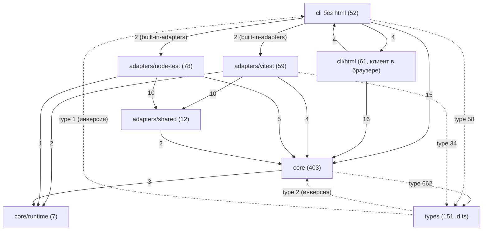
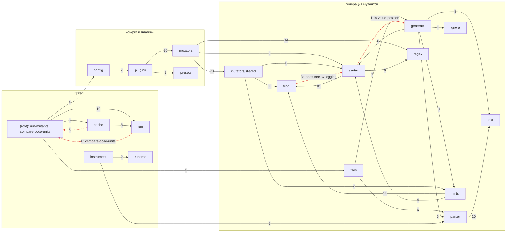

# Раздел 1. Архитектура

> Исследуемый коммит: `170ec52` (main). Рабочая копия — ветка
> `analysis/2026-11`, исходники совпадают с `170ec52`. Дата: 2026-11-04. Node
> v22.23.4.
>
> Инструменты (поставлены в `/home/user/tools-arch`, вне репозитория):
> dependency-cruiser 18.7.2, madge 8.0.0, jscpd 4, oxc-parser 0.156.0 (та же
> версия, что в проекте), esbuild 0.25, @hpcc-js/wasm-graphviz. Все скрипты и
> сырые данные — в [`analysis/architecture/`](architecture/README.md); любую
> цифру этого файла можно пересчитать командой
> `bash analysis/architecture/scripts/run-all.sh`.
>
> Тест-сьюты, сборка, `tsc` и `vitest` по договорённости не запускались (на
> машине шли замеры). Всё, что требует прогона тестов, помечено как оценка.
> Подраздел об адаптерах тестовых раннеров (контракт ядро↔адаптер, жизненный
> цикл, матрица ответственности, изоляция, Rstest/Jest) готовит другой агент;
> здесь — только границы пакетов и экспортов.

## Содержание

1. [Резюме](#1-резюме)
2. [Текущая картина](#2-текущая-картина)
3. [Проблемы по приоритету](#3-проблемы-по-приоритету)
4. [Граф зависимостей: циклы, fan-in/fan-out](#4-граф-зависимостей)
5. [Папки хелперов: семейства, одиночные импортёры, дубли](#5-папки-хелперов)
6. [Стиль «одна функция — один файл» и правило группировки](#6-стиль-одна-функция--один-файл)
7. [Границы слоёв core ↔ adapters ↔ cli ↔ types](#7-границы-слоёв)
8. [Публичный API, плагины, конфиг, содержимое пакета](#8-публичный-api)
9. [Устранение случайной архитектурной сложности](#9-устранение-случайной-архитектурной-сложности)
10. [Архитектура адаптеров тестовых раннеров](#архитектура-адаптеров-тестовых-раннеров)
11. [Целевая структура](#11-целевая-структура)
12. [План миграции небольшими PR](#12-план-миграции)
13. [Что сознательно не рекомендую и отрицательные результаты](#13-что-не-рекомендую-и-отрицательные-результаты)
14. [Что не проверено](#14-что-не-проверено)

---

## 1. Резюме

**Общее состояние: архитектура здоровая на уровне слоёв и ESLint-модели,
сложность сосредоточена в двух местах — в «движке владения» мутантов и в
публичной поверхности плагинного API.** Резкой реорганизации проект не требует.
Нужны правило группировки вместо «всё или ничего», выделение трёх-четырёх
концептов, которые сейчас размазаны по десяткам файлов, и сужение того, что
торчит наружу, до 1.0.

Что спроектировано хорошо и чего трогать не надо:

- **Ядро не знает раннеров.** В `core/` нет ни одного упоминания Vitest или
  `node:test` (grep по `vitest|node:test` → 0 строк). Встроенные адаптеры ядру
  передаёт CLI (`cli/built-in-adapters.ts:17-39`, `core/run-mutants.ts:64-68`).
  Правила `core ↛ cli`, `core ↛ adapters`, `adapters ↛ cli`,
  `vitest ↮ node-test` выполняются без единого нарушения
  ([`depcruise.config.cjs`](architecture/scripts/depcruise.config.cjs)).
- **ESLint-модель реализована чисто.** Мутатор — объект `{ meta, create }`
  (`types/mutator/mutator.d.ts:9-20`), реестр —
  `core/plugins/core-plugin.ts:30-54`, пресеты —
  `core/presets/recommended.ts:10-36` и `strict.ts:8-35`. Независимый мутатор —
  это 3–4 исходных файла (сам мутатор, реестр, пресеты) плюс тест, приёмочная
  фикстура и страница документации. Эту цену стоит сохранить (§9.1).
- **Копипасты почти нет:** jscpd находит 0.03 % дублированных строк при пороге
  50 токенов и 0.19 % при пороге 35 токенов (§5.5). Проблема проекта —
  размазанность концептов, а не дублирование текста.
- **Тесты точно зеркалят исходники:** у 636 из 653 исходных файлов (97 %) есть
  `test/<путь>.test.ts`, и 439 из 637 тестовых файлов (69 %) импортируют только
  своего «двойника». Это и сильная сторона, и главный множитель стоимости любой
  перегруппировки (§6.4).
- `adapters/shared` небольшой и действительно общий, JSON-отчёты версионированы
  (`schemaVersion: 3`, `types/report/run-report.d.ts:293`), CLI тонкий
  (`cli/index.ts` — 32 строки).

Главные проблемы:

1. **Плагинный API — неотфильтрованный дамп внутренних хелперов.**
   `MutatorContext.syntax` даёт плагинам 40 методов
   (`types/syntax/syntax-helpers.d.ts:24-306`). 16 из них нужны одному
   встроенному файлу, 3 ядро не использует вовсе. Каждый новый синтаксический
   факт для встроенного мутатора — это правка трёх файлов-посредников и
   расширение публичного API (§8.2).
2. **Логика «владения и избыточности» мутантов разнесена по циклу из 11 файлов**
   в `core/mutators/shared`. 7 из 20 мутаторов транзитивно зависят от 84–95
   файлов по импортам. С учётом хелперов, вызываемых через фасад
   `context.syntax`, — от 119–129 файлов, это ≈4.2–4.7 тыс. строк кода.
   Спецификация, на которую ссылаются 102 файла («catalog 2.8», «O19»), в
   репозитории отсутствует (§5.3).
3. **Одно правило подтверждения таймаута закодировано в 4–6 местах ядра**:
   литерал масштаба `2` и формула `2·k+1` встречаются дважды (§9.2).
4. **Плагин не может завести своё правило пропуска.** Если он всё же это делает,
   `mootant list --skipped` падает с `TypeError` (**подтверждено**, §8.3).
5. **Пакет:** 822 файла `.d.ts` (46 % распакованного размера), из которых
   публичным точкам входа нужны 62. `preserveModules` даёт 469 модулей на старте
   CLI: `mootant --help` занимает 241 мс против 93 мс у того же кода в бандле
   (замер, §8.5).

**Предлагаемое правило группировки:** «модуль = концепт». Приватные шаги меньше
40 строк кода переносятся в своего единственного импортёра, если тот не фасад.
Семейства вариантов одной операции, циклы импорта и константы одного протокола
собираются в один модуль. Листовые утилиты с большим fan-in, точки расширения и
код других процессов остаются отдельными файлами (§6.3). На реальном графе
консервативный вариант правила сокращает исходники с 653 до 535 файлов,
расширенный — до 494. Для связанных мутаторов число того, что надо открыть,
чтобы понять мутатор, падает со 119–129 файлов до 90–97 модулей в консервативном
варианте и до 56–62 в расширенном (с учётом фасада; по одним импортам — с 84–95
до 58–67 и 24–32).

---

## 2. Текущая картина

### 2.1. Размеры

Данные: [`style-areas.tsv`](architecture/data/style-areas.tsv),
[`folders.tsv`](architecture/data/folders.tsv). «Код» — строки без пустых,
JSDoc, комментариев и импортов. Подсчёт сделан парсером oxc, поэтому
многострочные импорты и комментарии учтены точно.

| Слой                               | Файлы `.ts` |      Строк |        Код |      JSDoc |   Импорты | Медиана кода на файл |
| ---------------------------------- | ----------: | ---------: | ---------: | ---------: | --------: | -------------------: |
| core                               |         410 |     38 814 |     56.4 % |     32.4 % |     5.5 % |                   25 |
| adapters (без `.d.ts`)             |         131 |      9 628 |     56.0 % |     33.5 % |     5.2 % |                   19 |
| cli                                |         112 |     10 829 |     63.0 % |     27.0 % |     4.9 % |                   26 |
| **итого исходники**                |     **653** | **59 271** | **57.5 %** | **31.6 %** | **5.4 %** |               **24** |
| types + adapters/*/types (`.d.ts`) |         169 |      7 866 |     21.5 % |     61.3 % |     3.7 % |                    6 |
| test (без fixtures)                |         696 |     85 907 |     81.4 % |      6.7 % |     3.5 % |                   40 |

| Папка                         | Файлов | 1 импортёр | …из той же папки | Медиана кода | < 15 строк кода |
| ----------------------------- | -----: | ---------: | ---------------: | -----------: | --------------: |
| core/syntax                   |     76 |         37 |               28 |           22 |              21 |
| core/mutators/shared          |     84 |         15 |               12 |           19 |              36 |
| core/mutators (правила)       |     20 |         20 |                0 |            — |               — |
| core/run                      |     45 |         29 |               14 |           25 |              10 |
| core/regex                    |     30 |         17 |               11 |           28 |               8 |
| core/hints                    |     18 |          7 |                4 |           92 |               5 |
| core/text                     |     16 |          5 |                3 |           29 |               3 |
| core/tree                     |     10 |          0 |                0 |            9 |               6 |
| core/parser                   |     20 |          7 |                6 |           21 |               5 |
| core/cache                    |     19 |         11 |                6 |           29 |               7 |
| adapters/vitest (+worker)     |     55 |         35 |               33 |           20 |              18 |
| adapters/node-test (+preload) |     66 |         34 |               32 |           18 |              27 |
| adapters/shared               |     10 |          3 |                3 |           41 |               1 |

Сводка по стилю ([`style-summary.json`](architecture/data/style-summary.json),
[`summary.json`](architecture/data/summary.json)):

- 601 из 653 исходных файлов (92 %) экспортируют ровно одну функцию.
- 197 файлов (30 %) содержат меньше 15 строк кода, 365 (56 %) — меньше 30.
- У 322 исходных файлов (49 %) ровно один импортёр, у 206 из них он лежит в той
  же папке.
- В среднем 4.48 импорта на файл, из них 3.85 локальных. 40.7 % импортов —
  `import type`.
- В файлах короче 15 строк кода собственно код занимает 39 % строк: в среднем
  7.8 строки кода, 8.9 строки JSDoc и 1.7 строки импортов.

Стиль применён неравномерно. `adapters/vitest/runner.ts` — класс на 1 285 строк
с 40 приватными полями и 25 методами. Его чистые хелперы при этом вынесены в 18
файлов `adapters/vitest/worker/*.ts` со средним размером 20 строк кода.
`core/mutators/shared/get-comparison-plan.ts` содержит 617 строк кода, а
соседний `is-always-nullish.ts` — 3.

### 2.2. Слои (Mermaid)

Граф уровня слоёв. Учтены только импорты значений, `import type` показан
пунктиром. Сгенерирован из
[`folder-edges.tsv`](architecture/data/folder-edges.tsv), полная версия —
[`layers.mmd`](architecture/data/layers.mmd).



Граф подпапок ядра (импорты значений с весом ≥ 2; красным отмечены обратные
рёбра, образующие циклы папок). Полная версия —
[`core.mmd`](architecture/data/core.mmd); SVG уровня папок —
[`folders-src-archi.svg`](architecture/folders-src-archi.svg) (без `types/`) и
[`folders-archi.svg`](architecture/folders-archi.svg) (с `types/`).



### 2.3. Что спроектировано хорошо (оставить как есть)

| Что                                                                     | Чем подтверждено                                                                                                                                       | Какое поведение защищает                                                                                    |
| ----------------------------------------------------------------------- | ------------------------------------------------------------------------------------------------------------------------------------------------------ | ----------------------------------------------------------------------------------------------------------- |
| Ядро не знает раннеров; встроенные адаптеры внедряет CLI                | 0 упоминаний `vitest`/`node:test` в `core/`; `core/run-mutants.ts:64-68` (`builtIns`), `cli/built-in-adapters.ts:17-39`                                | Новый раннер не трогает ядро; `core` тестируется фейковым адаптером (`test/helpers/create-fake-adapter.ts`) |
| Ни одного нарушения направлений слоёв в коде                            | 0 нарушений правил `core-not-to-cli`, `core-not-to-adapters`, `adapters-not-to-cli`, `adapter-not-to-other-adapter`                                    | Изоляция адаптеров друг от друга                                                                            |
| ESLint-модель: правило, реестр, пресеты, плагины с неймспейсом          | `core/plugins/core-plugin.ts:30-54`, `core/presets/*`, `docs/content/guide/configuration.mdx:280-296`                                                  | Явное включение мутаторов и стабильность пресетов                                                           |
| Тонкий CLI                                                              | `cli/index.ts` (32 строки), `cli/run-mutation.ts` (138)                                                                                                | Логика прогона не размазана по CLI                                                                          |
| Почти нет копипасты                                                     | jscpd: 2 клона на 56.9 тыс. строк (§5.5)                                                                                                               | —                                                                                                           |
| `adapters/shared` — 10 файлов, все нужны обоим адаптерам                | [`helpers.tsv`](architecture/data/helpers.tsv): 7 файлов импортируют оба адаптера напрямую, 3 — внутренние шаги `track-inputs` и `list-tsconfig-files` | Общие для раннеров отслеживание входов и часы                                                               |
| `core/tree` — листовые утилиты с fan-in до 51                           | `unwrap-expression` 51 импортёр, `get-context-slot` 27                                                                                                 | «Файл на функцию» здесь работает как индекс                                                                 |
| `core/hints` — крупные связные модули                                   | медиана 92 строки кода; цикл `infer-*` отражает взаимную рекурсию вывода типов                                                                         | —                                                                                                           |
| JSON-отчёты версионированы                                              | `schemaVersion: 3` в `types/report/{run,list,slim-run,slim-list}-report.d.ts`                                                                          | Совместимость для агентов и CI                                                                              |
| Центральные фильтры шума применяются ко всем мутаторам, включая плагины | `core/generate/collect-candidates.ts:39-43,235-239` (timer delay)                                                                                      | Одинаковый отсев для плагинов                                                                               |

---

## 3. Проблемы по приоритету

Критических архитектурных проблем, которые сами по себе делают вердикт неверным,
не найдено. Риски корректности вердикта — в разделе 2 (`02-bugs.md`).

| ID      | Приоритет | Трудоёмкость        | Проблема                                                                                                                                                                                                                                                | Доказательство                                                                                                                                                             | §        |
| ------- | --------- | ------------------- | ------------------------------------------------------------------------------------------------------------------------------------------------------------------------------------------------------------------------------------------------------- | -------------------------------------------------------------------------------------------------------------------------------------------------------------------------- | -------- |
| ARCH-1  | high      | L                   | `MutatorContext.syntax` (40 методов), `.hints`, `.sourceCode` — публичный, недокументированный и неотфильтрованный API. Каждый новый факт для встроенного мутатора расширяет его.                                                                       | `types/mutator/mutator-context.d.ts:39-49`, `types/syntax/syntax-helpers.d.ts:24`, `core/syntax/create-syntax-helpers.ts:136-178`; коммиты `cda98a7`, `b72d16f`, `a5d3a03` | 8.2, 9.1 |
| ARCH-2  | high      | L (M без редизайна) | Межмутаторное «владение/избыточность» — цикл из 11 файлов плюс `get-comparison-plan` (617 строк кода). 7 мутаторов тянут транзитивно 84–95 файлов (119–129 с учётом фасада). Каталог правил, на который ссылаются 102 файла, отсутствует.               | [`scc.txt`](architecture/data/scc.txt), §5.3                                                                                                                               | 5.3      |
| ARCH-3  | medium    | M                   | Политика подтверждения таймаута и протокол batch-попыток закодированы в 4–6 файлах `core/run`.                                                                                                                                                          | `plan-isolated.ts:23`, `run-batch-phases.ts:76,78`, `plan-batch.ts:69,106`, `get-batch-unit-cost.ts:24,35`, `get-unit-evidence.ts:22-28`, `apply-batch-result.ts:163-178`  | 9.2      |
| ARCH-4  | medium    | S / M               | `SkipNote.rule` — закрытое множество встроенных id. Плагин со своим `rule` роняет `list --skipped` и HTML-отчёт (**подтверждено**).                                                                                                                     | `types/mutant/skip-rule-id.d.ts:1,7`, `core/generate/generate-file-mutants.ts:376-377`; [репро](architecture/repro-plugin-skip-rule/README.md)                             | 8.3      |
| ARCH-5  | medium    | M                   | Граница adapters→core не совпадает с публичным API. Встроенные адаптеры используют 3 приватные функции ядра и весь `adapters/shared` (1 345 строк), которых у стороннего адаптера нет. Новый встроенный раннер — это правки в 6 местах вне своей папки. | §7.3                                                                                                                                                                       | 7.3      |
| ARCH-6  | medium    | S–M                 | В пакете 822 `.d.ts` (798 КБ из 1.75 МБ), публичным входам нужны 62 (77 КБ). `preserveModules`: 469 модулей на старте CLI, `--help` 241 → 93 мс в бандле.                                                                                               | §8.5, [`startup-bench.txt`](architecture/data/startup-bench.txt)                                                                                                           | 8.5      |
| ARCH-7  | medium    | M (по частям)       | «Одна функция — один файл» без правила группировки: семейства по 6–11 файлов (logging 10, type-view 11, member-chain 7, loops 6), хелперы дороже операции.                                                                                              | §5.2, §6                                                                                                                                                                   | 5–6      |
| ARCH-8  | low       | S                   | Инверсии слоёв: `types → core/cli` (3 импорта), `core/tree → core/syntax` (индексатор знает про логгеры), общие утилиты в доменных папках дают циклы папок.                                                                                             | §7.1–7.2                                                                                                                                                                   | 7        |
| ARCH-9  | low       | S                   | Id встроенных мутаторов — строковые литералы в 44 местах ядра вне реестра и пресетов (`'logical-operator'` — 15 раз в 12 файлах) без типовой проверки.                                                                                                  | §5.3                                                                                                                                                                       | 5.3      |
| ARCH-10 | low       | S                   | Лишнее или неясное в публичном API: `classifyTry` и `mootant/runtime` без потребителя и документации; 22 из 35 имён `mootant` — SPI адаптеров; типы JSON-отчётов не экспортируются; `settings.timeouts` ≠ `run.timeout`.                                | §8.1, §8.4                                                                                                                                                                 | 8        |
| ARCH-11 | low       | S                   | Церемония вокруг констант: 11 тестов на файлы-константы, названия `describe` искажены автофиксом (`'rUNTIME_VERSION'`); 3 файла на 3 строки-ключа.                                                                                                      | §5.4                                                                                                                                                                       | 5.4      |

### 3.1. Карточки существенных рекомендаций

| Рекомендация                                                                                      | Какую проблему решает                                                                | Чем подтверждена проблема                                                                                              | Польза для пользователей                                                                                      | Риски и компромиссы                                                            | Как проверить после                                                              |
| ------------------------------------------------------------------------------------------------- | ------------------------------------------------------------------------------------ | ---------------------------------------------------------------------------------------------------------------------- | ------------------------------------------------------------------------------------------------------------- | ------------------------------------------------------------------------------ | -------------------------------------------------------------------------------- |
| R1. Внутренний контекст встроенных мутаторов + курируемый `syntax` + страница о плагинах (ARCH-1) | Публичный API растёт с каждым внутренним фактом и не документирован                  | 40 методов, 16 нужны одному файлу, 3 не нужны никому; 3 коммита правили тройку «реализация + интерфейс + фасад» (§8.2) | Авторы плагинов получают стабильный документированный API; до 1.0 обязательства semver меньше                 | Breaking для недокументированного API (0.x); правка типа `Mutator`             | Тесты мутаторов и фикстура list без изменения ожиданий; `tsc` на примере плагина |
| R2. Каталог владения в репозитории + `core/mutators/plans/` + типизированные id (ARCH-2, ARCH-9)  | Межмутаторная логика разнесена по циклу из 11 файлов, спецификации нет               | SCC (§4.1), замыкания 119–129 файлов (§5.3), 102 файла ссылаются на отсутствующий каталог                              | Быстрее и безопаснее правки отсева дублей — ключевой фичи; меньше риск незаметно потерять или вернуть мутанты | Средний: перенос 16 файлов; каталог нужно написать                             | Фикстура list байт-в-байт, тесты планов перенесены как есть                      |
| R3. `core/run/timeout-policy.ts` (ARCH-3)                                                         | Политика подтверждения таймаута записана в 4–6 местах                                | §9.2: литерал `2` в 3 файлах, `2·k+1` в 2, причины подтверждения в 2                                                   | Одинаковые вердикты `Timeout` в batch и isolated при будущих правках                                          | Низкий                                                                         | Тесты `core/run/*` без изменения ожиданий, e2e с таймаутами                      |
| R4. Проверка `skip.rule`, затем `Plugin.skipRules` (ARCH-4)                                       | Плагин роняет `--skipped`/HTML или не может описать свой пропуск                     | Воспроизведение (§8.3)                                                                                                 | Понятная ошибка вместо `TypeError`; плагины с собственным отсевом шума                                        | Нет (S); расширение API (M)                                                    | Новый тест генерации, репро — exit 0                                             |
| R5. `adapters/kit` + правило импорта, затем `mootant/adapter` (ARCH-5)                            | Сторонний адаптер не может повторить встроенный без копирования около 1.4 тыс. строк | §7.3: 3 приватные функции ядра и `adapters/shared`                                                                     | Rstest, Jest и сторонние адаптеры на равных со встроенными                                                    | Ещё одна публичная поверхность (после стабилизации)                            | depcruise-правило; e2e обоих адаптеров                                           |
| R6. `.d.ts` только для публичных входов; бандлинг входов CLI, воркера и preload (ARCH-6)          | Лишние 760 деклараций; 469 модулей на старте                                         | §8.5 (`tar`, замер 241 → 93 мс)                                                                                        | Пакет примерно на 40 % меньше; `list` и циклы агента быстрее на ≈150 мс за вызов                              | Бандлинг: идентичность модулей между процессами; нужен e2e на собранном пакете | Проверка состава `npm pack`; `startup-bench.sh`; e2e на dist                     |
| R7. Правило группировки «модуль = концепт» (ARCH-7)                                               | Концепты по 6–11 файлов, хелперы дороже операции                                     | §5.2, симуляция §6.3                                                                                                   | Косвенная: быстрее правки, меньше файлов для понимания (на 18–24 % меньше файлов)                             | Объём механических переносов, конфликты с параллельной работой                 | Тесты переносятся без изменения случаев; 100 % покрытия; фикстура list           |

---

## 4. Граф зависимостей

Конфиг: [`depcruise.config.cjs`](architecture/scripts/depcruise.config.cjs).
Сырые данные: `data/depcruise.json.gz` (823 файла, 2 740 локальных рёбер, из них
1 545 — импорты значений). Агрегаты:
[`analyze-graph.mjs`](architecture/scripts/analyze-graph.mjs). Все локальные
импорты разрешены (0 неразрешённых). Статически различимых динамических импортов
7, из них локальных 3: `cli/built-in-adapters.ts:23,33` и
`cli/run-mutation.ts:127`. Импорты по вычисляемому URL
(`core/config/import-config.ts:12`,
`adapters/vitest/start-vitest-session.ts:70`) загружают код пользователя и
Vitest, в граф они не входят.

### 4.1. Циклы (сильно связные компоненты)

| Размер | Компонента                                                                                                                                                                                                                                              | Вид         | Оценка                                                                                                                  |
| -----: | ------------------------------------------------------------------------------------------------------------------------------------------------------------------------------------------------------------------------------------------------------- | ----------- | ----------------------------------------------------------------------------------------------------------------------- |
|     11 | `core/mutators/shared/{get-branch-copy-skip, get-condition-constants, get-group-constant, get-literal-flip, get-literal-skip, get-logical-drops, get-nullish-directions, get-or-default-skip, get-owner-constant, get-toward-mutant, has-polar-mutant}` | значения    | **Проблема** (ARCH-2): один концепт, «кто из мутаторов уже даёт этот мутант», разрезан на 11 взаимно рекурсивных файлов |
|      5 | `core/hints/infer-{annotation,binding,call,expression,member}-type.ts`                                                                                                                                                                                  | значения    | Оправдан: рекурсивный спуск вывода типов, файлы крупные (59–488 строк). Оставить                                        |
|      2 | `types/run/isolated-evidence.d.ts` ↔ `mutant-state.d.ts`                                                                                                                                                                                                | только типы | Безвреден                                                                                                               |
|      2 | `types/run/live-verdicts.d.ts` ↔ `run-state.d.ts`                                                                                                                                                                                                       | только типы | Безвреден                                                                                                               |

Независимая перепроверка madge 8
([`madge-circular.txt`](architecture/data/madge-circular.txt)) находит 9
элементарных циклов в тех же трёх местах: 8 из 11 файлов компоненты
`mutators/shared`, все 5 файлов `hints/infer-*` и обе пары `types/run`. madge
перечисляет отдельные циклы, а не компоненты связности, поэтому файлов в его
списке меньше.

Циклы на уровне папок (импорты значений):

- `core/syntax ↔ core/tree`: `core/tree/index-tree.ts:6-8` импортирует
  `is-logger-factory-call`, `is-logger-label`, `is-module-call`. Индексатор
  дерева исключает слоты подписей дочерних логгеров
  (`core/tree/index-tree.ts:105-109`), то есть политика шума живёт в самом
  нижнем слое (ARCH-8).
- `core/generate ↔ core/syntax`: `core/syntax/is-value-position.ts` →
  `core/generate/get-replacement-kind.ts`.
- `core/(root) ↔ core/{run,cache,config,files}`: из-за утилиты
  `core/compare-code-units.ts`, лежащей в корне рядом с оркестраторами
  `run-mutants.ts` и `list-mutants.ts`.

### 4.2. Fan-out: модули, которые «знают много»

Топ по числу локальных импортов значений
([`summary.json`](architecture/data/summary.json)):

| Файл                                              | Импортов значений | Чужих папок | Оценка                                                                                               |
| ------------------------------------------------- | ----------------: | ----------: | ---------------------------------------------------------------------------------------------------- |
| `core/syntax/create-syntax-helpers.ts`            |                40 |           3 | Фасад: 36 из 40 записей — лямбды-переходники `node => f(tree, node)`, ещё 4 — прямые ссылки (ARCH-1) |
| `core/run-mutants.ts`                             |     35 (+13 type) |          13 | Оркестратор прогона, оправдан; 712 строк, читается линейно                                           |
| `core/generate/generate-file-mutants.ts`          |     26 (+16 type) |          13 | Оркестратор генерации по файлу, оправдан                                                             |
| `cli/html/client/start-report.ts`                 |                23 |           3 | Вход браузерного клиента, оправдан                                                                   |
| `core/plugins/core-plugin.ts`                     |                22 |           3 | Реестр мутаторов, оправдан (ESLint-модель)                                                           |
| `core/mutators/shared/get-comparison-plan.ts`     |                21 |           5 | Часть движка владения (ARCH-2)                                                                       |
| `adapters/vitest/runner.ts`                       |      20 (+6 type) |           6 | Класс-воркер на 1 285 строк (детали — у другого агента)                                              |
| `core/mutators/shared/get-condition-constants.ts` |                20 |           3 | Движок владения                                                                                      |
| `adapters/node-test/start-node-test-session.ts`   |                19 |           2 | Сборка сессии из 8 одноразовых шагов                                                                 |
| `core/generate/collect-candidates.ts`             |     12 (+16 type) |          11 | Центральные фильтры, оправдан                                                                        |

«Знают слишком много» в плохом смысле, то есть знание не своего уровня:

- `core/tree/index-tree.ts` — низкоуровневый индексатор, который знает про
  логгеры и вызовы модулей (`:6-8`, `:105-109`).
- `create-syntax-helpers.ts` импортирует 36 синтаксических хелперов и ещё 4 из
  `core/tree` и `core/regex`: другого способа дать встроенному мутатору доступ к
  `tree` и `scopes` нет (§8.2).
- Семь мутаторов знают о мутантах друг друга через общие «планы», а id чужих
  мутаторов записаны строками: `'logical-operator'` встречается в 12 файлах
  (`get-condition-constants.ts:130`, `get-logical-drops.ts:85,233`,
  `get-owner-constant.ts:91` и др.). Это ARCH-9.

### 4.3. Fan-in

| Файл                                        |                                             Импортёров (значения) | Комментарий                                            |
| ------------------------------------------- | ----------------------------------------------------------------: | ------------------------------------------------------ |
| `core/tree/unwrap-expression.ts`            |                                                                51 | лист, оставить                                         |
| `core/compare-code-units.ts`                | 27 (20 из ядра, 5 из адаптеров, 1 из `adapters/shared`, 1 из CLI) | общая утилита в корне `core/` → в `core/util/`         |
| `core/tree/get-context-slot.ts`             |                                                                27 | лист                                                   |
| `cli/html/client/html.ts`                   |                                                                25 | лист клиента                                           |
| `core/mutators/shared/get-literal-value.ts` |                                                      25 (+4 type) | его тип `LiteralValue` импортирует `types/` (инверсия) |
| `cli/html/client/escape-html.ts`            |                                                                24 | лист                                                   |
| `core/tree/unwrap-parentheses.ts`           |                                                                23 | лист                                                   |
| `core/mutators/shared/get-type-view.ts`     |                                                      18 (+2 type) | центр семейства type-view (§5.2)                       |
| `core/text/pluralize.ts`                    |                                                                12 | 3 строки кода, 11 импортёров из CLI                    |

Типы с наибольшим числом импортёров: `types/mutator/mutator-context.d.ts` (60),
`types/syntax/tree-index.d.ts` (55), `types/mutant/skip-note.d.ts` (32),
`types/run/run-state.d.ts` (28).

### 4.3a. Fan-in и fan-out по папкам

Ca — сколько других папок зависят от этой, Ce — от скольких папок зависит она, I
= Ce / (Ca + Ce) — нестабильность по Мартину. `types/` не учитывается
([`folders.tsv`](architecture/data/folders.tsv)).

| Папка             |  Ca |  Ce |    I | Комментарий                                                                                                          |
| ----------------- | --: | --: | ---: | -------------------------------------------------------------------------------------------------------------------- |
| `core/(root)`     |  12 |  15 | 0.56 | Оркестраторы и утилита `compare-code-units` в одной папке. Отсюда и высокий Ca, и высокий Ce, и 4 цикла папок (§7.2) |
| `core/text`       |  12 |   3 | 0.20 | Стабильный нижний слой, как и должно быть                                                                            |
| `core/tree`       |   9 |   2 | 0.18 | Стабильный нижний слой; единственное лишнее ребро — в `core/syntax` (§7.2)                                           |
| `core/parser`     |   7 |   4 | 0.36 | —                                                                                                                    |
| `core/syntax`     |   6 |   6 | 0.50 | Середина; ребро в `core/generate` обратное                                                                           |
| `core/generate`   |   2 |  15 | 0.88 | Оркестратор генерации — нестабилен, это нормально                                                                    |
| `core/mutators`   |   1 |  11 | 0.92 | Правила, 165 исходящих рёбер, из них 73 в `mutators/shared`                                                          |
| `cli/report`      |   2 |  11 | 0.85 | —                                                                                                                    |
| `adapters/vitest` |   1 |   9 | 0.90 | 88 исходящих рёбер                                                                                                   |

Направление зависимостей в целом правильное: нестабильные оркестраторы и правила
зависят от стабильных `tree` и `text`. Исключения — корень `core/` и обратные
рёбра `tree → syntax` и `syntax → generate`.

### 4.4. Охват точек входа

Статические импорты значений, без динамических
([`reach.tsv`](architecture/data/reach.tsv)):

| Вход                                                                 | Локальных модулей |
| -------------------------------------------------------------------- | ----------------: |
| `cli/index.ts` (любая команда, даже `--help`)                        |               469 |
| `adapters/vitest/index.ts`                                           |                52 |
| `adapters/vitest/runner.ts` (в каждом воркере Vitest)                |                28 |
| `adapters/node-test/preload/preload.ts` (в каждом тестовом процессе) |                24 |
| `core/index.ts`                                                      |                 4 |

`cli/index.ts` статически импортирует `cli/run-mutation.ts` →
`core/run-mutants.ts`, поэтому даже `mootant --help` и `mootant list` грузят всё
ядро. В сборке с `preserveModules` (`vite.config.ts:133`) это 469 отдельных
файлов (§8.5).

---

## 5. Папки хелперов

Таблица по каждому файлу хелперных папок — размер, импортёры, тесты — лежит в
[`helpers.tsv`](architecture/data/helpers.tsv). Семейства по префиксам имён,
цепочки приватных хелперов и «всегда импортируются вместе» собраны в
[`helper-families.txt`](architecture/data/helper-families.txt).

### 5.1. Одиночные импортёры

Из 653 исходных файлов у 322 ровно один импортёр, у 206 из них он в той же
папке. С кодом меньше 40 строк таких файлов 111, меньше 25 — 73
([`merge-candidates-private-helpers.tsv`](architecture/data/merge-candidates-private-helpers.tsv)).
Цепочки «файл → его единственный импортёр» показывают, что многие папки — это
деревья одноразовых шагов одного алгоритма:

| Корень (единственный импортёр)                                  | Приватные шаги                                                                   |  Строк кода всего |
| --------------------------------------------------------------- | -------------------------------------------------------------------------------- | ----------------: |
| `core/syntax/create-syntax-helpers.ts`                          | 23 файла (`is-loop-test`, `is-condition-test`, `get-lower-bound`, …)             |             1 220 |
| `adapters/vitest/index.ts` (через `start-vitest-session`)       | 17 файлов                                                                        |               889 |
| `adapters/vitest/runner.ts`                                     | 14 файлов `worker/*`                                                             |               993 |
| `adapters/node-test/index.ts` (через `start-node-test-session`) | 21 файл                                                                          |               835 |
| `core/hints/infer-expression-type.ts`                           | `infer-{call,member,operator,this}-type`                                         |               809 |
| `core/regex/create-regex-replacement.ts`                        | 6 файлов печати и кодирования                                                    |               311 |
| `core/run/run-isolated-rounds.ts`                               | `apply-isolated-result`, `get-file-cost`, `number-chains`, `plan-isolated`       |               210 |
| `core/cache/prepare-run-cache.ts`                               | `create-run-cache`, `find-lockfile`, `get-environment-key`, `get-test-file-keys` |               444 |
| `core/git/read-changed-lines.ts`                                | `find-git-root`, `get-merge-base`, `parse-binary-paths`                          | ≈250 на всю папку |

Не всякий одиночный импортёр — повод сливать файлы. Фасад
(`create-syntax-helpers`) не владеет теми, кого связывает. Если влить в него 23
файла, получится модуль на 1 220 строк кода. Поэтому в правиле (§6.3) фасады
исключены, а для них есть отдельная рекомендация (§8.2).

### 5.2. Один концепт, размазанный по файлам

Семейства я искал тремя независимыми способами: по общим словам в именах (без
`is/get/read/...`), по цепочкам единственных импортёров и по одинаковым наборам
импортёров. Отобраны только семейства, где файлы действительно отвечают на
вопросы об одном понятии. Источник цифр —
[`simulate-grouping.mjs`](architecture/scripts/simulate-grouping.mjs).

| Семейство                    | Файлы                                                                                                                                                                                                                              | Строк / код |    Внешних импортёров | Тестов-двойников | Предложение                                                                                                                   |
| ---------------------------- | ---------------------------------------------------------------------------------------------------------------------------------------------------------------------------------------------------------------------------------- | ----------: | --------------------: | ---------------- | ----------------------------------------------------------------------------------------------------------------------------- |
| **Логирование**              | `core/syntax/{is-logging-call, is-logger-name, is-logger-label, is-log-message, is-logger-factory-call, find-logging-calls, is-console-path, find-message-texts, is-format-free, is-plain-message}`                                |   541 / 294 |                     3 | 10 (703 строки)  | `core/syntax/logging.ts`                                                                                                      |
| **Взгляд на выведенный тип** | `core/mutators/shared/{get-type-view, is-always-nullish, may-be-nullish, is-non-nullable, may-be-boolean, is-always-truthy, has-defined-falsy-value, is-number-type, is-non-number-type, get-canonical-falsy, is-canonical-falsy}` |   254 / 100 |                    21 | 11 (267 строк)   | `core/hints/type-view.ts`: это вопросы к `InferredType` из `core/hints`, а не к мутаторам                                     |
| **Цепочки членов**           | `core/syntax/{get-member-path, get-member-root, get-root-name, get-chain-root, get-chain-end, is-read-chain, is-written-member}`                                                                                                   |   288 / 146 |                    19 | 7 (327)          | `core/syntax/member-chain.ts`; разница между `getMemberRoot` (не идёт через вызовы) и `getRootName` (идёт) видна только рядом |
| **Циклы**                    | `core/syntax/{advances-loop, get-exited-loops, is-caught-in-loop, is-loop-advance-value, is-loop-test, is-tested-loop}`                                                                                                            |   508 / 252 |                     2 | 6 (661)          | `core/syntax/loops.ts`                                                                                                        |
| **Git**                      | `core/git/*` (7 файлов)                                                                                                                                                                                                            |   426 / 250 |                     2 | 7 (629)          | 2 модуля: `read-changed-lines.ts` (запуск git), `parse-diff.ts` (разбор)                                                      |
| **Владение мутантами (SCC)** | 11 файлов, §5.3                                                                                                                                                                                                                    | 1 536 / 887 |                     7 | 11 (2 926)       | `core/mutators/plans/`                                                                                                        |
| Слоты и развёртка обёрток    | `core/tree/{get-raw-slot, get-slot, get-context-slot, unwrap-expression, unwrap-parentheses, is-expression-wrapper}`                                                                                                               |    149 / 53 | **88** (118 импортов) | 6                | **Не трогать**: правка 118 импортов дороже пользы (правило K1)                                                                |

Пример «хелпера дороже операции» из семейства type-view:

```ts
// core/mutators/shared/may-be-nullish.ts — 14 строк, тест 18 строк
export function mayBeNullish(inferred: InferredType): boolean {
  return !isNonNullable(inferred)
}
// core/mutators/shared/is-non-nullable.ts — 15 строк, тест 18 строк
export function isNonNullable(inferred: InferredType): boolean {
  return getTypeView(inferred).nullability === 'non-nullable'
}
// core/mutators/shared/is-always-nullish.ts — 14 строк, тест 17 строк
export function isAlwaysNullish(inferred: InferredType): boolean {
  return getTypeView(inferred).type === 'nullish'
}
```

Всё семейство — 100 строк кода в 22 файлах (11 исходных на 254 строки и 11
тестовых на 267) и 42 импорта в 21 файле. После объединения это
`core/hints/type-view.ts` (≈180 строк с JSDoc), один тест (≈250 строк,
`describe` на функцию) и 21 импорт.

Дубли внутри семейств:

- Два списка методов логгера: `logMethods` (`core/syntax/is-logging-call.ts:11`,
  12 имён) и `consoleMethods` (`core/syntax/find-logging-calls.ts:19`, 22
  имени). Назначение у них разное: методы любого логгера и полный API `console`.
  Но шесть имён пересекаются, а сами списки лежат в разных файлах и не ссылаются
  друг на друга. В одном модуле расхождение было бы видно.
- `isComparison` (`core/mutators/shared/is-comparison.ts`) — узловая обёртка над
  `isComparisonOperator` (`core/syntax/is-comparison-operator.ts`). `isAndOr`
  (`core/mutators/shared/is-and-or.ts`) живёт отдельно от `getLogicalChain`
  (`core/syntax/get-logical-chain.ts`). Это одна тема «форма логического
  выражения» в двух папках.
- Формула числа попыток batch-юнита `2 · k + 1` повторена в
  `core/run/plan-batch.ts:106` и `core/run/get-batch-unit-cost.ts:35` (§9.2).

### 5.3. Движок «владения и избыточности» (ARCH-2)

**Что это.** Философия Mootant — не выдавать мутант, который уже дал другой
мутатор, или который поглощён другим мутантом. Поэтому мутатор, решая,
пропустить ли свой вариант, вычисляет, что сделали бы другие мутаторы в этом
месте: константы `condition`, отбрасывание операндов `logical-operator`, сдвиги
`comparison-operator`, флипы литералов. Каждое такое знание оформлено «планом»:
`get-condition-constants`, `get-logical-drops`, `get-comparison-plan`,
`get-nullish-plan` и другие. Решение о пропуске проверяет, запустится ли
«владелец», через `context.isActive(id, node)` и `createRunContext().runs`
(`core/mutators/shared/create-run-context.ts`).

**Почему это проблема:**

- Планы ссылаются друг на друга, и вышел цикл из 11 файлов с 23 внутренними
  рёбрами ([`scc.txt`](architecture/data/scc.txt)). Понять один из них, не
  прочитав остальные, нельзя.
- 13 мутаторов из 20 не участвуют в общем движке владения. Их замыкание по
  импортам — от 0 до 26 файлов, кроме `comparison-operator` (49: свой
  617-строчный план). С учётом фасада — от 2 до 46, у `comparison-operator`
  — 67. Остальные 7 (`boolean-literal`, `condition`, `logical-operator`,
  `number-literal`, `return-value`, `statement-removal`, `string-literal`) тянут
  84–95 файлов по импортам и 119–129 с фасадом.

  «С фасадом» означает: вызов `context.syntax.isLoopTest(...)` в файле замыкания
  добавляет `core/syntax/is-loop-test.ts` и его импорты. Граф импортов эти
  зависимости не видит. Данные:
  [`mutator-closures-with-facade.tsv`](architecture/data/mutator-closures-with-facade.tsv),
  скрипт [`facade-closures.mjs`](architecture/scripts/facade-closures.mjs).

  | Мутатор                                            | Файлов по импортам | Файлов с фасадом | Строк кода с фасадом |
  | -------------------------------------------------- | -----------------: | ---------------: | -------------------: |
  | `string-literal`                                   |                 95 |              129 |                4 599 |
  | `statement-removal`                                |                 88 |              128 |                4 687 |
  | `return-value` / `number-literal`                  |                 86 |              125 |        4 370 / 4 511 |
  | `condition`, `logical-operator`, `boolean-literal` |                 84 |              119 |                4 249 |
  | `comparison-operator`                              |                 49 |               67 |                2 386 |
  | `missing-await`                                    |                 21 |               46 |                1 640 |
  | `update-operator`                                  |                  0 |               16 |                  401 |
  | `bitwise-operator`                                 |                  2 |                2 |                   40 |

- Спецификация правил живёт вне репозитория. Комментарии в 102 файлах `core/`
  ссылаются на «catalog 2.2» (21 раз), «catalog 4.8» (12), «12.2» и на метки
  O1–O19 и R1–R7. Метки описаны пользователю в таблицах
  `docs/content/mutators/*.md`, а нумерованных разделов каталога нет ни в
  `docs/`, ни в `contributing.md`, ни в истории git. Предполагаю, что это личные
  заметки автора. Это **гипотеза**: проверяется вопросом к автору или поиском по
  его заметкам.
- Владельцы записаны строками. `'logical-operator'` встречается в 12 файлах,
  `'condition'` — в 5, `'comparison-operator'` — в 6. Карта «литерал → мутатор»
  зашита в `core/mutators/shared/get-literal-mutator.ts:13-31`. Опечатка в id не
  ловится ни типами, ни тестом.

**Что предлагаю (по возрастанию риска):**

1. _(M)_ Положить каталог в репозиторий: `docs/internals/ownership-catalog.md` с
   разделами, на которые уже ссылается код. Ничего не ломает, сразу снижает
   стоимость входа.
2. _(M)_ Собрать планы в `core/mutators/plans/` по владельцу: `comparison.ts`
   (`get-comparison-plan` с хелперами, при необходимости двумя файлами — план
   больше лимита размера), `condition.ts`, `logical.ts`, `literal.ts`,
   `ownership.ts` (`get-owner-constant`, `get-toward-mutant`, статический
   контекст). Один `index.ts` с описанием API запросов. Цикл останется, но
   внутри одной папки с явным входом. Вместе с перегруппировкой остального
   `core/mutators/shared` по концептам замыкание связанных мутаторов падает с
   119–129 файлов до 56–62 модулей (по импортам — с 84–95 до 24–32; расширенная
   симуляция,
   [`grouping-simulation-extended.json`](architecture/data/grouping-simulation-extended.json)).
3. _(S)_ Типизировать id встроенных мутаторов:
   `type BuiltInMutatorId = keyof typeof corePlugin.mutators` и константы вместо
   строк. Ловит опечатки на уровне `tsc`.
4. _(XL, гипотеза-направление, не к ближайшему плану)_ Двухфазная генерация.
   Сначала мутаторы выдают все кандидаты со структурным описанием эффекта
   («принуждает решение к `true`», «отбрасывает левый операнд»), затем
   центральный этап применяет правила владения ко всему набору — так же, как уже
   работают `core/generate/deduplicate-candidates.ts` и
   `apply-solitary-rule.ts`. Тогда мутаторы снова станут независимыми, как
   правила ESLint, и цикл исчезнет. Риск высокий: тонкая семантика пропусков,
   которую сейчас защищают `test/fixtures/list/expectations.json` и 4 858 строк
   `test/core/generate/generate-file-mutants.test.ts`. Браться только после пп.
   1–2 и только если появятся новые связанные мутаторы.

**Как проверить пп. 2–3.** Байт-в-байт совпадение `expected-mutants*.json` и
`expected-skipped*.json` в `test/cli/index.test.ts:158-200`, перенесённые без
изменений тесты планов (`test/core/mutators/shared/get-*.test.ts` → `describe` в
новых модулях), 100 % покрытия.

### 5.4. Константы и церемония вокруг них (ARCH-11)

33 исходных файла не объявляют функций верхнего уровня
([`style-files.tsv`](architecture/data/style-files.tsv), `topFunctions = 0`).
Если не считать входов, реэкспортов, мутаторов-объектов и пресетов, остаются 20
файлов, где лежат только константы. Среди них:

- три ключа одного протокола preload —
  `adapters/node-test/preload/{loaded,served,reported}-key.ts`, по 1 строке кода
  в каждом;
- три константы рантайма —
  `core/runtime/{runtime-global,runtime-symbol-key,runtime-version}.ts`;
- две заметки о пропуске —
  `core/mutators/shared/{leave-now-skip,no-op-callback-skip}.ts`.

На 11 таких файлов написаны отдельные тесты. Их заголовки искажены автофиксом
правила о строчной первой букве: `describe('rUNTIME_VERSION')`
(`test/core/runtime/runtime-version.test.ts:5`), `'cACHE_VERSION'`,
`'lEAVE_NOW_SKIP'` и ещё 8. Тест вроде `expect(RUNTIME_VERSION).toBe(1)`
проверяет литерал, а не поведение. Это прямое следствие правила «файл на
символ + тест на файл».

### 5.5. Дублирование кода (отрицательный результат)

jscpd по `core adapters cli` без `.d.ts`:

- `--min-tokens 50 --min-lines 6`: 2 клона, 16 строк (0.03 %);
- `--min-tokens 35 --min-lines 4 --mode weak`: 14 клонов, 109 строк (0.19 %).
  Самые крупные — 9 строк в `get-owner-constant.ts:60-68` и
  `get-toward-mutant.ts:78-86` (та же компонента владения), 9 строк в
  `adapters/node-test/list-package-files.ts:14-22` и
  `adapters/shared/list-tsconfig-files.ts:17-25`.

Копипаста в проекте не проблема. Автор уже провёл чистку: коммиты
`d865f6d refactor: remove duplicated code` (125 файлов) и
`f3f3b19 test: remove duplicated test code` (77 файлов). Дальнейшая работа — над
концептами, а не над текстом.

---

## 6. Стиль «одна функция — один файл»

Правило записано в `contributing.md:240`: «One exported function per file, named
after the file». Линтер его не проверяет: в `@azat-io/eslint-config` нет
`max-lines`, `complexity` и `import-x/no-cycle`, есть `max-params: 3` и
`unicorn/filename-case`. Значит, это конвенция, и менять её можно без борьбы с
инструментами.

### 6.1. Где стиль помогает

| Свойство               | Наблюдение                                                                                                                                                                                                                                                                                                                                              | Вес     |
| ---------------------- | ------------------------------------------------------------------------------------------------------------------------------------------------------------------------------------------------------------------------------------------------------------------------------------------------------------------------------------------------------- | ------- |
| Тестируемость          | 97 % файлов имеют тест-двойник, 69 % тестов импортируют только его, тесты табличные и короткие (`test/core/syntax/is-loop-test.test.ts` — 36 строк). Порог 100 % (`vitest.config.ts:9-14`) легко держать: непокрытая строка сразу указывает на файл.                                                                                                    | Высокий |
| Навигация по имени     | Имя файла = имя функции: нечёткий поиск файла находит любую функцию; история git по функции.                                                                                                                                                                                                                                                            | Средний |
| Контроль мёртвого кода | knip ловит неиспользуемый файл (`pnpm test:usage`).                                                                                                                                                                                                                                                                                                     | Средний |
| Tree-shaking           | **Не помогает.** Rolldown (сборщик Vite 8 из lockfile) удаляет неиспользуемые экспорты модуля и при `preserveModules: true`. Проверено экспериментом ([`experiments/treeshake`](architecture/experiments/treeshake/README.md)): `unusedHelper` выброшен из `helpers.js`. Браузерный клиент отчёта собирается целиком (`vite.config.ts` `inlineScript`). | Нет     |

### 6.2. Где стиль мешает

| Свойство          | Наблюдение                                                                                                                                                                                                                                                                                             |
| ----------------- | ------------------------------------------------------------------------------------------------------------------------------------------------------------------------------------------------------------------------------------------------------------------------------------------------------ |
| Связность         | Концепты по 6–11 файлов (§5.2). Цикл из 11 файлов (§5.3) нельзя читать по частям.                                                                                                                                                                                                                      |
| Глубина навигации | Чтобы понять `condition.ts` (60 строк кода), надо открыть транзитивно до 84 файлов по импортам и до 119 с учётом фасада `context.syntax`. Медиана хелпера — 22 строки кода.                                                                                                                            |
| Импорт-шум        | 3 182 строки импортов (5.4 % строк, 9.3 % от строк кода), 4.48 импорта на файл. В малых файлах код занимает 39 % строк, JSDoc — 44 %, импорты — 9 %. Сам по себе шум умеренный. Хуже то, что каждый шаг алгоритма требует отдельного JSDoc, отдельного файла теста и отдельного импорта у потребителя. |
| Поиск             | Поиск по содержимому работает. Хуже другое: варианты одной операции (`getRawSlot`/`getSlot`/`getContextSlot`, `getMemberRoot`/`getRootName`) не видны рядом, и легко выбрать не тот.                                                                                                                   |
| Фасады            | Мутатор видит файл только через контекст, а каждый хелпер — отдельный файл с явными параметрами `tree` и `scopes`. Поэтому их пришлось связывать поштучно, и получился фасад на 40 лямбд, который к тому же стал публичным API (§8.2). Сам стиль фасад не требует, но делает его длинным.              |
| Неравномерность   | Где правило неприменимо (класс-раннер Vitest с состоянием), файл вырос до 1 285 строк, а его чистые хелперы разнесены по 18 файлам.                                                                                                                                                                    |
| Время старта      | Не следствие стиля, а сборки с `preserveModules`: 469 модулей на старте CLI (§8.5). Лечится бандлингом входов без изменения исходников.                                                                                                                                                                |

### 6.3. Правило группировки: «модуль = концепт»

Файл соответствует модулю, модуль — концепту. «Одна функция в файле» — частный
случай концепта из одной функции.

**Группировать в один модуль, если выполняется хотя бы одно:**

- **G1. Приватный шаг.** У файла ровно один импортёр. Импортёр лежит в той же
  папке и не является фасадом или реестром: он не связывает 10 и больше соседей
  и это не `index.ts`. В файле меньше 40 строк кода. Функция переезжает в
  импортёр. Если у неё был свой тест, она остаётся экспортированной.
- **G2. Семейство вариантов.** Три и больше функций, которые отвечают на вопросы
  к одному типу данных или различаются режимом одной операции: предикаты над
  `InferredType`, логирование, цепочки членов, циклы. Модулю нужен вводный JSDoc
  о том, чем варианты различаются.
- **G3. Цикл импорта.** Сильно связная компонента становится одной папкой с
  `index.ts` и описанием.
- **G4. Константы одного протокола** (ключи `Symbol.for`, версии одного кэша) —
  один файл рядом с владельцем, без отдельного теста.

**Не группировать (оставить файл):**

- **K1.** Листовая утилита, у которой 5 и больше импортёров минимум из двух
  папок (`unwrap-expression`, `get-context-slot`, `compare-code-units`).
  Исключение — если она часть семейства G2 и импортов немного.
- **K2.** Точка расширения или вход: мутатор, пресет, адаптер, команда CLI,
  entry сборки, воркер, preload, клиент.
- **K3.** Функция от 80 строк кода или со своим состоянием либо кэшем
  (`solve-value-bounds`, `get-comparison-plan`, `analyze-scopes`).
- **K4.** Код, который исполняется в другом процессе или окружении (worker,
  preload, браузер): граница процесса должна быть видна по пути файла.

**Размер модуля:** до ≈400 строк кода (≈700 с JSDoc). Больше — делить по
под-концептам, а не по функциям.

**Тесты:** один тестовый файл на модуль, `describe` на экспортируемую функцию.
При слиянии тесты переносятся без изменения тестовых случаев, меняется только
`import`. Сужение экспорта (сделать функцию приватной) — отдельный шаг после
слияния (§6.4).

**Эффект на реальном графе**
([`simulate-grouping.mjs`](architecture/scripts/simulate-grouping.mjs)):

| Вариант                                                                                                                                             | Исходных файлов | Тестовых файлов | Локальных импорт-рёбер | Замыкание 7 связанных мутаторов: по импортам / с фасадом |
| --------------------------------------------------------------------------------------------------------------------------------------------------- | --------------: | --------------: | ---------------------: | -------------------------------------------------------- |
| Сейчас                                                                                                                                              |             653 |             636 |                  1 571 | 84–95 / 119–129 файлов                                   |
| Консервативный (G1 < 40 строк + семейства §5.2 + G3 + G4)                                                                                           |     535 (−18 %) |             522 |          1 409 (−10 %) | 58–67 / 90–97 модулей                                    |
| Расширенный (+ перегруппировка `core/mutators/shared` по концептам: boolean-mode, callbacks, returns, literal-values, nullish, loop-running, calls) |     494 (−24 %) |             481 |          1 314 (−16 %) | 24–32 / 56–62 модуля                                     |

Обе симуляции меняют только раскладку. Если ещё и убрать фасад для встроенных
мутаторов (§8.2), граф импортов начнёт показывать реальные зависимости: сейчас
35–40 файлов на каждый связанный мутатор от него скрыты.

Самые крупные модули после слияния: `plans/comparison.ts` (826 строк кода — по
правилу размера делится на план и хелперы), `plans/logical.ts` (≈505),
`regex/collect-pattern-changes.ts` (318), `syntax/logging.ts` (294),
`syntax/loops.ts` (252). Все остальные меньше 250. Карты «файл → модуль» —
[`grouping-map.tsv`](architecture/data/grouping-map.tsv) и
[`grouping-map-extended.tsv`](architecture/data/grouping-map-extended.tsv).

Правило не требует трогать `core/tree`, оркестраторы, мутаторы, адаптерные входы
и `core/hints`. Оно не превращает фасад в мегамодуль и даёт измеримый критерий
для ревью: «новый файл короче 40 строк с одним импортёром рядом — почему не в
импортёре?».

### 6.4. Как группировка повлияет на тесты и на 100 % покрытия

- **Покрытие не меняется**, если тестовые случаи переносятся как есть. Порог
  глобальный (`vitest.config.ts:9-15`, `include: adapters, cli, core`), а
  множество выполняемых строк и ветвей не меняется от того, в каком файле лежит
  функция.
- **Риск появляется на шаге сужения экспорта.** Если приватную функцию
  тестировать только через публичную, ветви, достижимые лишь прямым вызовом
  (защитный код), станут непокрытыми и порог упадёт. Это полезный сигнал о
  мёртвом коде, но такой шаг нельзя смешивать с механическим переносом. Поэтому
  экспорт сохраняется, а сужение идёт отдельным PR.
- **knip** считает тестовые файлы точками входа: плагин vitest включается сам,
  потому что `vitest` есть в devDependencies, а `knip.config.ts` его не
  отключает. Экспорт, который используют только тесты, не будет ошибкой.
- **Стоимость.** 69 % тестов импортируют только своего двойника, поэтому слияние
  N исходных файлов — это слияние N тестов в один с N блоками `describe` и
  правкой путей. 177 тестов импортируют и чужие модули, чаще всего фикстурные
  хелперы (`core/regex/parse-regex-pattern.ts` — 13 тестов,
  `core/tree/walk-tree.ts` — 11): правится один `import`
  ([`test-importers-per-source.tsv`](architecture/data/test-importers-per-source.tsv)).
- **Совместимость с историей.** Автор уже сливал разбитые тесты в «один файл на
  исходник» (коммит `f9f0859`, 21 файл). Правило продолжает ту же логику: «один
  тестовый файл на модуль».

---

## 7. Границы слоёв

### 7.1. `types/` — не только типы и не лист

`types/` содержит только `.d.ts`, но не является листовым слоем:

- `types/mutant/skip-rule-id.d.ts:1,7` — `keyof typeof skipRules` из реализации
  `core/skips/skip-rules.ts`. Этот тип публичен (достижим из `MutatorContext` →
  `Replacement.skip` → `SkipNote.rule`), значит `.d.ts` реестра пропусков —
  часть публичной поверхности типов.
- `types/syntax/literal-change.d.ts:1` — `LiteralValue` из
  `core/mutators/shared/get-literal-value.ts:8`.
- `types/cli/text-style.d.ts:1` — `ColorName` и `Color` из
  `cli/terminal/colors.ts`.
- `types/html/inline-script.d.ts` — `declare module '*?inline-script'` и
  `/// <reference types="vite/client" />`: окружение сборки, а не типы домена.

Правило из `contributing.md:241` («shared types in `types/`, types used by one
adapter in its own `types/`») соблюдается частично:

- 20 типов из `types/` используются ровно одним файлом
  ([`types-visibility.tsv`](architecture/data/types-visibility.tsv)), например
  `types/syntax/binding-closure.d.ts` с одной строкой без документации;
- 75 типов объявлены прямо в файлах реализации (`core/mutators/shared` и
  другие).

Классификация 151 типа из `types/`:

| Категория                          | Число |
| ---------------------------------- | ----: |
| достижимы из публичных входов      |    50 |
| используются несколькими слоями    |     9 |
| используются одним слоем           |    63 |
| используются одним файлом          |    20 |
| используются только другими типами |     9 |

**Рекомендация (S):**

- инвертировать три импорта: перенести `LiteralValue`, `ColorName` и `Color` в
  `types/`, а `SkipRuleId` объявить объединением строк в `types/` и в
  `skip-rules.ts` написать `satisfies Record<SkipRuleId, SkipRule>`;
- добавить в depcruise правило `types-only-types`, которое уже есть в конфиге
  анализа и сейчас даёт 6 нарушений, все перечислены здесь;
- типы с одним потребителем переносить к нему постепенно, при перегруппировках,
  а не отдельной кампанией.

### 7.2. Утилиты не на своём месте

| Утилита                 | Где лежит       | Кто использует                                                                 | Последствие                                 |
| ----------------------- | --------------- | ------------------------------------------------------------------------------ | ------------------------------------------- |
| `compare-code-units.ts` | корень `core/`  | 20 файлов ядра, 6 адаптерных (включая `adapters/shared`), 1 файл CLI           | Циклы папок `(root)↔run/cache/config/files` |
| `is-record.ts`          | `core/plugins/` | `core/cache/read-run-cache.ts:8`, `core/run/validate-adapter.ts:4` и др. (6)   | Ребро `cache → plugins`                     |
| `is-kebab-case-name.ts` | `core/plugins/` | `core/run/validate-adapter.ts:3`                                               | Ребро `run → plugins`                       |
| `create-digest.ts`      | `core/cache/`   | 4 файла `core/cache`, `core/generate/get-mutant-regions.ts`, 2 файла адаптеров | Ребро `generate → cache`                    |

**Рекомендация (S):** завести `core/util/` для 4–6 доменно-нейтральных функций.
Все 15 рёбер из `core/{run,cache,config,files}` в корень `core/` ведут в
`compare-code-units.ts`, поэтому его перенос убирает 4 из 6 циклов папок, а
адаптерам нужен один разрешённый путь в ядро (§7.3). Если закрепить это правилом
depcruise, новые нарушения не появятся.

`core/tree/index-tree.ts:6-8,105-109` → `core/syntax/*`. Индексатору дерева
лучше получать предикат «пропустить слот» параметром из `generate-file-mutants`
(там уже есть `findLoggingCalls`), чем импортировать логику логгеров. Защищаемое
поведение — подписи дочерних логгеров не попадают в рантайм-дерево — проверяет
`test/core/tree/index-tree.test.ts`, приёмку — фикстура list.

### 7.3. Адаптеры и ядро; что станет проблемой с Rstest и Jest

Детали контракта — у другого агента. Здесь — только уровень пакета.

**Что встроенный адаптер берёт из ядра в обход публичного API:**

| Импорт                                                                                          | Кто                                                                                                                                                                       | Публичен?             |
| ----------------------------------------------------------------------------------------------- | ------------------------------------------------------------------------------------------------------------------------------------------------------------------------- | --------------------- |
| `core/compare-code-units.ts`                                                                    | 5 файлов адаптеров и 1 в `adapters/shared` (`adapters/node-test/run-dry.ts`, `adapters/vitest/collect-dependencies.ts`, `adapters/shared/index-environment-hashes.ts`, …) | нет                   |
| `core/cache/create-digest.ts`                                                                   | `adapters/node-test/get-test-id.ts`, `adapters/shared/index-environment-hashes.ts`                                                                                        | нет                   |
| `core/run/compare-dry-entries.ts`                                                               | `adapters/vitest/run-dry.ts:10` (сортировка результата dry run по контракту «sorted», `types/adapter/dry-run-result.d.ts:46`)                                             | нет                   |
| `core/instrument/resolve-switched-text.ts`                                                      | `adapters/vitest/create-mootant-plugin.ts`, `adapters/node-test/preload/create-source-switcher.ts`                                                                        | да, `mootant`         |
| `core/runtime/install-mutant-runtime.ts`                                                        | `adapters/vitest/runner.ts`, `start-vitest-session.ts`, `adapters/node-test/preload/preload.ts`                                                                           | да, `mootant/runtime` |
| `adapters/shared/*` (10 файлов, 1 345 строк: отслеживание входов, часы, tsconfig, test-скрипты) | оба адаптера                                                                                                                                                              | нет                   |

**Что придётся трогать при добавлении встроенного раннера** (Rstest, Jest),
кроме его собственной папки:

1. `cli/built-in-adapters.ts:17-39` — запись с `load` и `detect`. Порядок
   записей — это порядок автодетекта.
2. `package.json` `exports` — новый подпуть `./rstest` и т.п.
   (`package.json:23-41`).
3. `package.json` `peerDependencies` и `peerDependenciesMeta` — ещё один
   опциональный peer (`package.json:130-149`).
4. `vite.config.ts:116-125` — входы сборки для кода воркера или preload: их
   грузят по пути файла (`adapters/vitest/get-runner-path.ts`,
   `adapters/node-test/get-preload-path.ts` с фолбэком `.js` → `.ts`).
5. `docs/content/guide/configuration.mdx:378-427` и `compatibility.mdx`.
6. При желании переиспользовать `adapters/shared` — импорт приватных путей.

Пункты 1–5 — нормальная цена встроенного адаптера. Внутри своей папки новый
адаптер повторит скелет, который уже виден по 9 парам файлов с одной ролью в
`adapters/vitest` и `adapters/node-test`:

- `index.ts`, `start-*-session.ts`, `run-dry.ts`, `run-isolated.ts`,
  `build-isolated-facts.ts`;
- `collect-dependencies.ts` и `collect-node-dependencies.ts`;
- `get-cache-inputs.ts` и `get-node-cache-inputs.ts`;
- `score-vitest.ts` и `score-node-test.ts`;
- `types/*-adapter-options.d.ts`.

Что из этого скелета переносить в общий код, решает матрица ответственности в
подразделе адаптеров. Проблемы начинаются на уровне пакета:

- **Сторонний адаптер — гражданин второго сорта.** Через публичный API ему
  недоступны `adapters/shared` и три приватные функции ядра. Чтобы повторить
  поведение встроенных адаптеров (отслеживание входов для кэша, хэши окружения,
  порядок dry-результатов), ему придётся скопировать около 1.4 тыс. строк.
- **Связанные релизы.** Все адаптеры выходят с одной версией `mootant`. Если
  выйдет Vitest 6, пользователи `node:test` тоже получат новую версию. Пока
  раннеров два, это приемлемо, но набор опциональных peer-зависимостей будет
  расти: `vitest`, `@rstest/core`, `jest`, …
- **Нет правила, которое удержит границу.** Ничто не мешает адаптеру
  импортировать любой модуль ядра.

**Рекомендация (M):**

- выделить `adapters/kit/`: нынешний `adapters/shared` плюс реэкспорт
  `compareCodeUnits`, `createDigest`, `compareDryEntries`,
  `resolveSwitchedText`, `installMutantRuntime`;
- разрешить адаптерам импортировать из ядра только `types/adapter/*`,
  `core/runtime/*` и `adapters/kit/*` (правило depcruise или
  `no-restricted-imports`);
- после стабилизации опубликовать kit как `mootant/adapter`, единый вход SPI
  адаптеров вместо нынешнего смешения в `mootant` (§8.1).

Так встроенные адаптеры начнут «есть свою собачью еду», и граница станет
проверяемой. Защищаемое поведение — одинаковая семантика вердикта для всех
раннеров. Классификация остаётся в ядре (`core/run/classify-try.ts`,
`read-isolated-unit.ts`), адаптер поставляет только факты.

### 7.4. CLI ↔ ядро

CLI импортирует из ядра оркестраторы (`core/run-mutants.ts`,
`core/list-mutants.ts`), подсчёт очков (`core/run/compute-score.ts`,
`count-statuses.ts`), `get-display-path` и текстовые утилиты. Всё это в одном
пакете и не нарушает слоёв. `compute-score` и `count-statuses` нужны и
браузерному клиенту (`cli/html/client/index-report.ts`), и это правильно: одна
формула очков. Программного API (`runMutants` из `mootant`) нет. Это
сознательное сокращение обязательств, но решение стоит зафиксировать до 1.0:
если появится MCP-сервер или интеграции, им понадобится стабильный вход, а
сейчас они могут только запускать CLI с `--json`.

---

## 8. Публичный API

### 8.1. `exports` и `core/index.ts`

`package.json:23-41` объявляет `"."`, `"./node-test"`, `"./vitest"`,
`"./runtime"`, `"./package.json"`. `core/index.ts` экспортирует 35 имён: 3
значения и 32 типа.

| Группа        | Имена                                                                                                                                                                                                                                                                                                                                                                             | Для кого         | Оценка                                                              |
| ------------- | --------------------------------------------------------------------------------------------------------------------------------------------------------------------------------------------------------------------------------------------------------------------------------------------------------------------------------------------------------------------------------- | ---------------- | ------------------------------------------------------------------- |
| Конфиг        | `defineConfig`, `Config`, `Plugin`, `Preset`, `PresetSettings`                                                                                                                                                                                                                                                                                                                    | пользователи     | нужно                                                               |
| API мутаторов | `Mutator`, `MutatorMeta`, `MutatorContext`, `MutatorVisitors`, `MutatorSetting`, `Replacement`                                                                                                                                                                                                                                                                                    | авторы плагинов  | нужно, но `MutatorContext` тянет 40 + 5 + 11 методов (§8.2)         |
| SPI адаптеров | `TestAdapter`, `AdapterSession`, `AdapterContext`, `DryRunRequest`, `DryRunResult`, `DryFile`, `DryTest`, `BatchPlan`, `BatchUnit`, `BatchTest`, `BatchResult`, `IsolatedPlan`, `IsolatedUnit`, `IsolatedResult`, `IsolatedFacts`, `SwitchedFile`, `MutantRuntime`, `TryLimits`, `TryFacts`, `TryVerdict`, `TryCause`, `UnitEnd` (22 типа) + `resolveSwitchedText`, `classifyTry` | авторы адаптеров | 70 % главного входа — SPI, у которого пока нет внешних потребителей |

Подробнее:

- `classifyTry` (`core/index.ts:38`) не использует ни один встроенный адаптер.
  Его импортируют только `core/run/read-isolated-unit.ts` и
  `apply-batch-result.ts`. Тест `test/core/index.test.ts:9` называет его «helper
  of test runner adapters», но потребителя нет.
- `mootant/runtime` не упоминается ни в документации, ни в коде. Встроенные
  адаптеры берут рантайм по относительному пути.
- Типы JSON-отчётов (`RunReport`, `SlimRunReport`, `ListReport`) не
  экспортируются, хотя формат версионирован (`schemaVersion: 3`) и его
  потребляют агенты.

### 8.2. Плагинный API: `MutatorContext` (ARCH-1)

`types/mutator/mutator-context.d.ts:11-60` даёт мутатору:

- `syntax: SyntaxHelpers` — 40 методов (`types/syntax/syntax-helpers.d.ts`, 306
  строк);
- `hints: TypeHints` — 5 методов;
- `sourceCode: SourceCode` — 11 методов;
- `isActive` и `isEnabled`, `settings`, `options`.

Сколько файлов ядра вызывают каждый метод `syntax`
([`syntax-helpers-usage.tsv`](architecture/data/syntax-helpers-usage.tsv)):

| Файлов ядра | Методы                                                                                                                                                                                                                                                                                                                                                                 | Число методов |
| ----------- | ---------------------------------------------------------------------------------------------------------------------------------------------------------------------------------------------------------------------------------------------------------------------------------------------------------------------------------------------------------------------- | ------------: |
| ≥ 10        | `getContextSlot` (32), `unwrapExpression` (11), `isBooleanContext` (11)                                                                                                                                                                                                                                                                                                |             3 |
| 2–9         | `getEnclosingFunction` (8), `unwrapParentheses` (6), `isValuePosition`, `isRuntimeNode` (по 4), `isLoopAdvanceValue`, `isGlobalName`, `getMemberPath`, `advancesLoop` (по 3), `readsRegexStatics`, `isTimerDelay`, `isResultUnused`, `isLoopTest`, `isErrorMessage`, `isConditionTest`, `getStatementList`, `getLogicalChain`, `getExitedLoops`, `getChainRoot` (по 2) |            18 |
| ровно 1     | `getMatchResultUse`, `getNamedGroupsFact`, `getNeverFalsyFact`, `getTruthOnlyName`, `getValueBound`, `isCaughtInLoop`, `isForEachResult`, `isGlobalTypeName`, `isInsideTryBlock`, `isJoinedArray`, `isLogMessage`, `isLoggingCall`, `isNonThenable`, `isPresenceTest`, `isRegexOnlyTested`, `readTimerCall`                                                            |            16 |
| 0           | `getLowerBound` («for plugins that need only the number», `core/syntax/get-lower-bound.ts:9`), `isLogicalOperand`, `isPropertyKey`                                                                                                                                                                                                                                     |             3 |

**Проблема.** Фасад — единственный способ дать встроенному мутатору доступ к
`tree` и `scopes`, поэтому любой частный вопрос одного мутатора становится
публичным методом. История это подтверждает: коммиты `b72d16f` (+33 строки в
`syntax-helpers.d.ts`, +16 в фасаде, +51 в его тесте), `cda98a7` и `a5d3a03`
каждый раз правят тройку «реализация + интерфейс + фасад». API не
документирован: в `docs/content` нет ни `MutatorContext`, ни `create(context`.
После 1.0 каждый из 40 методов станет обязательством semver.

Вторая цена фасада — он прячет зависимости от инструментов.

- Граф импортов не видит, что `update-operator` зависит от 16 файлов: по
  импортам у него 0
  ([`mutator-closures-with-facade.tsv`](architecture/data/mutator-closures-with-facade.tsv)).
- knip не сообщает о трёх неиспользуемых методах (`getLowerBound`,
  `isLogicalOperand`, `isPropertyKey`), потому что на их реализации ссылается
  фасад.
- Если удалить вызов `context.syntax.X` из последнего мутатора, хелпер останется
  жить — и с тестом, и с JSDoc.

**Рекомендация (L):**

1. Встроенным мутаторам — внутренний контекст:
   `InternalMutatorContext extends MutatorContext { program: AnalyzedProgram; bounds(): ValueBounds }`.
   Его создаёт `generate-file-mutants`; тип `Mutator` получает параметр
   контекста. Встроенные мутаторы импортируют хелперы концептов напрямую
   (`core/syntax/loops.ts` и т.п.).
2. Публичный `syntax` сократить до курируемого набора из 10–15 общих вопросов:
   первая строка таблицы и самые общие из второй (обёртки, слоты, позиция
   значения, охватывающая функция), без частных фактов. Документировать
   страницей «Writing a plugin».
3. В 0.x объявить изменение как breaking в changelog. Внешних плагинов, судя по
   документации, пока нет.

- **Польза:** новый факт для встроенного мутатора — 2 файла вместо 5 (§9.1),
  публичный API не растёт сам по себе.
- **Риски:** ломается нынешний недокументированный API (приемлемо в 0.x);
  `RunContext` (`create-run-context.ts`) придётся расширить.
- **Как проверить:** `test/core/syntax/create-syntax-helpers.test.ts` уменьшится
  до курируемого набора, все тесты мутаторов и приёмочная фикстура
  `test/cli/index.test.ts` проходят без изменения ожиданий, `tsc` проверяет, что
  плагины видят только публичный тип.

### 8.3. Правила пропуска в плагинах (ARCH-4, подтверждено)

`Replacement.skip?: SkipNote` (`types/mutator/replacement.d.ts`), а
`SkipNote.rule: SkipRuleId = keyof typeof skipRules`
(`types/mutant/skip-rule-id.d.ts:7`) — только 95 встроенных id
(`core/skips/skip-rules.ts:9`). `validateReplacement`
(`core/generate/validate-replacement.ts`) правило не проверяет, а
`core/generate/generate-file-mutants.ts:376-377` читает
`skipRules[candidate.rule].heuristic`.

**Воспроизведение**
([`repro-plugin-skip-rule/`](architecture/repro-plugin-skip-rule/README.md),
пакет `mootant-0.1.0-170ec52.tgz`). Плагин возвращает
`skip: { rule: 'my-own-rule', reason: 'plugin rule' }`.

- `mootant list src` → exit 0, кандидат плагина молча отброшен;
- `mootant list src --skipped` →
  `Error: Cannot read properties of undefined (reading 'heuristic')`, exit 1. По
  коду тем же путём идёт `run --html`: при HTML-отчёте собираются пропущенные
  кандидаты (`core/run-mutants.ts:198`). Это вывод из кода, `run` не запускал:
  нужен тестовый раннер.

TypeScript-плагин такую ошибку не совершит, тип не даст. Но тогда плагин вообще
не может описать свой пропуск: только чужим встроенным `rule`, с чужими
категорией и флагом `heuristic`.

**Рекомендация.**

- **S:** проверять `skip.rule` в `collect-candidates` или `validateReplacement`;
  неизвестное правило — диагностика ошибки мутатора, как другие нарушения
  контракта.
- **M:** `Plugin.skipRules?: Record<string, SkipRule>` с неймспейсом плагина
  (`acme/my-rule`), как у мутаторов и пресетов, и
  ``SkipRuleId = BuiltInSkipRuleId | `${string}/${string}` ``.

Как проверить: новый тест в `test/core/generate/generate-file-mutants.test.ts`
на плагин с неизвестным и с зарегистрированным правилом, репро даёт exit 0.

### 8.4. Формат конфига

`types/config/*.d.ts` и `core/config/*` — компактная ESLint-подобная модель:
`extends`, `mutators`, `settings`, `plugins`, `run`. Валидация ручная
(`core/config/validate-config.ts`, `core/plugins/get-settings-problem.ts`), без
зависимостей; ошибки называют ближайшее имя (`core/text/find-closest-name.ts`).
Это хорошо. Что поправить до 1.0:

- **Коллизия имён `timeout`.** `settings.timeouts: boolean` — «добавлять
  мутанты, которые могут вызвать таймаут» (`types/config/preset-settings.d.ts`,
  `configuration.mdx:268-271`). `run.timeout: { factor, constant }` — лимит
  времени попытки (`configuration.mdx:429-434`). Это два разных слоя (генерация
  и прогон) с почти одинаковыми именами. Кандидат на переименование:
  `settings.hangingMutants` или `settings.loopMutants`.
- **Внутренний тип в конфиге.** `types/config/run-settings.d.ts` (разрешённые
  настройки) импортирует `LimitSettings` из `types/run/run-state.d.ts` — тип
  конфига зависит от типа состояния прогона. Перенести `LimitSettings` в
  `types/config/`.
- **Захардкоженное число мутаторов.** «All 20» в
  `docs/content/guide/configuration.mdx:147` придётся править руками при каждом
  новом мутаторе (§9.1).

### 8.5. Что лежит в пакете (ARCH-6)

`tar tzf /home/user/artifacts/mootant-0.1.0-170ec52.tgz`: 1 434 файла, 1.75 МБ
распакованного, 648 КБ архива.

- 608 `.js` (945 КБ). Все достижимы из 9 входов сборки, мёртвого JS нет.
- **822 `.d.ts` (798 КБ). Из 4 типовых входов (`core/index.d.ts`,
  `core/runtime/index.d.ts`, `adapters/{vitest,node-test}/index.d.ts`) достижимы
  62 (77 КБ).** Остальные 760 — декларации внутренностей, в том числе 54 файла
  браузерного клиента `dist/cli/html/client/*.d.ts`, код которого встроен
  строкой. Причина —
  `dts({ include: ['adapters', 'cli', 'core', 'types'], copyDtsFiles: true })`
  (`vite.config.ts:146-148`). Глубокие импорты закрыты `exports`, так что вреда
  нет, только вес и шум.
- `dist/docs/public/fonts/*.js` (192 КБ) и `dist/docs/styles/*.js` — шрифты и
  стили HTML-отчёта. Это оправдано: отчёт самодостаточен.
- В архиве есть `devDependencies` и `scripts`. Это артефакт упаковки без
  `ci:clear`: релизный workflow выполняет `pnpm run ci:clear`
  (`.github/workflows/release.yml:50`) перед `npm publish`. Не дефект.

**Старт CLI** (замер,
[`startup-bench.txt`](architecture/data/startup-bench.txt), скрипты
[`startup-bench.sh`](architecture/scripts/startup-bench.sh) и
[`preload-bench.sh`](architecture/scripts/preload-bench.sh)). Машина — 4 vCPU,
общая, load average ≈2.1, `nice -n 19`, по 15 чередующихся запусков. Бандл
собран esbuild 0.25 из того же `dist`
(`--bundle --splitting --minify --packages=external`).

| Что                                                         | dist (preserveModules)            | бандл                   | Разница                      |
| ----------------------------------------------------------- | --------------------------------- | ----------------------- | ---------------------------- |
| `mootant --help`                                            | медиана 241 мс (p25 201, p75 253) | 93 мс (p25 78, p75 105) | ≈150 мс на каждый запуск CLI |
| preload `node:test` без юнита (только загрузка 24 модулей)  | 51 мс (p25 46, p75 63)            | 44 мс (p25 39, p75 49)  | ≈7 мс на тестовый процесс    |
| для сравнения: `node -e 0` / `node --import node:test -e 0` | 26 / 34 мс                        |                         |                              |

Шум большой, но распределения для `--help` почти не пересекаются (максимум
бандла 142 мс, минимум dist — 171 мс). На полный прогон это не влияет: тесты
идут секунды и минуты. Влияет на `mootant list`, на циклы агента
(`run --mutant <id>`) и на `node:test`, где процесс запускается на каждого
мутанта: 1 000 мутантов дают ≈7 с суммарно по воркерам.

**Рекомендация (S–M):**

1. генерировать `.d.ts` только для публичных входов: `rollupTypes` у
   `vite-plugin-dts` или отдельный `tsc --emitDeclarationOnly` с `files` из
   четырёх входов, плюс проверка состава пакета в CI (скрипт, который сравнивает
   `npm pack --dry-run` со списком);
2. собирать в бандл входы, которые грузятся в других процессах и на старте CLI:
   `cli/index`, `adapters/vitest/runner`, `adapters/node-test/preload/*`.

Риск второго пункта — идентичность модулей. После бандлинга копии рантайма
окажутся в разных бандлах. Рантайм к этому готов:

- `installMutantRuntime` переиспользует уже установленный `globalThis.__mootant`
  (`core/runtime/install-mutant-runtime.ts:18-22`);
- `isHitLimitError` сравнивает `name`, а не `instanceof`
  (`core/runtime/is-hit-limit-error.ts`).

Остальные модули, разделяемые воркером и главным процессом (типы, ключи), надо
проверить e2e-тестами адаптеров на собранном пакете. Сейчас e2e идут по
исходникам: `get-runner-path.ts` выбирает `.ts`, если `.js` нет.

---

## 9. Устранение случайной архитектурной сложности

### 9.1. Трасса (а): добавление мутатора

Процедура описана в `contributing.md:173-180` (5 шагов). Ниже фактическая
картина, сверенная с историей (`git show --stat` коммитов `cda98a7`, `b72d16f`,
`a5d3a03`, `07af2a1`).

**(а1) Независимый мутатор** (как `bitwise-operator`, `update-operator`):

| #   | Модуль                                                                                                        | Переход нужен из-за                                       | Тип           |
| --- | ------------------------------------------------------------------------------------------------------------- | --------------------------------------------------------- | ------------- |
| 1   | `core/mutators/<name>.ts` (`create`, `meta`)                                                                  | семантики JS: какие узлы и как менять                     | сущностный    |
| 2   | `core/plugins/core-plugin.ts:30-54`                                                                           | реестр, ESLint-модель                                     | сущностный    |
| 3   | `core/presets/recommended.ts:11-32` (+ `strict.ts` для опций)                                                 | явное включение, semver пресетов                          | сущностный    |
| 4   | `test/core/mutators/<name>.test.ts`                                                                           | корректность                                              | сущностный    |
| 5   | `test/fixtures/list/{source,expectations.json}` + перегенерация `expected-*.json` (`contributing.md:210-232`) | приёмка: защищает от незаметных изменений набора мутантов | сущностный    |
| 6   | `docs/content/mutators/<name>.md`                                                                             | пользовательская документация                             | сущностный    |
| 7   | `docs/content/guide/configuration.mdx:147` («All 20»)                                                         | захардкоженное число                                      | **случайный** |

Итого 7 файлов, из них случайный один. **Эта граница хорошая, её стоит
сохранить:** реестр и пресеты защищают явное включение мутатора, так что новый
мутатор меняет score только через пресет.

**(а2) Мутатору нужен новый синтаксический факт.** Это типичная правка:
`b72d16f` добавил 6 файлов в `core/syntax` и 4 метода фасада, `cda98a7` — 5
файлов и 1 метод, `a5d3a03` — 1 файл и 1 метод (`git show` по
`types/syntax/syntax-helpers.d.ts`):

| #   | Модуль                                                             | Тип                                                      |
| --- | ------------------------------------------------------------------ | -------------------------------------------------------- |
| 1   | `core/syntax/<fact>.ts`                                            | сущностный                                               |
| 2   | `test/core/syntax/<fact>.test.ts`                                  | сущностный                                               |
| 3   | `types/syntax/syntax-helpers.d.ts` (метод с JSDoc)                 | **случайный** (фасад), к тому же расширяет публичный API |
| 4   | `core/syntax/create-syntax-helpers.ts:136-178` (лямбда-переходник) | **случайный**                                            |
| 5   | `test/core/syntax/create-syntax-helpers.test.ts`                   | **случайный**                                            |

После §8.2: факт живёт в модуле концепта (например, `core/syntax/loops.ts`),
встроенный мутатор импортирует его напрямую с `context.program` из внутреннего
контекста. Остаётся 2 файла (функция и `describe` в тесте модуля), публичный API
не меняется. **5 → 2 модулей, примерно −25 строк на факт**: JSDoc метода
интерфейса, лямбда и тест лямбды. В `b72d16f` это 33 + 16 + 51 строк на 4
метода.

**(а3) Мутатор пересекается с другими** (новый вид литерала, новый вид
константы):

- `core/mutators/shared/get-literal-mutator.ts:13-31` — карта «узел → мутатор
  литерала»;
- `get-literal-skip.ts:53-120` — общие правила литералов;
- `get-owner-constant.ts:35-97` и `get-toward-mutant.ts:51-178` — обходы
  «мутантов владельца»;
- `has-polar-mutant.ts`;
- записи в `core/skips/skip-rules.ts:9-390` и таблица пропусков в
  `docs/content/mutators/<name>.md`.

Чтобы безопасно изменить любой из них, нужно понимать весь цикл из 11 файлов и
`get-comparison-plan` — 13–15 модулей, около 1 600 строк кода. Сущностная часть
— сама семантика владения: какой мутант эквивалентен или поглощён. Это и есть
философия Mootant. Случайная часть:

- нет одного места, где видно «кто чем владеет», а каталог отсутствует;
- id записаны строками в 12+ файлах;
- взаимная рекурсия разнесена по файлам.

После §5.3 пп. 1–3 нужно прочитать каталог и 1–2 модуля `plans/` (`literal.ts`,
`ownership.ts`), id проверяет `tsc`. **13–15 → 3–4 модуля для понимания.** Объём
кода не меняется, исчезает около 25 % строк импортов и JSDoc-заголовков файлов.

### 9.2. Трасса (б): изменение обработки таймаута

Возьмём две типичные правки.

**(б1) Политика.** Например, «подтверждать таймаут с множителем ×3» или
«подтверждать и `hit-limit`». Вот всё, что надо понять и изменить.

| #   | Модуль (path:строка)                                                                                                                                                              | Что там                                                                   | Переход нужен из-за                     | Тип           |
| --- | --------------------------------------------------------------------------------------------------------------------------------------------------------------------------------- | ------------------------------------------------------------------------- | --------------------------------------- | ------------- |
| 1   | `types/config/run-config.d.ts`, `core/config/validate-config.ts:20,26,126-127`, `core/config/resolve-run-settings.ts:24-32`, `types/run/run-state.d.ts:106-118` (`LimitSettings`) | настройка `run.timeout`, валидация, умолчания                             | пользовательской настройки              | сущностный    |
| 2   | `core/run/read-dry-run.ts:35-67`                                                                                                                                                  | базовые длительности попыток (`baselines`, `loads`)                       | лимит считается от прогона без мутантов | сущностный    |
| 3   | `core/run/get-try-limits.ts:16-28`                                                                                                                                                | формула `scale × (ceil(factor × d) + constant)`                           | —                                       | сущностный    |
| 4   | `core/run/plan-isolated.ts:23`                                                                                                                                                    | `request.confirming ? 2 : 1`                                              | масштаб подтверждения, копия 1          | **случайный** |
| 5   | `core/run/run-batch-phases.ts:76,78,160`                                                                                                                                          | литералы `2` и `1` при вызове `planBatch` и `describeBatch`               | масштаб подтверждения, копия 2          | **случайный** |
| 6   | `core/run/plan-batch.ts:69,106`                                                                                                                                                   | `scale > 1` → половина воркеров; `2 · k + 1` попыток                      | протокол batch-попыток, копия 1         | **случайный** |
| 7   | `core/run/get-batch-unit-cost.ts:24,35`                                                                                                                                           | `scale > 1`; `2 · k + 1`                                                  | протокол batch-попыток, копия 2         | **случайный** |
| 8   | `core/run/get-unit-evidence.ts:22-28`                                                                                                                                             | какие причины требуют подтверждения (isolated)                            | политика, копия 1                       | **случайный** |
| 9   | `core/run/apply-batch-result.ts:163-178`                                                                                                                                          | какие причины требуют подтверждения (batch): `hit-limit` или `confirming` | политика, копия 2                       | **случайный** |
| 10  | `core/run/classify-try.ts:26-33`, `core/run/read-isolated-unit.ts:31-40,64-74`                                                                                                    | классификация `hit-limit`/`time-limit`/`hang`                             | единая семантика вердикта               | сущностный    |
| 11  | `core/run/apply-isolated-result.ts:86-88`, `run-isolated-rounds.ts:67,90`, `route-isolated.ts:29`                                                                                 | маршрутизация подтверждений                                               | —                                       | сущностный    |
| 12  | `core/run/run-dry-phase.ts:114` (`DRY_TIMEOUTS`)                                                                                                                                  | лимиты dry run                                                            | зависание без мутантов                  | сущностный    |
| —   | тесты: `test/core/run/{plan-isolated,plan-batch,run-batch-phases,get-batch-unit-cost,get-unit-evidence,apply-batch-result,classify-try,read-isolated-unit}.test.ts`               |                                                                           |                                         |               |

Адаптеры в (б1) не участвуют. **Эту границу стоит сохранить:** адаптер получает
абсолютные бюджеты в миллисекундах (`types/adapter/try-limits.d.ts`,
`batch-plan.d.ts:38`, `isolated-plan.d.ts:13`) и не знает политики
подтверждения. Значит, политика одинакова для всех раннеров, и новый раннер её
не реализует.

**Предложение (M, ARCH-3):** `core/run/timeout-policy.ts` — одно место для:

```ts
// до: 4 разных записи одного решения
let scale = request.confirming ? 2 : 1                          // plan-isolated.ts:23
let plan = planBatch(state, tries, 2)                            // run-batch-phases.ts:76
: test.timeout * (2 * test.mutants.length + 1)                   // plan-batch.ts:106
let tries = test === undefined ? 1 : 2 * test.mutants.length + 1 // get-batch-unit-cost.ts:35

// после
export const CONFIRM_SCALE = 2
export function needsConfirmation(cause: TryCause, confirming: boolean): boolean
export function getBatchTries(mutants: number): number // control before and after every mutant try
export function getTryLimits(...) // перенос из get-try-limits.ts
```

`get-unit-evidence.ts` и `apply-batch-result.ts` вызывают `needsConfirmation`, а
`plan-batch.ts` и `get-batch-unit-cost.ts` — `getBatchTries`. Правка политики
после этого — 1 модуль и 1 тест вместо 6 модулей и 6 тестов. Для понимания
остаётся около 4 модулей вместо 10. Объём кода не уменьшается (−10…−20 строк),
но исчезает возможность поменять масштаб в одном пути и забыть про другой.

- **Риск:** низкий, поведение не меняется.
- **Как проверить:** существующие тесты из таблицы без изменения ожиданий, плюс
  `test/core/run-mutants.test.ts` и e2e с таймаутами в
  `test/adapters/vitest/index.test.ts` и
  `test/adapters/node-test/index.test.ts`.

**(б2) Обнаружение.** Например, «отличать зависание хука от таймаута теста»:

- Vitest: `adapters/vitest/runner.ts` (`HANG_GRACE` :176, бюджеты :551-570,
  гонка :722-729, пульс :1087-1093), `worker/race-try-timeout.ts`,
  `worker/get-hook-budget.ts`, `worker/is-timeout-message.ts:5` (регулярка по
  тексту сообщения Vitest), `watch-heartbeats.ts`, `wait-for-workers.ts`;
- `node:test`: `adapters/node-test/get-unit-deadline.ts:7`
  (`STARTUP_ALLOWANCE`), `get-dry-deadline.ts`, `read-test-timeout.ts`,
  `run-test-process.ts:135`, `preload/create-try-tracker.ts:182`
  (`failureType === 'testTimeoutFailure'`), `read-tries.ts:75`;
- ядро: только `TryFacts.timedOut`, `IsolatedFacts.incomplete`.

Почти все переходы здесь сущностные: у Vitest гонка внутри воркера и пульс, у
`node:test` дедлайн процесса. Хрупкое место одно — `is-timeout-message.ts`
опирается на формулировку сообщения Vitest, и при обновлении Vitest это первое,
что надо проверить. Перекладывать (б2) не предлагаю. Детали жизненного цикла — в
подразделе адаптеров.

### 9.3. Слои-переходники, промежуточные форматы, повторные преобразования

| Находка                            | Пример                                                                                                                                                                                                                                                                                           | Оценка                                                                                                                                                                                                                                                                                                                      |
| ---------------------------------- | ------------------------------------------------------------------------------------------------------------------------------------------------------------------------------------------------------------------------------------------------------------------------------------------------ | --------------------------------------------------------------------------------------------------------------------------------------------------------------------------------------------------------------------------------------------------------------------------------------------------------------------------- |
| Слой, который лишь передаёт вызов  | `core/syntax/create-syntax-helpers.ts:136-178`: 36 из 40 записей — лямбды `node => f(tree, node)`, своя логика есть только у `isRuntimeNode` и мемоизированного `readsRegexStatics`                                                                                                              | Частично оправдан: привязка `tree`/`scopes`, ленивые `bounds` (`:121-134`), публичная поверхность. Лечится §8.2, а не удалением                                                                                                                                                                                             |
| Хелпер дороже операции             | семейство type-view (100 строк кода в 22 файлах), `get-lower-bound.ts` (4 строки поверх `getValueBound`), `print-regex-literal.ts` (3), `serialize-report-data.ts` (3), `set-markup.ts` (3), `is-source-file.ts` (3), 3 файла-ключа preload                                                      | G1/G2/G4 из §6.3                                                                                                                                                                                                                                                                                                            |
| Повторное правило                  | `2 · k + 1` (§9.2); подтверждение таймаута для batch и isolated (§9.2); `hits > hitLimit` в `classify-try.ts:26` и `read-isolated-unit.ts:31` — порог для попытки и для юнита целиком, это разные уровни, **оставить**                                                                           | ARCH-3                                                                                                                                                                                                                                                                                                                      |
| Повторное преобразование данных    | сортировка результата dry run: адаптеры (`adapters/vitest/run-dry.ts:209-210` по файлу и проекту, `adapters/node-test/run-dry.ts:145-147` только по файлу) и ядро на пути перезапуска (`core/run/run-dry-phase.ts:233-237`); `mergeSorted` пересортировывает всегда (`:618-620`)                 | Незначительно по стоимости. Но в обычном пути (`run-dry-phase.ts:201-203`) ядро берёт порядок от адаптера как есть, поэтому правило «sorted» из контракта держат два адаптера разным кодом, а вспомогательная функция ядра для этого приватна. Разумнее сортировать один раз в ядре — решать вместе с подразделом адаптеров |
| Промежуточные форматы              | `RunResult` → `RunReport` (полный JSON) → `SlimRunReport` (`--json` для агентов) → текст или `HtmlReport` (`cli/report/format-run-report.ts`)                                                                                                                                                    | **Оправданы:** у каждого свой потребитель (`--verbose`, агент, человек, браузер). Отрицательный результат                                                                                                                                                                                                                   |
| Изменяемое состояние без владельца | `MutantState.verdict` присваивается в 5 файлах (`core/cache/apply-cached-batch.ts:42,45`, `apply-cached-units.ts:45`, `core/run/apply-isolated-result.ts:145`, `apply-batch-result.ts:166,181`, `mark-outside-mutants.ts:28`), `path` — в 2 (`route-isolated.ts:26`, `apply-cached-batch.ts:44`) | Умеренно. Инварианты вроде «вердикт окончателен» и «кэшированный вердикт не перезаписывается» держатся на дисциплине писателей. `timeout-policy.ts` (§9.2) — первый шаг; полный автомат состояний мутанта стоит делать, только если раздел 2 найдёт баги переходов                                                          |

### 9.4. Сводка «до/после»

| Правка                                 | Модулей понять / изменить, до | После                                                  | Изменение кода                 | Риск                                          | Тестируемость                                                      |
| -------------------------------------- | ----------------------------- | ------------------------------------------------------ | ------------------------------ | --------------------------------------------- | ------------------------------------------------------------------ |
| (а1) независимый мутатор               | 7 / 7                         | 7 / 6 (число мутаторов из `PresetStats` или без числа) | 0                              | —                                             | без изменений                                                      |
| (а2) новый синтаксический факт         | 5 / 5                         | 2 / 2                                                  | ≈−25 строк на факт             | ломает недокументированный API плагинов (0.x) | лучше: факт тестируется в модуле концепта, тест фасада сокращается |
| (а3) мутатор, пересекающийся с другими | 13–15 / 3–6                   | 3–4 / 2–4                                              | ≈0 (минус импорты и заголовки) | средний (перенос 11 файлов цикла)             | без изменений: тесты переносятся как есть                          |
| (б1) политика таймаута                 | 10 / 6 + 6 тестов             | 4 / 1 + 1 тест                                         | −10…−20 строк                  | низкий                                        | лучше: политика проверяется одним тестом                           |
| (б2) обнаружение таймаута              | 6–8 на раннер                 | без изменений                                          | 0                              | —                                             | —                                                                  |

---

## Архитектура адаптеров тестовых раннеров

см. 01-architecture-adapters.md (будет влит)

---

## 11. Целевая структура

Показаны только изменения. Неупомянутое остаётся как есть.

```text
core/
  index.ts                  # mootant: defineConfig + типы конфига и API мутаторов
  run-mutants.ts            # оркестратор прогона (без изменений)
  list-mutants.ts
  util/                     # НОВОЕ: доменно-нейтральные утилиты
    compare-code-units.ts   #   ← core/compare-code-units.ts
    is-record.ts            #   ← core/plugins/is-record.ts
    is-kebab-case-name.ts   #   ← core/plugins/is-kebab-case-name.ts
    create-digest.ts        #   ← core/cache/create-digest.ts
  config/  plugins/  presets/  ignore/  identity/  instrument/  files/  generate/
  git/
    read-changed-lines.ts   # + find-git-root, get-merge-base, run-git (G1)
    parse-diff.ts           # parse-unified-diff, parse-binary-paths, unquote-git-path (G2)
  hints/
    type-view.ts            # НОВОЕ: 11 предикатов над InferredType ← mutators/shared (G2)
    infer-*-type.ts         # без изменений (K3, семантический цикл)
  syntax/
    create-syntax-helpers.ts  # курируемый публичный фасад (10–15 методов)
    logging.ts              # ← 10 файлов (G2)
    loops.ts                # ← 6 файлов (G2)
    member-chain.ts         # ← 7 файлов (G2)
    solve-value-bounds.ts …  # крупные — без изменений (K3)
  tree/                     # без изменений (K1); index-tree получает предикат пропуска параметром
  regex/                    # print-*/encode-*/is-raw-template-text → create-regex-replacement (G1)
  mutators/
    <20 правил>.ts          # без изменений (K2)
    plans/                  # НОВОЕ: движок владения (G3), index.ts описывает API запросов
      comparison.ts  comparison-helpers.ts  condition.ts  logical.ts  literal.ts  ownership.ts
    shared/                 # по концептам: boolean-mode.ts, callbacks.ts, returns.ts,
                            # literal-values.ts, nullish.ts, loop-running.ts, calls.ts, skip-notes.ts
  run/
    timeout-policy.ts       # НОВОЕ: CONFIRM_SCALE, needsConfirmation, getBatchTries, getTryLimits
  runtime/
    keys.ts                 # ← runtime-global, runtime-symbol-key, runtime-version (G4)
  skips/skip-rules.ts       # + регистрация правил плагинов
adapters/
  kit/                      # ← adapters/shared + реэкспорт нужного адаптерам из core
  vitest/  node-test/       # импортируют из core только types/adapter, core/runtime, adapters/kit
  node-test/preload/keys.ts # ← loaded-, served-, reported-key (G4)
types/
  adapter/ config/ mutator/ …  # без массового переноса; инверсии убраны (§7.1)
docs/internals/ownership-catalog.md  # НОВОЕ: каталог O*/R* и разделов, на которые ссылается код
```

Публичные входы после 1.0:

- `mootant` — конфиг, `Plugin`, API мутаторов, типы JSON-отчётов;
- `mootant/vitest`, `mootant/node-test`, будущие `mootant/rstest` и т.п.;
- `mootant/adapter` — SPI адаптеров: типы `TestAdapter…`, `resolveSwitchedText`,
  рантайм, kit. Заменяет `mootant/runtime` и типы SPI в `mootant`.

---

## 12. План миграции

Каждый шаг — отдельный PR. Перед слиянием каждого: `pnpm test` целиком
(`test:unit` с порогом 100 %, `test:types`, `test:js`, `test:usage`). Поведение
подтверждают:

- приёмочная фикстура `test/cli/index.test.ts:158-200`: `expected-mutants*.json`
  и `expected-skipped*.json` совпадают байт-в-байт;
- e2e адаптеров `test/adapters/vitest/index.test.ts` и
  `test/adapters/node-test/index.test.ts`.

| #   | PR                                                                                                                                                                                                                           | Трудоёмкость | Что меняется                                            | Чем подтверждается сохранение поведения                                                                                                                                   |
| --- | ---------------------------------------------------------------------------------------------------------------------------------------------------------------------------------------------------------------------------- | ------------ | ------------------------------------------------------- | ------------------------------------------------------------------------------------------------------------------------------------------------------------------------- |
| 1   | Граф как проверка: `dependency-cruiser` в devDependencies, правила из [`depcruise.config.cjs`](architecture/scripts/depcruise.config.cjs), baseline известных нарушений (`depcruise-baseline`), скрипт `test:deps`           | S            | только инструменты                                      | `pnpm test:deps` зелёный на текущем коде; новое нарушение валит CI                                                                                                        |
| 2   | ARCH-4: проверка `skip.rule` в `collect-candidates`                                                                                                                                                                          | S            | валидация                                               | новый тест в `generate-file-mutants.test.ts`; репро даёт диагностику вместо `TypeError`                                                                                   |
| 3   | `core/util/` (4 файла)                                                                                                                                                                                                       | S            | пути импорта                                            | `tsc`, unit; depcruise: исчезли циклы `(root)↔run/cache/config/files`                                                                                                     |
| 4   | Инверсии `types/` (§7.1), `LimitSettings` → `types/config`                                                                                                                                                                   | S            | типы                                                    | `tsc`; `test/core/skips/skip-rules.test.ts`; правило `types-only-types` → 0                                                                                               |
| 5   | `index-tree` без импорта `syntax`: предикат пропуска параметром                                                                                                                                                              | S            | 2 файла                                                 | `test/core/tree/index-tree.test.ts`, `test/core/list-mutants.test.ts`, фикстура list                                                                                      |
| 6   | `core/run/timeout-policy.ts` (ARCH-3)                                                                                                                                                                                        | M            | 6 файлов `core/run`                                     | тесты из таблицы §9.2 без изменения ожиданий; `run-mutants.test.ts`; e2e с таймаутами                                                                                     |
| 7   | `core/hints/type-view.ts` (11 → 1)                                                                                                                                                                                           | M            | перенос и импорты в 21 файле                            | 11 тестов → `describe` в `test/core/hints/type-view.test.ts` без изменения случаев; покрытие 100 %; фикстура list                                                         |
| 8   | `core/syntax/logging.ts` (10 → 1)                                                                                                                                                                                            | M            | перенос                                                 | 10 тестов → 1 файл; `test/core/list-mutants.test.ts`; фикстура list                                                                                                       |
| 9   | `syntax/loops.ts`, `syntax/member-chain.ts`, `git/*` (7 → 2), ключи и константы (G4) — по PR на семейство                                                                                                                    | M            | перенос                                                 | перенесённые тесты; тесты-константы удаляются (литерал проверяется местом использования)                                                                                  |
| 10  | G1 по папкам (`core/run`, `core/cache`, `core/regex`, `adapters/*`) по [`merge-candidates-private-helpers.tsv`](architecture/data/merge-candidates-private-helpers.tsv), по PR на папку                                      | M каждый     | перенос                                                 | перенесённые тесты; e2e адаптеров для адаптерных папок                                                                                                                    |
| 11  | Каталог владения в `docs/internals/`                                                                                                                                                                                         | M            | документация                                            | ревью; ссылки «catalog N.M» в коде совпадают с заголовками (простой скрипт-проверка)                                                                                      |
| 12  | `core/mutators/plans/` + типизированные id (ARCH-2, ARCH-9)                                                                                                                                                                  | L            | перенос 11 + 5 файлов, константы id                     | тесты планов как есть; `generate-file-mutants.test.ts`; фикстура list байт-в-байт                                                                                         |
| 13  | Внутренний контекст встроенных мутаторов, курируемый `syntax`, страница «Writing a plugin» (ARCH-1) — **breaking для плагинов**                                                                                              | L            | `generate-file-mutants`, мутаторы, фасад, тип `Mutator` | все тесты мутаторов; тест фасада сокращён до курируемого набора; фикстура list                                                                                            |
| 14  | `adapters/kit` + правило импорта для адаптеров (ARCH-5)                                                                                                                                                                      | M            | пути импорта адаптеров                                  | e2e обоих адаптеров; depcruise-правило                                                                                                                                    |
| 15  | Пакет: `.d.ts` только для публичных входов; проверка состава `npm pack` в CI                                                                                                                                                 | S–M          | сборка                                                  | `test/core/index.test.ts`, `test/core/runtime/index.test.ts`; новый скрипт сравнивает список `.d.ts` пакета; `tsc` на тестовом потребителе с `moduleResolution: NodeNext` |
| 16  | Бандлинг входов CLI, воркера и preload (опционально)                                                                                                                                                                         | M            | сборка                                                  | смоук `node bin/mootant.js --help/list`; e2e адаптеров на **собранном** пакете (нужен новый job); [`startup-bench.sh`](architecture/scripts/startup-bench.sh)             |
| 17  | До 1.0: `mootant/adapter` вместо `mootant/runtime` и SPI-типов в `mootant`; решить судьбу `classifyTry`; экспорт типов отчётов; `Plugin.skipRules`; переименование `settings.timeouts` — breaking, одним релизом с changelog | M            | API                                                     | `test/core/index.test.ts` обновлён осознанно; документация                                                                                                                |

Шаги 1–9 независимы и безопасны, их можно делать в любом порядке за 1–2 недели.
Шаги 12–13 крупные: их стоит делать после 11 (каталог) и до 1.0.

---

## 13. Что не рекомендую и отрицательные результаты

- **Не объединять `core/tree`.** Слоты и развёртки — 6 файлов, 53 строки кода,
  но 88 импортёров и 118 импортов. Правка дороже выгоды (K1).
- **Не централизовать тексты причин пропуска.** 166 записей `reason:` в 39
  файлах на 95 правил реестра. Как минимум у 25 правил тексты в разных местах
  разные и объясняют конкретный случай (`timer-delay`: «it only changes a timer
  delay» против «awaiting a timer only waits for its delay»). Коммит `a5d3a03`
  («reword skip reasons…») затронул 31 исходный файл, но шаблоны в реестре
  потеряли бы точность сообщений. Граница «причина живёт там, где принято
  решение» защищает понятность отчёта.
- **Не переносить `types/` массово.** 664 ребра `core → types`. Переезд всех
  типов к реализации — огромная правка без поведенческой пользы. Достаточно
  §7.1.
- **Не дробить оркестраторы** `run-mutants.ts` (712 строк) и
  `generate-file-mutants.ts` (639): они связные и читаются сверху вниз.
- **Не разбивать цикл `core/hints/infer-*`.** Это взаимная рекурсия вывода
  типов, файлы крупные.
- **Группировка исходников не ускоряет рантайм**, а tree-shaking не страдает от
  группировки (эксперимент §6.1). Скорость старта даёт бандлинг сборки (§8.5), а
  не раскладка файлов.
- **Классического дублирования нет** (§5.5). Отдельная кампания «убрать дубли»
  не нужна.
- **`adapters/shared` хорош.** Переименование в `kit` — ради публичной границы,
  а не ради чистоты.
- **Двухфазная генерация (§5.3 п. 4)** записана как направление, а не как
  рекомендация: проверить её выгоду без прототипа нельзя, риск для семантики
  пропусков высокий.

---

## 14. Что не проверено

- Тесты, `tsc` и сборку не запускал (ограничение машины). Утверждение «покрытие
  при переносе не меняется» — рассуждение, а не прогон. Эффект правила
  группировки посчитан на графе
  ([`simulate-grouping.mjs`](architecture/scripts/simulate-grouping.mjs)), код
  не переносился.
- Замер старта — на шумной общей машине (load ≈2.1). Разница для `--help`
  намного больше шума. Разница для preload (≈7 мс) — на уровне шума, это оценка.
  Загрузку модулей в воркерах Vitest не мерил.
- Бандлинг входов проверен только на старте `--help`. Работу адаптеров из бандла
  не проверял: e2e идут по исходникам.
- Происхождение «catalog N.M» — гипотеза (личные заметки автора).
- Контракт адаптера, жизненный цикл, изоляция, Rstest и Jest — в
  `01-architecture-adapters.md`.
