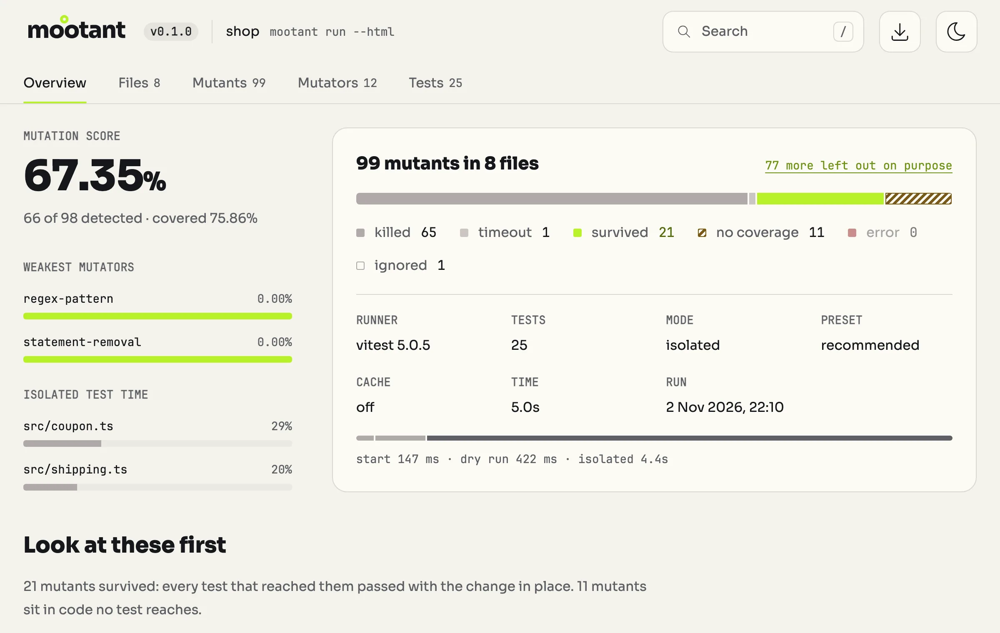

# Mootant

<picture>
  <source
    srcset="https://raw.githubusercontent.com/azat-io/mootant/main/assets/logo-light.svg"
    media="(prefers-color-scheme: light)"
  />
  <source
    srcset="https://raw.githubusercontent.com/azat-io/mootant/main/assets/logo-dark.svg"
    media="(prefers-color-scheme: dark)"
  />
  
</picture>

[](https://npmjs.com/package/mootant)
[](https://codecov.io/gh/azat-io/mootant)
[](https://github.com/azat-io/mootant/blob/main/license.md)

Find the gaps in your tests.

Mutation testing for JavaScript and TypeScript. Mootant makes small changes to
your code, called mutants, and runs your tests. If they still pass, the mutant
survives, which points to a test that is missing or too weak.

## See what your tests miss

Coverage shows that a line ran, not that a test would notice it change. In the
[sample shop](https://github.com/azat-io/mootant/tree/main/docs/demo), the tests
run every line and branch of `src/discount.ts`, yet all of them still pass after
Mootant makes this change:

```diff
- if (total >= 100 || isMember) {
+ if (total > 100 || isMember) {
```

The tests cover small orders, large orders and members. None checks a
non-member's order of exactly 100, where this change removes the discount. That
is why this mutant survives.

Mootant shows the change, suggests `test/discount.test.ts` as the file to extend
and prints the mutant's id, so `--mutant q31p` re-checks it after you add the
missing test.

## Why Mootant

- **Use your existing tests.** Mootant works with Vitest 5 and `node:test`,
  using your project's test configuration. With Vitest, it also tests Vue and
  Svelte components.
- **Find hidden gaps.** Mootant mutates numbers, return values, `await`s and
  regular expressions, not just operators.
- **Filter out noise.** Mootant skips duplicate and likely equivalent mutants,
  and by default leaves out loop changes it expects to hang.
- **Follow each finding.** Reports show the code change and a suggested test
  file. Re-check one mutant as you improve the tests, or export JSON for tools
  and agents.
- **Check your next change.** Mootant caches verdicts between runs. In CI, check
  changed lines with `--since` and set a passing score with `--threshold`.

## Getting started

> **Early development.** Expect breaking changes.

You need passing tests on **Vitest 5** (Node.js 22.12+, no browser mode) or
**`node:test`** (Node.js 20.19+ or 22.12+). See
[compatibility](https://mootant.org/guide/compatibility) for other limits.

Install Mootant and point it at your source code:

```sh
npm install -D mootant
npx mootant run src
```

Mootant never writes to your source files. The report lists the mutants that
survived, those no test reached and any errors. To see the mutants without
running any test, use `npx mootant list src`.

Follow the [getting started guide](https://mootant.org/guide/getting-started) to
turn a surviving mutant into a test that catches it.

## HTML report

Browse each mutant in its code, see what your tests reach and find the files
with the lowest scores. Add `--html` to write `.mootant/report.html`, a single
file that opens offline:

```sh
npx mootant run src --html
```

Add `.mootant` to `.gitignore`: the report holds your source code.

<a href="https://mootant.org/report/demo">
  <picture>
    <source
      srcset="https://raw.githubusercontent.com/azat-io/mootant/main/docs/public/report-overview-dark.webp"
      media="(prefers-color-scheme: dark)"
    />
    
  </picture>
</a>

[Explore the demo report](https://mootant.org/report/demo) or
[learn about the HTML report](https://mootant.org/guide/report).

## Documentation

- [CLI reference](https://mootant.org/guide/cli)
- [Configuration](https://mootant.org/guide/configuration)
- [Mutators](https://mootant.org/mutators) and
  [ignore comments](https://mootant.org/mutators#ignore-mutants)
- [Supported runners and frameworks](https://mootant.org/guide/compatibility)

## Contributing

See
[Contributing Guide](https://github.com/azat-io/mootant/blob/main/contributing.md).

## License

MIT &copy; [Azat S.](https://azat.io)
